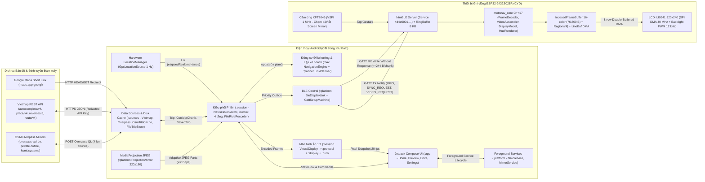
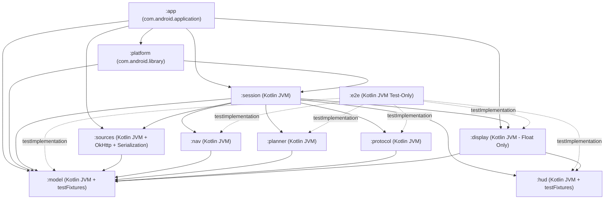
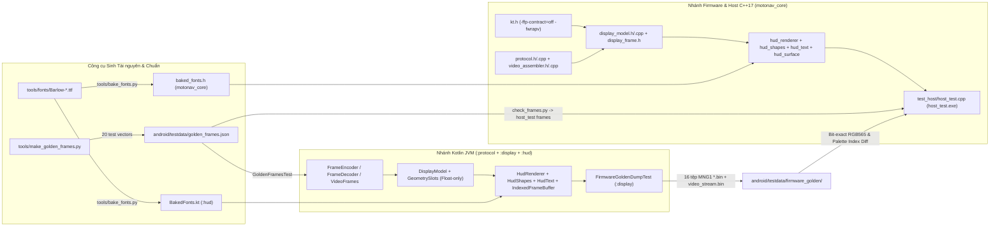
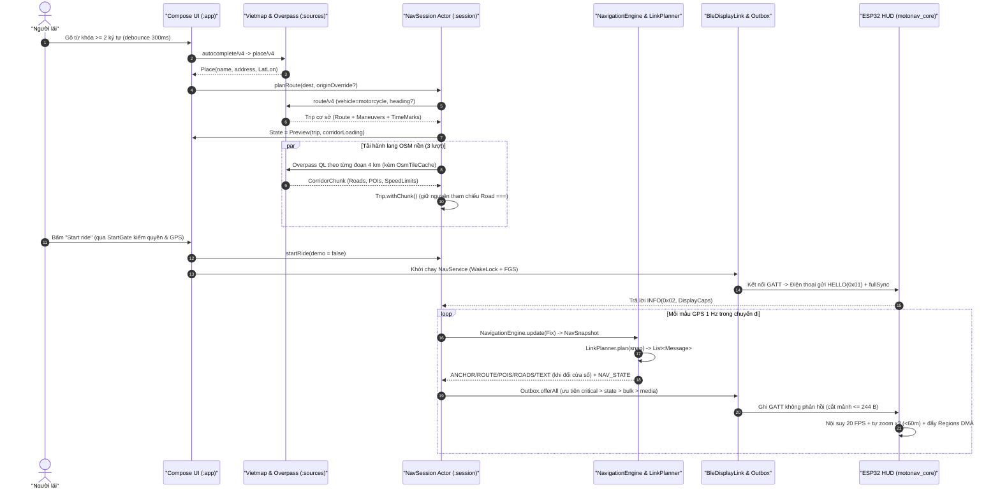
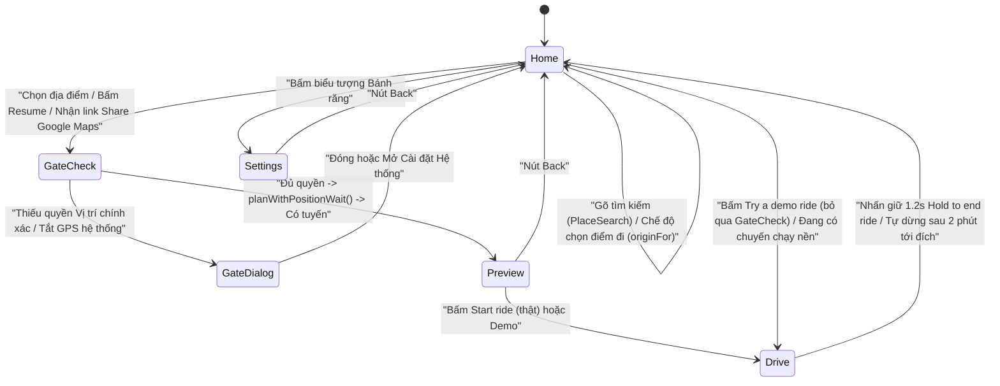

# TÀI LIỆU KIẾN TRÚC & THAM CHIẾU MÃ NGUỒN TOÀN DIỆN — MOTONAV (`moto-nav`)

> **Tài liệu chuẩn kỹ thuật (Canonical Codebase Reference)** cho toàn bộ hệ sinh thái **MotoNav**: Ứng dụng điều hướng Android đa module (Kotlin / Jetpack Compose), Thư viện lõi vẽ & giải mã chia sẻ bit-exact C++17 (`motonav_core`), Firmware màn hình gắn ghi-đông xe máy ESP32-2432S028R ("Cheap Yellow Display" — CYD), Bộ kiểm thử đối chiếu bit-exact trên máy chủ (`host_test`), Trình mô phỏng Web HTML5 Canvas (`sim/`), và Bộ công cụ Python nướng phông chữ / sinh vector chuẩn (`tools/`).

---

## 1. Tổng quan Dự án (Project Overview)

### 1.1. Bài toán thực tế, Đối tượng sử dụng & Bối cảnh vận hành

Tại Việt Nam và các đô thị Đông Nam Á có mật độ xe hai bánh dày đặc, việc gắn trực tiếp điện thoại thông minh lên ghi-đông xe máy bộc lộ nhiều rủi ro nghiêm trọng:
1. **Hư hỏng phần cứng & Mất an toàn tài sản**: Rung chấn tần số cao làm hỏng cụm chống rung quang học (OIS) của camera điện thoại; nắng gắt nhiệt đới làm quá nhiệt pin và hạ độ sáng màn hình; mưa lớn gây loạn cảm ứng; nguy cơ bị giật điện thoại khi dừng đèn đỏ.
2. **Đặc thù giao thông hẻm & đường đô thị Việt Nam**: Mạng lưới giao thông gồm hàng loạt `Hẻm`, `Ngõ`, `Ngách` đan dày cách nhau chỉ 15–30 mét. Các thiết bị HUD chỉ báo mũi tên đơn thuần (turn-by-turn arrow-only) không đủ ngữ cảnh không gian để người lái phân biệt "bỏ qua hai con hẻm đầu, rẽ vào hẻm thứ ba". Ngược lại, bản đồ vệ tinh/vector đầy đủ của Google Maps trên màn hình nhỏ vừa gây rối mắt, vừa tốn băng thông nếu truyền ảnh liên tục qua Bluetooth Low Energy (BLE).
3. **Ràng buộc khắc nghiệt khi điện thoại cất trong túi quần / cốp xe**:
   - Điện thoại phải tắt màn hình suốt chuyến đi thực tế để tiết kiệm pin và tránh chạm nhầm trong túi, nhưng dịch vụ định vị vẫn phải sống sót qua cơ chế diệt tiến trình nền rất gắt của các bản ROM Android nội địa/tùy biến (đặc biệt là Xiaomi HyperOS / MIUI, Samsung OneUI, OPPO ColorOS) và các máy không cài Google Play Services (no-GMS).
   - Khi đi vào hầm, vùng mất sóng di động hoặc mất kết nối BLE tạm thời rồi kết nối lại giữa chừng, cả điện thoại lẫn màn hình HUD trên ghi-đông phải tự phục hồi trạng thái mượt mà mà không cần người lái dừng xe thao tác lại.

**MotoNav** giải quyết trọn vẹn bài toán trên bằng kiến trúc **Cặp thiết bị phân tách thông minh (Split-Brain Handlebar HUD)**:
- **Điện thoại Android (cất trong túi/balo)** đảm nhiệm toàn bộ phần nặng: tìm kiếm địa điểm & tính tuyến xe máy qua **Vietmap API**, tải trước (prefetch) mạng lưới đường nhánh/hẻm/đèn đỏ/camera tốc độ/biển giới hạn tốc độ quanh hành lang tuyến từ **OpenStreetMap Overpass API** (có bộ nhớ đệm ô lưới 30 ngày trên đĩa để chạy offline), bám tuyến GPS 1 Hz trực tiếp từ phần cứng `LocationManager`, phát hiện lệch tuyến & tự tính lại đường, cắt tỉa & lượng tử hóa cửa sổ bản đồ cục bộ thành các gói tin nhị phân siêu gọn (chỉ vài chục đến vài trăm byte qua BLE GATT), đồng thời hỗ trợ chế độ truyền hình ảnh màn hình điện thoại nén JPEG thích ứng (`Screen Mirroring`) khi xe đang dừng.
- **Màn hình gắn ghi-đông ESP32-2432S028R (CYD — bo mạch ESP32 kèm màn LCD TFT ILI9341 2.8 inch `320×240` và cảm ứng điện trở XPT2046, chi phí phần cứng chỉ khoảng \$10–\$15)** nhận dữ liệu vector đã lượng tử hóa qua BLE, tự nội suy chuyển động mượt ở **20 FPS** (`FRAME_INTERVAL_MS = 50 ms`, dead-reckoning + làm mượt EMA), tự động phóng to `×3` khi cách hẻm rẽ dưới `60 m`, tự dựng khung hình trên bộ đệm chỉ số màu `IndexedFrameBuffer` (`76.800 byte` ở mức 1 byte/pixel cho bảng 16 màu Ngày/Đêm không khử răng cưa, phông chữ Barlow nướng sẵn) và đẩy từng vùng thay đổi (`regions[]`) ra màn hình qua SPI DMA 40 MHz.
- **Đối xứng Bit-Exact Kotlin ↔ C++17**: Toàn bộ tầng giải mã giao thức (`protocol`), mô hình hiển thị & nội suy chuyển động (`DisplayModel`), dựng đồ họa (`HudRenderer`, `HudShapes`, `HudText`, `IndexedFrameBuffer`) và phông chữ nướng sẵn (`BakedFonts`) được cài đặt song song bằng Kotlin (chạy trong màn hình ảo `VirtualDisplay` trên điện thoại để xem trước / gỡ lỗi không cần phần cứng) và C++17 (`firmware/motonav/lib/motonav_core`), được kiểm chứng **trùng khớp từng điểm ảnh (pixel-for-pixel bit-exact)** qua 16 kịch bản chuẩn (`MNG1` golden `.bin`), 20 khung giao thức chuẩn (`golden_frames.json`) và kiểm thử fuzzing ngẫu nhiên.

---

### 1.2. Bảng Tech Stack Chi tiết

| Phân hệ | Thành phần / Công nghệ | Phiên bản cụ thể | Nguồn khai báo & Ghi chú kỹ thuật |
| :--- | :--- | :--- | :--- |
| **Hệ thống Build Android** | Gradle Wrapper | `9.1.0` | `android/gradle/wrapper/gradle-wrapper.properties` |
| **Android Gradle Plugin** | `com.android.application` / `com.android.library` | `8.13.0` | `android/build.gradle.kts` |
| **Ngôn ngữ Mobile / Host** | Kotlin (`org.jetbrains.kotlin.jvm` / `android` / `plugin.compose` / `plugin.serialization`) | `2.2.20` | `android/build.gradle.kts`, JVM Target `17` (`JavaLanguageVersion.of(17)`) |
| **Android SDK** | `compileSdk` / `targetSdk` / `minSdk` | `36` / `36` / `26` | `android/app/build.gradle.kts`, `android/platform/build.gradle.kts` (Android 8.0 Oreo → Android 16) |
| **Bất đồng bộ & Luồng** | `org.jetbrains.kotlinx:kotlinx-coroutines-core` / `-android` / `-test` | `1.10.2` | `:sources`, `:session`, `:platform`, `:app` |
| **Tuần tự hóa JSON** | `org.jetbrains.kotlinx:kotlinx-serialization-json` | `1.9.0` | `:sources`, `:session`, `:protocol` (test), `:display` (test) |
| **HTTP Client & Mock** | `com.squareup.okhttp3:okhttp` / `mockwebserver` | `4.12.0` | `:sources` (`build.gradle.kts`), `:app` (`build.gradle.kts`) |
| **AndroidX Core & Lifecycle** | `androidx.core:core-ktx` | `1.15.0` | `:platform`, `:app` |
| **Compose Activity** | `androidx.activity:activity-compose` | `1.10.1` | `:app` |
| **Lifecycle & ViewModel** | `androidx.lifecycle:lifecycle-runtime-compose` / `lifecycle-viewmodel-compose` | `2.9.0` | `:app` |
| **Giao diện người dùng** | Jetpack Compose BOM (`androidx.compose:compose-bom`) + `material3` + `ui` + `foundation` | `2025.05.00` | `:app` (hệ thống thiết kế riêng trong `Theme.kt`, không phụ thuộc `navigation-compose`) |
| **Kiểm thử JVM & Android** | JUnit Jupiter (`org.junit.jupiter:junit-jupiter`) & JUnit 4 (`junit:junit`) | `5.11.3` / `4.13.2` | 9 module JVM thuần dùng JUnit 5 (`useJUnitPlatform()`); `:platform` và `:app` dùng JUnit 4 |
| **Vi điều khiển & Bo mạch** | ESP32-2432S028R ("Cheap Yellow Display" — CYD) | ESP32-D0WDQ6 (`esp32dev`) | LCD TFT `ILI9341` `320×240` SPI, cảm ứng `XPT2046`, 520 KB SRAM, không dùng PSRAM |
| **Hệ thống Build Firmware** | PlatformIO (`platform = espressif32`, `framework = arduino`) | `6.9.0` | `firmware/motonav/platformio.ini`, `firmware/bringup/platformio.ini` |
| **Thư viện Hiển thị & JPEG** | `lovyan03/LovyanGFX` | `1.2.7` | Điều khiển SPI DMA `40 MHz` cho `Panel_ILI9341` + giải mã `drawJpg` cho Screen Mirror |
| **Thư viện BLE Firmware** | `h2zero/NimBLE-Arduino` | `2.3.0` | Stack BLE nhẹ thay thế Bluedroid (tiết kiệm hàng chục KB heap nội trên ESP32) |
| **Trình biên dịch C++** | Xtensa GCC (ESP32) & MinGW-w64 `g++` (Host Windows) | Chuẩn `C++17` (`-std=gnu++17`) | Cờ bắt buộc `-O2 -ffp-contract=off -fwrapv` để đồng nhất dấu chấm động IEEE-754 với JVM |
| **Trình mô phỏng Web** | HTML5 Canvas 2D + Vanilla ES6 JavaScript | ES2020+ | `sim/index.html` (chạy trực tiếp bằng trình duyệt không cần bundler/server) |
| **Công cụ Phụ trợ & Dữ liệu** | Python 3 + `Pillow` (PIL FreeType) | Python `3.10+` | `tools/bake_fonts.py`, `tools/make_golden_frames.py`, `sim/fetch_route.py`, `check_frames.py` |
| **Phông chữ HUD** | Phông họ **Barlow** (`SemiBold`, `Bold`, `BoldItalic`) | SIL OFL 1.1 | `tools/fonts/*.ttf` nướng thành bitmap 1-bit nén byte trong `BakedFonts.kt` & `baked_fonts.h` |
| **Dịch vụ Bản đồ Ngoài** | Vietmap API (`v3`/`v4`), OSM Overpass API, Valhalla (`sim`) | REST / JSON | Vietmap cho tìm kiếm & dẫn đường xe máy VN; Overpass cho đường nhánh, đèn giao thông, camera, `maxspeed` |

---

### 1.3. Trạng thái Kho mã nguồn Git

Kiểm tra trực tiếp tại thư mục gốc `d:\Project\moto-nav` bằng `git status`, `git remote -v` và `git log`:
- Thư mục `d:\Project\moto-nav` hiện là **bản làm việc độc lập chưa khởi tạo kho `.git`** (`fatal: not a git repository (or any of the parent directories): .git`), do đó chưa có `remote URL`, nhánh hiện tại hay lịch sử commit Git.
- Tuy nhiên, dự án đã chuẩn bị sẵn hai tệp cấu hình loại trừ phiên bản:
  - `.gitignore` ở thư mục gốc: loại trừ `.env`, `sim/data/vietmap_raw.json`, `**/__pycache__/`.
  - `android/.gitignore`: loại trừ `.gradle/`, `build/`, `*/build/`, `local.properties`, `.idea/`.

---

## 2. Kiến trúc Tổng thể & Luồng Dữ liệu (Architecture & End-to-End Data Flow)

### 2.1. Các Sơ đồ Kiến trúc Hệ thống (Mermaid)

#### 2.1.1. Kiến trúc Phần cứng – Phần mềm Tổng thể (End-to-End Topology)



#### 2.1.2. Đồ thị Phụ thuộc 11 Module Gradle (`android/settings.gradle.kts`)



#### 2.1.3. Kiến trúc Đối xứng Bit-Exact Kotlin ↔ C++17 & Chuỗi Kiểm chứng Golden



---

### 2.2. Phân tích Các Tầng Kiến trúc & Cơ chế Giao tiếp

Dự án được chia thành **5 tầng kiến trúc tách biệt nghiêm ngặt**, trong đó **9/11 module Gradle là Kotlin JVM thuần túy** (không hề chạm tới Android SDK, chạy kiểm thử đơn vị trong vài giây trên máy tính và tuân thủ kiểm tra quét mã nguồn tự động):

1. **Tầng Mô hình & Hình học Cốt lõi (`:model`)**:
   - Định nghĩa các kiểu dữ liệu bất biến dùng chung toàn hệ thống (`LatLon`, `Route`, `Maneuver`, `Road`, `Poi`, `SpeedLimitSpan`, `Lane`, `LaneHint`, `Place`, `PlaceSuggestion`, `Trip`, `Fix`, `Alert`, `NavSnapshot`, `NavStatus`) và mô hình thông điệp đường truyền (`Message` sealed interface, `Wire` constants, `Quantizer`).
   - Cung cấp phép chiếu phẳng cục bộ `LocalProjection` (`toXy` / `toLatLon`) và cấu trúc `Polyline` hỗ trợ tìm kiếm nhị phân theo chiều dài cung `s`, chiếu vuông góc và tính góc phương vị mượt (`bearingAt(s)`).

2. **Tầng Nghiệp vụ Điều hướng, Nguồn Dữ liệu & Lập Kế hoạch Cửa sổ (`:nav`, `:sources`, `:planner`)**:
   - `:sources`: Giao tiếp mạng bất đồng bộ qua `HttpCall` (bọc `OkHttpClient.newCall().enqueue()` trong `suspendCancellableCoroutine`, tuyệt đối cấm `.execute()` đồng bộ), giải mã dữ liệu Vietmap/Overpass, lưu đệm ô bản đồ `OsmTileCache` theo lưới `0.005°` (`~550 m`), lưu chuyến đi nguyên tử qua `FileTripStore` (`.tmp` + `fd.sync()` + `ATOMIC_MOVE`), và khử khóa bí mật qua `Redactor`.
   - `:nav`: `NavigationEngine` nhận `Trip` và từng `Fix` để tính ra `NavSnapshot` (trạng thái bám đường, cổng giữ lệnh rẽ tại ngã tư, phát hiện lệch tuyến hai tốc độ nhanh/chậm, 4 quy tắc tới đích trong `arrivalZoneM = 150 m`, ETA điều chỉnh theo nhịp chạy thực tế `paceFactor`, cảnh báo POI trong `500 m` và gợi ý làn trong `220 m`). Đi kèm `RideSimulator` tạo quỹ đạo xe máy có phanh vào cua và nhiễu GPS tương quan Gauss-Markov.
   - `:planner`: `LinkPlanner` biến chuỗi `(Trip, NavSnapshot)` thành tập thông điệp vi sai tối ưu băng thông cho màn hình (`Anchor`, `RoutePart`, `Pois`, `RoadsPart`, `Text`, `NavState`, `Clear`), cắt đoạn đường bằng thuật toán Liang-Barsky, rút gọn Douglas-Peucker hai ràng buộc (sai số hình học VÀ sai số trượt tham số cung `s`), loại bỏ bớt hẻm phụ khi chạm trần sức chứa `DisplayCaps` và viết tắt tên đường tiếng Việt (`StreetText`).

3. **Tầng Giao thức Nhị phân & Dựng Đồ họa Đối xứng (`:protocol`, `:hud`, `:display` ↔ `firmware/motonav/lib/motonav_core`)**:
   - `:protocol` / `protocol.cpp`: Đóng gói và giải mã khung nhị phân MotoNav Protocol v1 (`0xA5 | type:u8 | len:u16 LE | payload[len] | crc:u16 LE`, tổng phần khung bao 6 byte, tối đa `486 byte`/khung, kiểm tra `CRC-16/CCITT-FALSE`). Tách biệt bộ chia/lắp ghép luồng JPEG `VideoFrames` / `VideoAssembler`.
   - `:hud` / `hud_surface` + `hud_shapes` + `hud_text` + `baked_fonts`: Công cụ vẽ phần mềm thuần số nguyên 32-bit trên bộ đệm chỉ số 16 màu `320×240` (`IndexedFrameBuffer`, `76.800 byte`, 1 byte/pixel), theo dõi vùng vẽ `begin(x, y, w, h) .. end()` (`dirtyLeft..dirtyBottom` và `regions[4]` trên C++), vẽ đoạn thẳng dày đầu tròn/phẳng, tam giác, hình chữ nhật bo góc, biển tốc độ, biểu tượng mũi tên rẽ và văn bản UTF-8 tiếng Việt.
   - `:display` / `display_model` + `hud_renderer`: Máy trạng thái bên phía màn hình nhận trực tiếp `Message`, ghép nối các cửa sổ dữ liệu nhiều phần bằng 2 khe `Active`/`Pending` (`RouteSlot`, `RoadsSlot`), tự động xin phát lại phần thiếu qua `SyncRequest` (`need` bitmask), nội suy vị trí xe 20 FPS giữa các mẫu 1 Hz, tự phóng to `×3` khi vào giao lộ và xuất `DisplayFrame` kèm khóa băm `sideKey` / `bottomKey` để `HudRenderer` chỉ vẽ lại đúng vùng màn hình có thay đổi.

4. **Tầng Điều phối Phiên Actor & Hàng đợi Ưu tiên (`:session`)**:
   - `NavSession` là **trái tim điều phối duy nhất**, cài đặt theo mẫu **Single-Coroutine Actor**: mọi sự kiện từ UI, GPS, mạng, đồng hồ nhịp `1 Hz`, kết nối BLE và bộ cấp khung hình Mirror đều đẩy vào một kênh `Channel<Ev>(Channel.UNLIMITED)` duy nhất. Hàm chuyển trạng thái `reduce(ev)` hoàn toàn **không tạm dừng (`non-suspending`)**, loại bỏ triệt để race condition.
   - Mỗi đường truyền `DisplayLink` gắn với hệ thống (bao gồm cả `VirtualDisplay` trong màn hình điện thoại và `BleDisplayLink` nối ra phần cứng ESP32) đều có một hàng đợi `Outbox` 4 mức ưu tiên riêng biệt (`critical` → `state` ghi đè 1 ô → `bulk` tự dọn cửa sổ cũ → `media` tự dọn khung JPEG cũ).

5. **Tầng Nền tảng Android, UI Compose & Phần cứng ESP32 (`:platform`, `:app`, `firmware/`)**:
   - `:platform`: Cung cấp `BleDisplayLink` (chạy toàn bộ callback GATT trên luồng riêng `HandlerThread("ble")`), `GpsLocationSource`, `NavService` (`PARTIAL_WAKE_LOCK` + Foreground Service linh hoạt Android 14+), `MirrorService` + `ProjectionMirror`, `AppPrefs`, `Permissions`, `PowerSettings`.
   - `:app`: Ứng dụng một `Activity` duy nhất (`MainActivity`) với đồ thị phụ thuộc thủ công `AppGraph`, `AppViewModel` quản lý máy trạng thái 4 màn hình (`Home`, `Preview`, `Drive`, `Settings`) và hệ thống thiết kế Compose tùy biến (`Theme.kt`).
   - `firmware/motonav/src/main.cpp`: Nối NimBLE GATT Server vào `RingBuffer` 8 KB được bảo vệ bằng spinlock `portMUX_TYPE`, chạy vòng lặp dựng hình `50 ms` (`20 FPS`) trên Core 1 Arduino, điều khiển độ sáng đèn nền PWM mượt và đọc cảm ứng XPT2046.

---

### 2.3. Vòng đời Khởi động (Startup Lifecycle)

#### 2.3.1. Vòng đời Khởi động trên Android (`MotoNavApp` → `MainActivity` → `NavSession`)

1. **Khởi tạo tiến trình (`MotoNavApp.onCreate`)**:
   - Hệ điều hành Android khởi tạo `MotoNavApp` (khai báo tại `android:name=".MotoNavApp"` trong `android/app/src/main/AndroidManifest.xml`).
   - `MotoNavApp` đọc biến `BuildConfig.VIETMAP_API_KEY` (được nạp lúc biên dịch từ tệp `.env` hoặc biến môi trường) và khởi tạo đồ thị phụ thuộc thật `RealAppGraph(this, BuildConfig.VIETMAP_API_KEY)`.
   - Bên trong `RealAppGraph`:
     - Khởi tạo `AndroidClock`, `AppPrefs` (`SharedPreferences` `"motonav_prefs"`), `UiPrefs` (`"motonav_ui"`).
     - Khởi tạo `OkHttpClient` dùng chung, `VietmapClient`, `OsmTileCache` (`filesDir/osm-tiles`), `OverpassCorridorSource` (`rounds = 2`, `callTimeoutMs = 45_000`), `FileTripStore` (`filesDir/trips`), `FileRideRecorder` (`filesDir/rides`), `GpsLocationSource`, `VirtualDisplay`, và `BleDisplayLink`.
     - Khởi tạo `NavSession` và gọi `session.attachLink(virtualDisplay)` ngay lập tức để màn hình ảo luôn nhận được luồng khung hình.
     - Nếu người dùng đã bật màn hình ngoài (`prefs.displayEnabled == true` và có `prefs.displayAddress`), `RealAppGraph` gọi ngay `bleLink.connect(addr)` và `session.attachLink(bleLink)`.
     - Đọc danh sách địa điểm gần đây (`tripStore.loadRecent()`) và kiểm tra chuyến đi dở dang trên đĩa (`tripStore.loadActive()`): nếu chuyến đi dở dang còn cách đích `>= 60 m` (`RESUME_MIN_REMAINING_M`), nạp sẵn vào `session` ở trạng thái chờ khôi phục (`resumable`).

2. **Khởi tạo giao diện (`MainActivity.onCreate`)**:
   - Bật chế độ tràn viền `enableEdgeToEdge()`, đọc `intent` ban đầu qua `parseIncomingShare(intent)` (nếu mở app từ nút Chia sẻ của Google Maps hoặc liên kết `geo:`) và đẩy vào `graph.pendingShare`.
   - Dựng cây Compose `AppRoot(graph)` gắn với `AppViewModel`.
   - `AppRoot` lắng nghe `Lifecycle.Event.ON_RESUME` để làm mới trạng thái quyền (`Permissions.snapshot`) và cấu hình tiết kiệm pin (`PowerSettings.snapshot`); đồng thời giữ đăng ký làm nóng GPS (`graph.holdUiLocation()`) khi người dùng đang đứng ở màn `Home` hoặc `Preview` đã có quyền vị trí để có tọa độ tức thì khi tìm đường.

#### 2.3.2. Vòng đời Khởi động trên Firmware ESP32 (`setup()` → `loop()`)

1. **`setup()` trong `firmware/motonav/src/main.cpp`**:
   - Khởi tạo cổng nối tiếp `Serial.begin(115200)` và tắt đèn LED RGB tích hợp trên bo mạch CYD (các chân `4, 16, 17` mức tích cực thấp được kéo lên `HIGH`).
   - Khởi tạo phần cứng màn hình `lcd.init()`, xoay ngang `lcd.setRotation(1)` (`320×240`) và bật đèn nền PWM `12 kHz` ở chân `GPIO 21` với độ sáng ban đầu `BL_NIGHT = 110`.
   - **Bước sống còn về bộ nhớ**: Cấp phát vùng đệm điểm ảnh toàn màn hình `pixels = (uint8_t*)heap_caps_malloc(320 * 240, MALLOC_CAP_8BIT)` (**`76.800 byte`**, lưu 1 byte chỉ số màu `0..15` cho mỗi điểm ảnh) **TRƯỚC KHI** gọi `bleInit()` — vì NimBLE khi khởi tạo sẽ chia nhỏ vùng nhớ heap nội liên tục của ESP32 khiến không thể cấp phát khối `76.8 KB` liền mạch sau đó.
   - Khởi tạo tĩnh tại chỗ (`placement new` trên các mảng `static alignas(...)` trong BSS, không tốn heap) cho các đối tượng lõi: `IndexedFrameBuffer(320, 240, pixels)`, `DisplayModel`, `HudRenderer`, `FrameDecoder`.
   - Khởi tạo cảm ứng điện trở XPT2046 trên bus `VSPI_HOST` (`1 MHz`, `CS=33, INT=36`).
   - Khởi tạo NimBLE Server quảng bá tên `"MotoNav"` kèm dịch vụ UUID `4d4e0001-6d6f-746f-6e61-760000000001` (không yêu cầu ghép đôi bảo mật cấp OS để tự kết nối lại tức thì).
   - Dựng và vẽ ngay khung hình đầu tiên (`LINK_LOST`) ra màn hình LCD.

2. **`loop()` (`20 FPS`, chu kỳ mục tiêu `FRAME_INTERVAL_MS = 50 ms`)**:
   - Đọc cảm ứng `pollTouch(now)`: nếu phát hiện thao tác chạm-nhả hợp lệ, gửi thông điệp `VideoRequest(on = 1 / 0)` (`0x04`) bật/tắt chế độ phản chiếu màn hình điện thoại.
   - Đọc lệnh gỡ lỗi từ cổng `Serial` (`pollSerial(now)` hỗ trợ `!DBG`, `!LIVE`, `!TAP`, `!BL`, `!FEED`, `!FRAME`, `!INV`, `!LRST`).
   - Rút toàn bộ byte nhận từ BLE trong `RingBuffer` (`drainBle()`) đưa qua `FrameDecoder`; các khung `HELLO`, `ANCHOR`, `ROUTE`, `ROADS`, `POIS`, `TEXT`, `NAV_STATE`, `CLEAR` đi vào `DisplayModel`, còn `VIDEO_STATUS (0x40)` và `VIDEO (0x41)` đi vào `VideoAssembler`.
   - Nếu đang ở chế độ video (`videoActive`): khi `VideoAssembler` ghép trọn một khung JPEG vào `jpegBuf` (`24.576 byte`), gọi `lcd.drawJpg(...)` vẽ lên màn hình; tự thoát chế độ video nếu quá `VIDEO_STALE_MS = 3000 ms` không có ảnh mới.
   - Nếu ở chế độ HUD chuẩn: gọi `model->frame(now)` → `renderer->render(f, *fb)` → duyệt các hình chữ nhật vùng thay đổi `fb->regions()` (tối đa `MAX_REGIONS = 4`), đổi chỉ số màu sang `RGB565` qua bộ đệm dòng kép 8 hàng `lineBuf[2][320 * 8]` và đẩy bất đồng bộ qua SPI DMA lên `ILI9341`.
   - Kiểm tra các khung phản hồi từ `DisplayModel` (`takeInfo()` gửi `INFO 0x02` sau khi nhận `HELLO`, `takeSync(now)` gửi `SYNC_REQUEST 0x03` khi thiếu cửa sổ dữ liệu) và phát qua GATT TX Notify ngược về điện thoại.
   - Nội suy mượt độ sáng đèn nền PWM theo trạng thái Ngày / Đêm / Chờ (`IDLE` sau 5 phút) / Mất kết nối (`LINK_LOST` sau 2 phút).

---

### 2.4. Toàn bộ Các Luồng Nghiệp vụ Chính (End-to-End Business Flows)



1. **Luồng Tìm kiếm Địa điểm & Nhận Chia sẻ từ Google Maps**:
   - Khi người dùng gõ vào ô tìm kiếm trên `HomeScreen`, `PlaceSearch` đợi đủ `MIN_CHARS = 2` ký tự và chống dội `DEBOUNCE_MS = 300 ms`, hủy truy vấn cũ nếu gõ tiếp, rồi gọi `VietmapClient.autocomplete(text, focus)` (lấy `focus` từ vị trí GPS làm nóng gần nhất để ưu tiên kết quả gần người dùng).
   - Khi chọn một gợi ý `PlaceSuggestion`, app gọi `VietmapClient.place(refId)` lấy tọa độ chính xác `Place`, lưu vào `recent_places.json` (tối đa 20 mục, khử trùng lặp bán kính `~1.1 m` + tên) và chuyển sang tính tuyến.
   - Nếu người dùng chia sẻ một địa điểm từ ứng dụng **Google Maps** sang MotoNav (`ACTION_SEND` `text/plain` chứa chuỗi hoặc URL rút gọn `https://maps.app.goo.gl/...` hoặc `ACTION_VIEW` `geo:`): `SharedLocation.resolve()` tự động bóc tọa độ theo 6 mẫu biểu thức chính quy (`!3d..!4d..`, `?q=lat,lon`, `@lat,lon`, `ll=lat,lon`, `geo:lat,lon`, chuỗi tọa độ thô). Nếu là link rút gọn chưa có tọa độ trên URL, nó gọi tối đa `MAX_HOPS = 5` bước chuyển hướng HTTP không tự follow (`followRedirects(false)`) để bắt tọa độ ngay từ header `Location` mà không cần tải trang HTML nặng của Google!

2. **Luồng Lập tuyến Xe máy & Tải trước Hành lang Bản đồ Offline (Corridor Prefetch)**:
   - `NavSession` lấy vị trí xuất phát (từ `originOverride`, hoặc mẫu GPS tươi trong vòng `FRESH_FIX_MS = 60_000 ms`, hoặc chờ tối đa 10 giây qua `PositionWait` nếu vừa cấp quyền trong nhà).
   - Gọi `VietmapClient.route(origin, dest, headingDeg)`: nếu thiết bị đang có góc di chuyển tin cậy nhưng điểm xuất phát nằm ngược chiều đường một chiều khiến Vietmap trả lỗi HTTP 400 `NO_ROUTE` hoặc `BAD_RESPONSE`, `VietmapClient` **tự động thử lại 1 lần không kèm `heading`** để luôn tìm được đường.
   - Ngay khi có `Trip` cơ sở, người dùng đã xem được màn `PreviewScreen` và có thể bấm chạy ngay mà không phải đợi tải xong dữ liệu phụ. Ở hậu cảnh, `NavSession` chia tuyến thành các đoạn `~4.000 m`, chạy tối đa `CORRIDOR_PASSES = 3` lượt (nghỉ `60 s` giữa các lượt nếu lỗi mạng) để nạp đường lớn (`700 m` quanh tuyến), hẻm nhỏ (`280 m`), đèn giao thông & camera tốc độ (`30 m`), và biển giới hạn tốc độ (`maxspeed`) từ `OsmTileCache` / `OverpassCorridorSource`. Mỗi đoạn tải xong được trộn vào `Trip` qua `Trip.withChunk()` và ghi bền vững xuống `active_trip.json`.

3. **Luồng Điều hướng Thực tế 1 Hz, Cổng Giữ Lệnh Rẽ & Chống Hao mòn Flash**:
   - Khi vào chuyến đi thật (`demo = false`), `AppRoot` khởi chạy `NavService` giữ `PARTIAL_WAKE_LOCK` (tối đa 12 giờ) và tắt cờ `FLAG_KEEP_SCREEN_ON` để điện thoại tắt màn hình nằm gọn trong túi quần.
   - Mỗi giây, mẫu `Fix` từ `GPS_PROVIDER` đi vào `NavigationEngine.update()`:
     - Chấm điểm các đoạn thẳng ứng viên trên tuyến dựa trên khoảng cách ngang + độ lệch so với vị trí dự đoán (`0.5 * |s - expectedS|`) + phạt lệch góc hướng đi (`0.25` điểm/độ khi lệch quá `30°` ở tốc độ tin cậy `>= 2.5 m/s`).
     - **Cổng giữ lệnh rẽ (`gates`)**: Với các khúc cua thật (`>= 30°`, đo trên dây cung `turnChordM = 15 m`), động cơ giữ tiến độ không vượt qua đỉnh ngã tư (`gateMarginM = 1.0 m` trước chỗ rẽ) khi xe chưa thật sự rẽ, chỉ mở cổng chuyển sang lệnh rẽ kế tiếp khi hướng xe khớp nhánh thoát hoặc điểm chiếu đã vượt qua chỗ rẽ đủ xa (`gateSlowPassMinM = 8 m` / `gateHeldPassMinM = 20 m`).
   - **Tối ưu ghi đĩa Flash**: Cứ mỗi `PROGRESS_SAVE_MS = 10_000 ms` (10 giây), nếu cấu trúc `Trip` không đổi (`active.trip === fullTrip`), `FileTripStore.saveProgress(s)` chỉ ghi tệp siêu nhỏ `active_progress.json` (`< 100 byte`) thay vì ghi lại toàn bộ `active_trip.json` (nặng hàng trăm KB dữ liệu đường nhánh OSM).

4. **Luồng Phát hiện Lệch tuyến Hai Tốc độ & Tự động Định tuyến lại (Off-Route & Rerouting)**:
   - `NavigationEngine` tính ngưỡng lệch tuyến động `T = clamp(10 + 1.5 * accuracy, 25 m, 50 m)` và kết hợp 2 nhánh phát hiện:
     - **Đường nhanh (`offRouteFastFixes = 3`)**: Xe đang chạy nhanh, cách tuyến `> T` và không có bất kỳ đoạn tuyến hợp lý nào nằm song song bên hông trong `60 m` / `45°` liên tiếp qua `3` mẫu định vị.
     - **Đường chậm (`offRouteSlowFixes = 8`, `offRouteSlowTravelM = 40 m`)**: Xe ở xa tuyến `> T` liên tục `8` mẫu và đã thực sự di chuyển được tối thiểu `40 m`.
   - Khi `snap.shouldReroute == true`, `NavSession` kích hoạt `REROUTING` (có chống dội tối thiểu `REROUTE_MIN_GAP_MS = 10_000 ms` và lùi mũ nếu mất mạng).
   - Khi API Vietmap trả tuyến mới sau vài giây (lúc này người lái vẫn đang di chuyển!), `NavSession` kiểm tra xem vị trí hiện tại của người lái có bám hợp lệ trên tuyến mới hay không: nếu hợp lệ thì cấp `route.id` mới, truyền tiếp `paceFactor` cũ sang `NavigationEngine` mới và tận dụng ngay các ô `OsmTileCache` đã có; nếu người lái vừa tự quay lại tuyến cũ (`rejoinDistanceFactor = 0.75 * T` qua `rejoinFixes = 3` mẫu) trước khi API trả về thì hủy kết quả thừa.

5. **Luồng Bắt tay BLE, Tự Phục hồi Mất gói & Dựng Từng phần (Partial Redraw)**:
   - Ngay khi kênh GATT thiết lập xong (`READY`), điện thoại mở phiên bằng khung `HELLO (0x01)` (chứa giờ địa phương `unixS`, `utcOffsetMin` và `theme`) kèm `LinkPlanner.fullSync()` để nạp trạng thái hiện hành.
   - Màn hình ESP32 phản hồi khung `INFO (0x02)` báo kích thước màn `320×240` và sức chứa bộ nhớ `DisplayCaps` (`maxRoutePoints=512, maxRoadPoints=4096, maxRoads=1024, maxPois=90`).
   - Trong quá trình chạy trên kênh GATT `WRITE_WITHOUT_RESPONSE`, nếu rơi mảnh BLE làm mất một phần cửa sổ khiến `NAV_STATE` tham chiếu tới `anchorId`, `routeWin`, `roadsWin` hoặc `textId` mà màn hình chưa có đủ trong `RouteSlot` / `RoadsSlot`, `DisplayModel` tự bật các bit thiếu trong `Wire.Need` và phát `SYNC_REQUEST (0x03)` (sau khi `NAV_STATE` còn tươi `< 3s` và có tiết lưu chống ngập) để `NavSession` gọi `planner.sync(need & ~outbox.pendingNeed())` gửi bù đúng phần bị rớt!

6. **Luồng Chạm Cảm ứng Phản chiếu Màn hình Điện thoại (Touch-Triggered Screen Mirroring)**:
   - Khi người lái dừng xe bên lề và muốn xem nhanh thông báo hoặc bản đồ đầy đủ trên điện thoại mà không rút máy khỏi túi: chạm nhẹ lên màn hình cảm ứng XPT2046 của ESP32.
   - ESP32 gửi `VIDEO_REQ (0x04)` (`VideoRequest(on = 1)`).
   - Nếu người dùng đã cấp quyền `MediaProjection` trong màn `SettingsScreen` (chạy `MirrorService` + `ProjectionMirror`), điện thoại gửi `VIDEO_STATUS (0x40, ON)`, chụp màn hình ở khung cắt 16:9 `320×180` ngay dưới thanh trạng thái dọc, nén JPEG chất lượng thích ứng (`quality 20..75` sao cho kích thước ảnh lọt vùng mục tiêu `6..9 KB`, tối đa `24 KB`), chia thành các khung `VIDEO (0x41)` (`VideoPart`, tối đa `474 byte` dữ liệu JPEG/khung) và chỉ chụp ảnh kế tiếp khi hàng `media` của `Outbox` đã trống (`outbox.mediaEmpty`)!
   - **Khóa an toàn tự động**: Ngay khi tốc độ GPS của xe đạt `speed >= 10 km/h` (hoặc mẫu GPS cũ quá `5 giây`), `NavSession` tự động ngắt luồng video (`VideoStatus(PAUSED_SPEED)` / `OFF`) và trả màn hình ESP32 về giao diện HUD dẫn đường tối giản để không gây mất tập trung khi đang chạy xe!

7. **Luồng Chạy Thử Demo (1× / 4×) & Phát lại Nhật ký Chuyến đi (`RideReplay`)**:
   - Ở chế độ `Demo`, `NavSession` không cần quyền GPS hay mạng: nạp `assets/demo_trip.json` (tuyến thực tế tại Gò Vấp – Phú Nhuận TP.HCM), dùng `RideSimulator` sinh mẫu GPS tổng hợp và dùng `SessionClock` cho phép tua nhanh thời gian thực `1×` hoặc `4×`. Khi kết thúc chạy `4×`, `SessionClock.resyncWall()` đồng bộ lại mốc thời gian thực và buộc gửi lại `HELLO` ra màn hình thật để bộ lọc tốc độ EMA trên ESP32 không bị vọt lố.
   - Mọi chuyến đi thật đều được `FileRideRecorder` ghi thành tệp dòng JSONL `filesDir/rides/ride-YYYYMMDD-HHmmss.jsonl` (giữ tối đa 10 chuyến gần nhất, có thể xuất qua nút Share trong `SettingsScreen`). `RideReplay` có thể nạp lại bất kỳ tệp `.jsonl` nào để tái hiện chính xác 100% chuỗi `NavSnapshot` (sai số kiểm chứng `< 0.5 m`).


---

## 3. Cấu trúc Thư mục & Bản đồ Toàn bộ Tệp nguồn (Complete Directory & File Map)

### 3.1. Cây Thư mục Trực quan

```text
moto-nav/
├── .env                                 # Khóa VIETMAP_API_KEY cục bộ (gitignored, REDACTED trong tài liệu)
├── .gitignore                           # Quy tắc loại trừ cấp gốc (.env, sim/data/vietmap_raw.json, __pycache__)
├── README.md                            # Sổ tay lệnh build/test/flash nhanh của dự án
├── MotoNav-debug.apk                    # Bản đóng gói APK debug biên dịch sẵn (~11.4 MB)
├── docs/
│   └── PROTOCOL.md                      # Đặc tả nhị phân MotoNav Protocol v1 & luồng Video Sec 9
├── design/
│   ├── MotoNav-App-redesign.svg         # Bản vẽ thiết kế chuẩn UI Android v2 (Dark & Light, 6 màn hình)
│   └── MotoNav-Display-redesign.svg     # Bản vẽ thiết kế chuẩn HUD ESP32 320x240 v2 (Ngày & Đêm, 1:1 pixel)
├── tools/
│   ├── bake_fonts.py                    # Công cụ nướng phông chữ TTF -> BakedFonts.kt + baked_fonts.h
│   ├── make_golden_frames.py            # Công cụ sinh 20 vector kiểm thử nhị phân chuẩn -> golden_frames.json
│   └── fonts/                           # Bộ phông Barlow (Bold, BoldItalic, SemiBold + giấy phép SIL OFL)
├── sim/
│   ├── fetch_route.py                   # Script tải tuyến Valhalla / Vietmap + Overpass cho Web Simulator
│   ├── index.html                       # Trình mô phỏng Web HTML5 Canvas độc lập (bản đồ tổng quan + HUD 320x240)
│   └── data/                            # Dữ liệu tuyến đóng gói sẵn (route.js, route_vietmap.js)
├── firmware/
│   ├── bringup/                         # Dự án PlatformIO kiểm tra phần cứng ban đầu (LCD màu + cảm ứng + BLE)
│   │   ├── platformio.ini
│   │   └── src/main.cpp
│   └── motonav/                         # Dự án PlatformIO Firmware HUD chính thức trên ESP32-2432S028R
│       ├── README.md
│       ├── platformio.ini
│       ├── src/main.cpp                 # Vòng lặp 20 FPS, NimBLE GATT, DMA SPI, PWM đèn nền, cảm ứng, Serial !DBG
│       ├── lib/motonav_core/            # Thư viện C++17 chia sẻ bit-exact với Kotlin (:protocol + :hud + :display)
│       ├── test_host/                   # Bộ kiểm thử đối chiếu trên máy chủ (host_test.cpp, check_frames.py)
│       └── build_host/host_test.exe     # Tệp thực thi kiểm thử C++ biên dịch bằng MinGW g++
└── android/                             # Dự án đa module Gradle 9.1.0 / Kotlin 2.2.20 (11 modules)
    ├── build.gradle.kts                 # Khai báo phiên bản plugin gốc (AGP 8.13.0, Kotlin 2.2.20)
    ├── settings.gradle.kts              # Đăng ký 11 module (:model .. :app)
    ├── gradle.properties                # Cấu hình bộ nhớ JVM Gradle (-Xmx2g, AndroidX)
    ├── local.properties                 # Đường dẫn Android SDK cục bộ (sdk.dir=D:/dev/sdk/android)
    ├── gradlew / gradlew.bat            # Script khởi chạy Gradle Wrapper
    ├── gradle/wrapper/                  # gradle-wrapper.jar & gradle-wrapper.properties
    ├── testdata/                        # Kho dữ liệu kiểm thử dùng chung (Vietmap, Overpass, Golden frames & MNG1 .bin)
    ├── model/                           # [JVM] Thực thể miền, phép chiếu phẳng, Polyline, thông điệp đường truyền
    ├── protocol/                        # [JVM] Mã hóa/giải mã khung nhị phân CRC-16 & lắp ghép mảnh JPEG Video
    ├── hud/                             # [JVM] Bộ đệm chỉ số 16 màu, nguyên thủy hình học 2D, chữ UTF-8 & phông nướng sẵn
    ├── display/                         # [JVM] Máy trạng thái màn hình Float-only, nội suy 20 FPS & HudRenderer
    ├── e2e/                             # [JVM Test] Kiểm thử tích hợp toàn tuyến Engine -> Planner -> Wire -> Display
    ├── planner/                         # [JVM] Cắt cửa sổ bản đồ Liang-Barsky, tối giản đường & viết tắt tên đường VN
    ├── nav/                             # [JVM] Động cơ bám đường GPS, cổng giữ rẽ, lệch tuyến, ETA & RideSimulator
    ├── sources/                         # [JVM] Client Vietmap/Overpass bất đồng bộ, OsmTileCache, FileTripStore, Redactor
    ├── session/                         # [JVM] Actor điều phối NavSession, Outbox 4 tầng, nhật ký JSONL & VirtualDisplay
    ├── platform/                        # [Android Lib] BleDisplayLink, GpsLocationSource, NavService, MirrorService
    └── app/                             # [Android App] MotoNavApp, MainActivity, AppGraph, Jetpack Compose UI (4 màn hình)
```

---

### 3.2. Bảng Kê khai Đầy đủ Toàn bộ 281 Tệp của Dự án

> **Ghi chú quy ước**: Cột **Số dòng / Kích thước** ghi chính xác số dòng văn bản và dung lượng byte của từng tệp tại thời điểm kiểm kê; với tệp nhị phân (`.apk`, `.jar`, `.exe`, `.ttf`, `.bin`, `.jpg`) ghi nhãn `Nhị phân` kèm kích thước byte chính xác.

#### 3.2.1. Nhóm Tệp Gốc, Tài liệu, Thiết kế & Hệ thống Build Gradle (26 tệp)

| Đường dẫn tương đối | Dòng / Kích thước | Vai trò chi tiết | Thành phần chính / Khóa cấu hình |
| :--- | :--- | :--- | :--- |
| `.env` | 1 dòng (`65 B`) | Tệp cấu hình khóa API cục bộ ở thư mục gốc, được `android/app/build.gradle.kts` tự động đọc khi build | `VIETMAP_API_KEY=<REDACTED>` (49 ký tự) |
| `.gitignore` | 3 dòng (`54 B`) | Quy tắc loại trừ Git ở cấp gốc kho mã nguồn | Loại trừ `.env`, `sim/data/vietmap_raw.json`, `**/__pycache__/` |
| `MotoNav-debug.apk` | Nhị phân (`11.413.487 B`) | Bản đóng gói APK Debug hoàn chỉnh để cài đặt nhanh qua `adb install` | Gói `dev.motonav.app` (`versionCode = 1`, `versionName = "0.1"`) |
| `README.md` | 75 dòng (`4.505 B`) | Tài liệu hướng dẫn nhanh cấu trúc dự án, lệnh test JVM, build APK, nướng phông và nạp ESP32 | Tổng quan dự án & sổ tay CLI |
| `docs/PROTOCOL.md` | 367 dòng (`22.817 B`) | Đặc tả kỹ thuật chính thức của MotoNav Protocol v1 qua BLE GATT và phần mở rộng Video Section 9 | Cấu trúc khung `0xA5 | type | len | payload | crc`, `CRC-16/CCITT-FALSE`, các thông điệp `0x01..0x41` |
| `design/MotoNav-App-redesign.svg` | 1 dòng (`147.322 B`) | Bản thiết kế giao diện điện thoại v2 tỷ lệ `360×800 dp` (màn Settings dài `1200 dp`) cho cả Dark & Light | 6 khung màn hình mẫu: Home, Search, Route Preview, Drive, Settings, Dialogs |
| `design/MotoNav-Display-redesign.svg` | 1 dòng (`141.197 B`) | Bản thiết kế giao diện HUD gắn xe v2 `320×240` pixel chuẩn 1:1 16 màu không khử răng cưa | Bố cục 3 vùng độc lập, chế độ Đêm/Ngày, phóng to hẻm `×3`, dải làn, `TIẾP THEO` |
| `android/.gitignore` | 5 dòng (`48 B`) | Quy tắc loại trừ Git riêng cho cây thư mục Gradle Android | Loại trừ `.gradle/`, `build/`, `*/build/`, `local.properties`, `.idea/` |
| `android/build.gradle.kts` | 9 dòng (`530 B`) | Khai báo phiên bản plugin Gradle ở mức root project (`apply false`) | AGP `8.13.0`, Kotlin `2.2.20` (`jvm`, `android`, `compose`, `serialization`) |
| `android/gradle.properties` | 8 dòng (`302 B`) | Cấu hình JVM cho tiến trình nền Gradle và cờ AndroidX | `org.gradle.jvmargs=-Xmx2g -Dfile.encoding=UTF-8`, `android.useAndroidX=true` |
| `android/gradlew` | 160 dòng (`4.971 B`) | Script POSIX shell khởi chạy Gradle Wrapper trên Linux/macOS/WSL | Khởi chạy `GradleWrapperMain` |
| `android/gradlew.bat` | 90 dòng (`2.404 B`) | Script Windows Batch khởi chạy Gradle Wrapper trên Windows PowerShell/CMD | Khởi chạy `GradleWrapperMain` |
| `android/local.properties` | 1 dòng (`27 B`) | Khai báo đường dẫn cài đặt Android SDK trên máy cục bộ | `sdk.dir=D:/dev/sdk/android` |
| `android/settings.gradle.kts` | 31 dòng (`1.505 B`) | Khai báo kho tải `google()`, `mavenCentral()` và danh sách 11 module con | `rootProject.name = "motonav"`, `include(":model", ..., ":app")` |
| `android/gradle/wrapper/gradle-wrapper.jar` | Nhị phân (`53.636 B`) | Thư viện tự tải phân phối Gradle chuẩn | Bootstrapper của Gradle `9.1.0` |
| `android/gradle/wrapper/gradle-wrapper.properties` | 7 dòng (`252 B`) | Cấu hình URL phân phối phiên bản Gradle Wrapper | `gradle-9.1.0-bin.zip` |
| `android/model/build.gradle.kts` | 34 dòng (`908 B`) | Cấu hình build module `:model` (JVM 17 + `java-test-fixtures` + JUnit 5) | Phụ thuộc trống (zero runtime dependencies) |
| `android/protocol/build.gradle.kts` | 36 dòng (`1.013 B`) | Cấu hình build module `:protocol` (JVM 17 + JUnit 5) | Phụ thuộc `:model`, test dùng `kotlinx-serialization-json:1.9.0` |
| `android/hud/build.gradle.kts` | 36 dòng (`1.044 B`) | Cấu hình build module `:hud` (JVM 17 + `java-test-fixtures` + JUnit 5) | Độc lập hoàn toàn (zero runtime dependencies) |
| `android/display/build.gradle.kts` | 39 dòng (`1.225 B`) | Cấu hình build module `:display` (JVM 17 + JUnit 5) | Phụ thuộc `:model`, `:hud`; truyền `motonav.dumpFirmwareGolden` vào JVM test |
| `android/e2e/build.gradle.kts` | 42 dòng (`1.388 B`) | Cấu hình build module kiểm thử tích hợp `:e2e` | `testImplementation` tới `:model`, `:nav`, `:planner`, `:protocol`, `:hud`, `:display` |
| `android/planner/build.gradle.kts` | 34 dòng (`873 B`) | Cấu hình build module `:planner` (JVM 17 + JUnit 5) | Phụ thuộc duy nhất `:model` |
| `android/nav/build.gradle.kts` | 34 dòng (`873 B`) | Cấu hình build module `:nav` (JVM 17 + JUnit 5) | Phụ thuộc duy nhất `:model` |
| `android/sources/build.gradle.kts` | 46 dòng (`1.765 B`) | Cấu hình build module `:sources` (JVM 17 + Kotlin Serialization + OkHttp) | `:model`, `coroutines-core:1.10.2`, `serialization-json:1.9.0`, `okhttp:4.12.0` |
| `android/session/build.gradle.kts` | 51 dòng (`1.993 B`) | Cấu hình build module `:session` (JVM 17 + Kotlin Serialization + Coroutines) | `:model`, `:nav`, `:planner`, `:protocol`, `:hud`, `:display`, `:sources` |
| `android/platform/build.gradle.kts` | 35 dòng (`846 B`) | Cấu hình build Android Library `:platform` (`dev.motonav.platform`) | `compileSdk = 36`, `minSdk = 26`, `:model`, `:session`, `core-ktx:1.15.0` |

*(Ghi chú: Tệp `android/app/build.gradle.kts` được liệt kê chi tiết ngay đầu bảng module `:app` mục 3.2.11 bên dưới).*

#### 3.2.2. Module `:model` — Thực thể Miền, Hình học & Mô hình Đường truyền (11 tệp)

| Đường dẫn tương đối | Dòng / Kích thước | Vai trò chi tiết | Thành phần chính xuất ra |
| :--- | :--- | :--- | :--- |
| `android/model/src/main/kotlin/dev/motonav/model/Domain.kt` | 210 dòng (`8.332 B`) | Khai báo toàn bộ các kiểu dữ liệu miền bất biến của ứng dụng dẫn đường | `LatLon`, `Route`, `TimeMark`, `ManeuverType`, `Maneuver`, `RoadClass`, `Road`, `PoiKind`, `Poi`, `SpeedLimitSpan`, `Lane`, `LaneHint`, `Place`, `PlaceSuggestion`, `Trip`, `Fix`, `NavStatus`, `Alert`, `NavSnapshot` |
| `android/model/src/main/kotlin/dev/motonav/model/Geo.kt` | 63 dòng (`2.411 B`) | Các hàm lượng giác cầu cơ bản và phép chiếu phẳng cục bộ quanh tâm neo | `Xy`, `LocalProjection`, `Geo` (`distanceM`, `bearingDeg`, `angleDiffDeg`, `wrapDeg`) |
| `android/model/src/main/kotlin/dev/motonav/model/Polyline.kt` | 127 dòng (`5.451 B`) | Đường gấp khúc phẳng tối ưu hóa truy vấn theo chiều dài cung `s` và chiếu vuông góc | `Polyline`, `pointAt()`, `project()`, `bearingAt()`, `slice()` |
| `android/model/src/main/kotlin/dev/motonav/model/RoutePois.kt` | 57 dòng (`2.668 B`) | Chiếu danh sách POI thô lên tuyến đường, lọc theo khoảng cách ngang và gộp cụm cùng loại | `RoutePoi`, `RoutePois.match()` |
| `android/model/src/main/kotlin/dev/motonav/model/link/Messages.kt` | 174 dòng (`6.718 B`) | Cây kiểu niêm phong (`sealed interface Message`) biểu diễn mọi thông điệp giao thức MotoNav v1 | `Message`, `Hello`, `Info`, `SyncRequest`, `NavState`, `Text`, `Anchor`, `RoutePart`, `RoadsPart`, `Pois`, `Clear`, `VideoRequest`, `VideoStatus`, `VideoPart`, `WireAlert`, `WireRoad` |
| `android/model/src/main/kotlin/dev/motonav/model/link/Quantizer.kt` | 58 dòng (`2.169 B`) | Quy tắc lượng tử hóa tọa độ mét, chiều dài cung và vĩ độ/kinh độ quanh mốc `Anchor` | `Quantizer` (`0.25 m` `i16`, `0.1 m` `u32`, `e7` lat/lon) |
| `android/model/src/main/kotlin/dev/motonav/model/link/Wire.kt` | 139 dòng (`4.044 B`) | Hằng số khung truyền, mã loại gói tin, cờ bit, mặt nạ `Need`, `DisplayCaps` và giới hạn kích thước | `Wire` (`SOF = 0xA5`, `PROTOCOL_VERSION = 1`, `Type`, `Need`, `Theme`, `DisplayCaps`) |
| `android/model/src/testFixtures/kotlin/dev/motonav/model/LinkFixtures.kt` | 190 dòng (`8.408 B`) | Dữ liệu mẫu thông điệp `LinkMessage` chia sẻ cho kiểm thử đa module | `LinkFixtures` |
| `android/model/src/testFixtures/kotlin/dev/motonav/model/TripFixtures.kt` | 85 dòng (`4.317 B`) | Bộ tạo nhanh `Trip`, `Route`, `Maneuver`, `GpsFix` giả lập cho unit test | `TripFixtures` |
| `android/model/src/test/kotlin/dev/motonav/model/GeometryTest.kt` | 128 dòng (`5.375 B`) | Kiểm thử phép chiếu `LocalProjection`, `Polyline` và `RoutePois` | `GeometryTest` |
| `android/model/src/test/kotlin/dev/motonav/model/LinkModelTest.kt` | 108 dòng (`4.781 B`) | Kiểm thử `Quantizer`, mã hóa enum `Wire` và `LinkMessage.validate()` | `LinkModelTest` |

#### 3.2.3. Module `:protocol` — Đóng gói Khung Nhị phân, CRC-16 & Mảnh Video (16 tệp)

| Đường dẫn tương đối | Dòng / Kích thước | Vai trò chi tiết | Thành phần chính xuất ra |
| :--- | :--- | :--- | :--- |
| `android/protocol/src/main/kotlin/dev/motonav/protocol/Crc16.kt` | 33 dòng (`1.468 B`) | Tính mã kiểm tra dư vòng `CRC-16/CCITT-FALSE` (`poly=0x1021, init=0xFFFF`) | `Crc16.compute()`, `Crc16.update()` |
| `android/protocol/src/main/kotlin/dev/motonav/protocol/FrameFormat.kt` | 56 dòng (`1.845 B`) | Hằng số kích thước phần bao khung (`0xA5 | type | len | payload | crc`) và bố cục offset `Layout` | `FrameFormat` (`OVERHEAD = 6`, `MAX_FRAME_SIZE = 486`), `Layout` |
| `android/protocol/src/main/kotlin/dev/motonav/protocol/FrameEncoder.kt` | 321 dòng (`14.212 B`) | Mã hóa đối tượng `Message` thành mảng byte khung hoàn chỉnh kèm cắt mảnh BLE | `FrameEncoder` (`encode()`, `typeOf()`, `chunkForBle()`) |
| `android/protocol/src/main/kotlin/dev/motonav/protocol/FrameDecoder.kt` | 426 dòng (`20.361 B`) | Máy trạng thái luồng byte tự bắt lại đồng bộ `0xA5` khi nhiễu và giải mã ra `Message` | `FrameDecoder` |
| `android/protocol/src/main/kotlin/dev/motonav/protocol/VideoFrames.kt` | 86 dòng (`3.476 B`) | Chia ảnh JPEG Screen Mirror thành `VideoPart` (`<= 474 B`/phần) và ghép lại bằng `VideoAssembler` | `VideoFrames`, `VideoAssembler` |
| `android/protocol/src/test/kotlin/dev/motonav/protocol/ChunkingTest.kt` | 101 dòng (`3.959 B`) | Kiểm thử cắt mảnh GATT MTU bất kỳ (từ 1 byte tới 512 byte) | `ChunkingTest` |
| `android/protocol/src/test/kotlin/dev/motonav/protocol/DecoderAdversarialTest.kt` | 497 dòng (`25.775 B`) | Kiểm thử đối kháng: byte giả `0xA5` lồng nhau, tràn độ dài, UTF-8 hỏng, CRC sai | `DecoderAdversarialTest` |
| `android/protocol/src/test/kotlin/dev/motonav/protocol/DecoderFuzzTest.kt` | 321 dòng (`17.372 B`) | Fuzzing hàng vạn luồng byte ngẫu nhiên và đột biến bit đảm bảo không bao giờ văng ngoại lệ | `DecoderFuzzTest` |
| `android/protocol/src/test/kotlin/dev/motonav/protocol/DecoderRulesTest.kt` | 366 dòng (`20.956 B`) | Kiểm thử từng quy tắc ràng buộc miền giá trị của mọi loại khung `0x01..0x30` | `DecoderRulesTest` |
| `android/protocol/src/test/kotlin/dev/motonav/protocol/EncoderAdversarialTest.kt` | 209 dòng (`9.001 B`) | Kiểm thử biên mã hóa: chuỗi tiếng Việt dài, số điểm tối đa, giá trị biên âm/dương | `EncoderAdversarialTest` |
| `android/protocol/src/test/kotlin/dev/motonav/protocol/EncoderLimitsTest.kt` | 219 dòng (`12.165 B`) | Kiểm thử giới hạn kích thước khung và phát hiện vi phạm `IllegalArgumentException` | `EncoderLimitsTest` |
| `android/protocol/src/test/kotlin/dev/motonav/protocol/GoldenFramesTest.kt` | 182 dòng (`9.226 B`) | Đối chiếu bit-exact với 20 vector chuẩn trong `android/testdata/golden_frames.json` | `GoldenFramesTest` |
| `android/protocol/src/test/kotlin/dev/motonav/protocol/RoundTripTest.kt` | 141 dòng (`7.778 B`) | Kiểm thử khứ hồi `encode -> decode` toàn bộ các biến thể `LinkMessage` | `RoundTripTest` |
| `android/protocol/src/test/kotlin/dev/motonav/protocol/SceneTest.kt` | 73 dòng (`3.392 B`) | Kiểm thử truyền trọn một cảnh dẫn đường nhiều khung liên tiếp | `SceneTest` |
| `android/protocol/src/test/kotlin/dev/motonav/protocol/TestSupport.kt` | 329 dòng (`14.093 B`) | Tiện ích kiểm thử tạo khung hỏng và bộ sinh ngẫu nhiên xác định | `TestSupport` |
| `android/protocol/src/test/kotlin/dev/motonav/protocol/VideoFramesTest.kt` | 309 dòng (`16.922 B`) | Kiểm thử cắt mảnh/ghép khung JPEG, rớt mảnh giữa chừng, đổi `frameId` và `VIDEO_STOP` | `VideoFramesTest` |

#### 3.2.4. Module `:hud` — Bộ đệm 4-bit, Đồ họa Phần mềm & Phông chữ Nướng sẵn (22 tệp)

| Đường dẫn tương đối | Dòng / Kích thước | Vai trò chi tiết | Thành phần chính xuất ra |
| :--- | :--- | :--- | :--- |
| `android/hud/src/main/kotlin/dev/motonav/hud/HudColor.kt` | 116 dòng (`4.003 B`) | Định nghĩa 16 chỉ số màu ngữ nghĩa (`0..15`) và bảng màu `NIGHT` / `DAY` kèm pha mờ `ROAD_FADE` | `HudColor`, `HudPalette` (`NIGHT`, `DAY`, `withRoadFade()`) |
| `android/hud/src/main/kotlin/dev/motonav/hud/HudSurface.kt` | 71 dòng (`3.576 B`) | Giao diện bề mặt vẽ trừu tượng có cắt khung `begin(x, y, w, h) .. end()` | `HudSurface`, `HudRaster` |
| `android/hud/src/main/kotlin/dev/motonav/hud/IndexedFrameBuffer.kt` | 360 dòng (`15.578 B`) | Bộ đệm khung hình phần mềm 1 byte/pixel (`76.800 B` cho `320×240`) kèm vùng bẩn `dirtyLeft..dirtyBottom` & `revision` | `IndexedFrameBuffer` |
| `android/hud/src/main/kotlin/dev/motonav/hud/HudFont.kt` | 140 dòng (`5.626 B`) | Cấu trúc phông bitmap 1-bit nén theo hàng, tra cứu nhị phân mã Unicode và vẽ ký tự | `FontAtlas`, `HudFont` (`SPEED`, `DIST`, `TITLE`, `VALUE`, `SIGN`, `LABEL`) |
| `android/hud/src/main/kotlin/dev/motonav/hud/BakedFonts.kt` | 192 dòng (`19.257 B`) | Dữ liệu nhị phân nướng sẵn của 6 vai phông Barlow (tự sinh từ `tools/bake_fonts.py`) | `BakedFonts` (`SPEED`, `DIST`, `TITLE`, `VALUE`, `SIGN`, `LABEL`) |
| `android/hud/src/main/kotlin/dev/motonav/hud/HudText.kt` | 183 dòng (`7.705 B`) | Giải mã chuỗi UTF-8, tách dấu thanh tiếng Việt rời sang ký tự dựng sẵn / fallback và đo/cắt chuỗi `…` | `HudText` (`measureWidth()`, `drawText()`, `drawTextEllipsized()`, `decodeUtf8()`) |
| `android/hud/src/main/kotlin/dev/motonav/hud/HudShapes.kt` | 889 dòng (`45.393 B`) | Toàn bộ thuật toán vẽ 2D không khử răng cưa: đoạn thẳng dày, đường gấp khúc, bo góc, mũi tên, POI, xe | `HudShapes` (`drawThickLine()`, `drawPolyline()`, `fillRoundRect()`, `drawManeuverGlyph()`, `drawSpeedLimitSign()`, `drawVehiclePuck()`, `drawPoiIcon()`) |
| `android/hud/src/testFixtures/kotlin/dev/motonav/hud/PngSnapshots.kt` | 40 dòng (`1.775 B`) | Xuất `IndexedFrameBuffer` ra ảnh PNG để kiểm tra trực quan | `PngSnapshots` |
| `android/hud/src/testFixtures/kotlin/dev/motonav/hud/RecordingSurface.kt` | 112 dòng (`4.843 B`) | Bề mặt vẽ ghi lại nhật ký thao tác vẽ để kiểm thử đơn vị | `RecordingSurface` |
| `android/hud/src/test/kotlin/dev/motonav/hud/ContactSheetTest.kt` | 162 dòng (`8.871 B`) | Kết xuất bảng tổng hợp toàn bộ biểu tượng, phông chữ và bảng màu | `ContactSheetTest` |
| `android/hud/src/test/kotlin/dev/motonav/hud/HudFontTest.kt` | 183 dòng (`9.707 B`) | Kiểm thử bảng mã phông nướng sẵn, thứ tự codepoint tăng dần và đầy đủ tiếng Việt | `HudFontTest` |
| `android/hud/src/test/kotlin/dev/motonav/hud/HudFuzzTest.kt` | 248 dòng (`13.253 B`) | Fuzzing tọa độ cực đoan/ngoài biên cho mọi hàm vẽ hình học và chữ | `HudFuzzTest` |
| `android/hud/src/test/kotlin/dev/motonav/hud/HudLinesAdversarialTest.kt` | 235 dòng (`11.870 B`) | Kiểm thử đối kháng đoạn thẳng suy biến (độ dài 0, góc gập 180°, cắt sát mép clip) | `HudLinesAdversarialTest` |
| `android/hud/src/test/kotlin/dev/motonav/hud/HudLinesTest.kt` | 348 dòng (`17.675 B`) | Kiểm thử độ dày, khớp nối tròn và hiệu năng vẽ `drawThickLine` / `drawPolyline` | `HudLinesTest` |
| `android/hud/src/test/kotlin/dev/motonav/hud/HudPaletteTest.kt` | 117 dòng (`5.478 B`) | Kiểm thử độ tương phản và chuyển đổi RGB888 sang RGB565 của `NIGHT` & `DAY` | `HudPaletteTest` |
| `android/hud/src/test/kotlin/dev/motonav/hud/HudShapesAdversarialTest.kt` | 218 dòng (`10.864 B`) | Kiểm thử biên cho hình tròn, hình chữ nhật bo góc, đa giác lồi và biểu tượng | `HudShapesAdversarialTest` |
| `android/hud/src/test/kotlin/dev/motonav/hud/HudShapesTest.kt` | 698 dòng (`37.914 B`) | Kiểm thử chi tiết từng biểu tượng rẽ (1..14), vòng xuyến, biển tốc độ, đèn đỏ, camera | `HudShapesTest` |
| `android/hud/src/test/kotlin/dev/motonav/hud/HudTextAdversarialTest.kt` | 190 dòng (`10.952 B`) | Kiểm thử chuỗi NFD tổ hợp dấu tiếng Việt, chuỗi rỗng, ký tự lạ ngoài BMP | `HudTextAdversarialTest` |
| `android/hud/src/test/kotlin/dev/motonav/hud/HudTextTest.kt` | 353 dòng (`18.120 B`) | Kiểm thử căn lề, đo độ rộng, cắt dấu ba chấm `…` với địa danh tiếng Việt thực tế | `HudTextTest` |
| `android/hud/src/test/kotlin/dev/motonav/hud/IndexedFrameBufferAdversarialTest.kt` | 214 dòng (`10.194 B`) | Kiểm thử biên ghi chẵn/lẻ nibble 4-bit và gộp tràn trên 4 vùng bẩn | `IndexedFrameBufferAdversarialTest` |
| `android/hud/src/test/kotlin/dev/motonav/hud/IndexedFrameBufferTest.kt` | 700 dòng (`30.320 B`) | Kiểm thử toàn diện `setPixel`, `fillRect`, `hline`, cắt clip và theo dõi `DirtyRect` | `IndexedFrameBufferTest` |
| `android/hud/src/test/kotlin/dev/motonav/hud/TestSupport.kt` | 58 dòng (`2.414 B`) | Hàm hỗ trợ kiểm thử cho module `:hud` | `TestSupport` |

#### 3.2.5. Module `:display` & `:e2e` — Máy Trạng thái Màn hình, Dựng HUD & Kiểm thử Toàn tuyến (20 tệp)

| Đường dẫn tương đối | Dòng / Kích thước | Vai trò chi tiết | Thành phần chính xuất ra |
| :--- | :--- | :--- | :--- |
| `android/display/src/main/kotlin/dev/motonav/display/DisplayFrame.kt` | 443 dòng (`16.088 B`) | Cấu trúc khung dữ liệu đầu ra bất biến cho bộ dựng HUD kèm hàm băm khóa vùng vẽ lại `sideKey`/`bottomKey` | `DisplayScreen`, `DisplayTheme`, `ScreenPoint`, `ScreenRoad`, `ScreenPoi`, `LaneBar`, `AlertChip`, `MapView`, `DisplayFrame` |
| `android/display/src/main/kotlin/dev/motonav/display/GeometrySlots.kt` | 236 dòng (`7.848 B`) | Kho lưu trữ vòng đệm 2 khe (`Active` / `Pending`) cho `RouteSlot` và `RoadsSlot` để tráo cửa sổ không nhấp nháy | `RouteSlot`, `RoadsSlot` |
| `android/display/src/main/kotlin/dev/motonav/display/DisplayText.kt` | 98 dòng (`3.346 B`) | Định dạng chuỗi khoảng cách (`m`/`km`), giờ đến `HH:MM`, tốc độ và đồng hồ màn chờ không cấp phát thừa | `DisplayText` |
| `android/display/src/main/kotlin/dev/motonav/display/DisplayModel.kt` | 1144 dòng (`47.722 B`) | Máy trạng thái trung tâm của màn hình (chỉ dùng `Float`/`Int`/`Long` khớp FPU ESP32): nhận gói tin, phát `SyncRequest`, nội suy 20 FPS, tự zoom `×3` và chiếu bản đồ | `DisplayModel` (`onMessage()`, `onLinkReset()`, `takeInfo()`, `takeSync()`, `frame()`) |
| `android/display/src/main/kotlin/dev/motonav/display/HudRenderer.kt` | 809 dòng (`38.777 B`) | Dựng `DisplayFrame` lên `IndexedFrameBuffer` `320×240` theo 3 vùng độc lập (Cột trái `112×212`, Bản đồ `207×212`, Thanh đáy `320×28`) và 7 màn hình trạng thái | `HudRenderer` (`render()`, `invalidate()`) |
| `android/display/src/test/kotlin/dev/motonav/display/DisplayFuzzTest.kt` | 479 dòng (`24.206 B`) | Fuzzing `DisplayModel` + `HudRenderer` VÀ **kiểm tra quét mã nguồn cấm kiểu `Double` trong `:display`** | `DisplayFuzzTest` (`noDoubleInDisplayModule`) |
| `android/display/src/test/kotlin/dev/motonav/display/DisplayModelSceneTest.kt` | 326 dòng (`18.130 B`) | Kiểm thử chuyển cảnh đầy đủ của `DisplayModel` qua các thông điệp đường truyền | `DisplayModelSceneTest` |
| `android/display/src/test/kotlin/dev/motonav/display/DisplayMotionAdversarialTest.kt` | 94 dòng (`4.574 B`) | Kiểm thử biên nội suy chuyển động khi nhảy lùi thời gian, tốc độ cực đại, quay đầu 180° | `DisplayMotionAdversarialTest` |
| `android/display/src/test/kotlin/dev/motonav/display/DisplayMotionTest.kt` | 617 dòng (`32.454 B`) | Kiểm thử chi tiết dead-reckoning 30 FPS, EMA vị trí/góc lái, camera look-ahead và auto-zoom `×3` | `DisplayMotionTest` |
| `android/display/src/test/kotlin/dev/motonav/display/DisplayStatusTest.kt` | 447 dòng (`22.543 B`) | Kiểm thử 7 màn hình trạng thái (`LINK_LOST`, `IDLE`, `NAVIGATING`, `OFF_ROUTE`, `REROUTING`, `ARRIVED`, `NO_GPS`) & chọn bảng màu Ngày/Đêm | `DisplayStatusTest` |
| `android/display/src/test/kotlin/dev/motonav/display/DisplayTestSupport.kt` | 196 dòng (`8.544 B`) | Bộ khung hỗ trợ tạo cảnh kiểm thử cho `:display` | `DisplayTestSupport` |
| `android/display/src/test/kotlin/dev/motonav/display/FirmwareGoldenDumpTest.kt` | 288 dòng (`12.283 B`) | Sinh 16 tệp nhị phân chuẩn `MNG1` (`*.bin`) và `video_stream.bin` vào `android/testdata/firmware_golden/` để đối chiếu bit-exact với C++ | `FirmwareGoldenDumpTest` |
| `android/display/src/test/kotlin/dev/motonav/display/HudRendererTest.kt` | 439 dòng (`21.565 B`) | Kiểm thử dựng từng phần (partial redraw), dải làn, hàng `THEN`, cảnh báo tốc độ và chip POI | `HudRendererTest` |
| `android/display/src/test/kotlin/dev/motonav/display/RedrawKeyAdversarialTest.kt` | 103 dòng (`5.549 B`) | Kiểm thử chống va chạm khóa băm `sideKey` và `bottomKey` khi thay đổi từng trường nhỏ nhất | `RedrawKeyAdversarialTest` |
| `android/display/src/test/kotlin/dev/motonav/display/RideAdversarialTest.kt` | 380 dòng (`18.414 B`) | Mô phỏng chuyến đi có rớt mạng, mất gói ngẫu nhiên và đổi tuyến liên tục | `RideAdversarialTest` |
| `android/display/src/test/kotlin/dev/motonav/display/SyncRequestTest.kt` | 291 dòng (`15.736 B`) | Kiểm thử cơ chế phát `SYNC_REQ`, mặt nạ `needMask`, tiết lưu lùi mũ `200..2000 ms` và đổi `bootId` | `SyncRequestTest` |
| `android/display/src/test/kotlin/dev/motonav/display/WindowAssemblyTest.kt` | 652 dòng (`31.563 B`) | Kiểm thử ghép nối 2 khe `GeometrySlots`, lệch `anchorId`, rơi cửa sổ và làm mờ đường biên `ROAD_FADE` | `WindowAssemblyTest` |
| `android/display/src/test/kotlin/dev/motonav/display/WindowDifferentialAdversarialTest.kt` | 304 dòng (`14.082 B`) | Kiểm thử vi sai khi cập nhật từng phần cửa sổ lồng nhau | `WindowDifferentialAdversarialTest` |
| `android/e2e/src/test/kotlin/dev/motonav/e2e/PipelineE2eTest.kt` | 409 dòng (`21.256 B`) | Kiểm thử tích hợp toàn bộ đường ống: `RideSimulator -> NavigationEngine -> LinkPlanner -> FrameEncoder -> BLE lossy channel -> FrameDecoder -> DisplayModel -> HudRenderer` | `PipelineE2eTest` |

*(Ghi chú: Tệp `android/display/build.gradle.kts` và `android/e2e/build.gradle.kts` đã thống kê ở mục 3.2.1; riêng mã nguồn + kiểm thử của `:display` & `:e2e` gồm 19 tệp `.kt` ở trên).*

#### 3.2.6. Module `:planner` — Cắt Cửa sổ Bản đồ, Rút gọn Đường & Viết tắt Địa danh (19 tệp)

| Đường dẫn tương đối | Dòng / Kích thước | Vai trò chi tiết | Thành phần chính xuất ra |
| :--- | :--- | :--- | :--- |
| `android/planner/src/main/kotlin/dev/motonav/planner/Geometry.kt` | 176 dòng (`7.040 B`) | Thuật toán cắt đoạn thẳng Liang-Barsky theo hộp chữ nhật, khoảng cách điểm-đoạn và Douglas-Peucker cơ sở | `PlannerGeo` (`clipPolylineToBox()`, `simplifyDp()`, `pointToSegmentDistSq()`) |
| `android/planner/src/main/kotlin/dev/motonav/planner/RouteWindow.kt` | 262 dòng (`10.742 B`) | Trích xuất cửa sổ tuyến `[-400 m, +3000 m]`, rút gọn bảo toàn cả hình học lẫn tham số cung `s`, hoặc tạo đoạn giả 2 điểm khi lệch tuyến quá xa (`> 8 km`) | `RouteWindow`, `BuiltRouteWindow` |
| `android/planner/src/main/kotlin/dev/motonav/planner/RoadsWindow.kt` | 500 dòng (`20.241 B`) | Chỉ mục không gian & bộ nhớ đệm nhận diện tham chiếu `IdentityHashMap<Road, PreppedRoad>` (`RoadPrep`), cắt hộp `2000×2000 m` và cắt giảm dần hẻm phụ khi đầy gói BLE | `RoadPrep`, `RoadsWindow`, `BuiltRoadsWindow` |
| `android/planner/src/main/kotlin/dev/motonav/planner/StreetText.kt` | 113 dòng (`5.362 B`) | Chuẩn hóa Unicode NFC, viết tắt tiền tố đường phố Việt Nam (`Quốc lộ -> QL`, bỏ `Đường `...) và cắt an toàn theo ranh giới ký tự UTF-8 `≤ 120 byte` | `StreetText.prepare()`, `StreetText.truncateUtf8()` |
| `android/planner/src/main/kotlin/dev/motonav/planner/LinkPlanner.kt` | 544 dòng (`26.574 B`) | Bộ lập kế hoạch thông điệp vi sai giữ trạng thái đồng bộ với màn hình HUD: quyết định khi nào đổi tâm `ANCHOR`, làm mới `ROUTE`/`ROADS`/`POIS`/`TEXT`, xử lý `SYNC_REQ` và tính lệnh rẽ nối tiếp `thenType`/`thenGap` (`≤ 120 m`) | `PlannerConfig`, `LinkPlanner` (`onFix()`, `onSync()`, `reset()`) |
| `android/planner/src/test/kotlin/dev/motonav/planner/LinkPlannerAnchorTest.kt` | 243 dòng (`12.640 B`) | Kiểm thử dịch chuyển tâm neo `ANCHOR` khi đi quá `4000 m` và bảo toàn tính liên tục | `LinkPlannerAnchorTest` |
| `android/planner/src/test/kotlin/dev/motonav/planner/LinkPlannerCapsTest.kt` | 404 dòng (`23.396 B`) | Kiểm thử tôn trọng nghiêm ngặt trần số điểm/byte của gói tin trên mạng hẻm siêu dày | `LinkPlannerCapsTest` |
| `android/planner/src/test/kotlin/dev/motonav/planner/LinkPlannerDriveTest.kt` | 204 dòng (`11.234 B`) | Kiểm thử băng thông trung bình trên chuyến đi dài (chỉ gửi `NAV_STATE` ở phần lớn các giây) | `LinkPlannerDriveTest` |
| `android/planner/src/test/kotlin/dev/motonav/planner/LinkPlannerEdgeAdversarialTest.kt` | 219 dòng (`12.489 B`) | Kiểm thử biên tuyến cực ngắn, lệch tuyến hàng chục km, đổi `Trip` đột ngột | `LinkPlannerEdgeAdversarialTest` |
| `android/planner/src/test/kotlin/dev/motonav/planner/LinkPlannerFuzzAdversarialTest.kt` | 513 dòng (`27.221 B`) | Fuzzing hàng nghìn bước nhảy GPS và `SYNC_REQ` ngẫu nhiên | `LinkPlannerFuzzAdversarialTest` |
| `android/planner/src/test/kotlin/dev/motonav/planner/LinkPlannerNavStateTest.kt` | 269 dòng (`15.450 B`) | Kiểm thử ánh xạ các trường `NavSnapshot` sang `NavStateMsg` (cờ bit, làn, cảnh báo, `thenGap`) | `LinkPlannerNavStateTest` |
| `android/planner/src/test/kotlin/dev/motonav/planner/LinkPlannerReferenceTest.kt` | 257 dòng (`15.430 B`) | Kiểm thử bộ đệm tham chiếu `RoadPrep` khi gộp thêm `CorridorChunk` mới | `LinkPlannerReferenceTest` |
| `android/planner/src/test/kotlin/dev/motonav/planner/LinkPlannerRefreshAdversarialTest.kt` | 212 dòng (`11.657 B`) | Kiểm thử ngưỡng làm mới sớm cửa sổ tuyến (`< 900 m` phía trước) và đường nhánh (`> 350 m` rời tâm) | `LinkPlannerRefreshAdversarialTest` |
| `android/planner/src/test/kotlin/dev/motonav/planner/LinkPlannerSyncTest.kt` | 397 dòng (`20.920 B`) | Kiểm thử phản hồi chính xác từng bit của `SYNC_REQ` (`ANCHOR`, `ROUTE`, `ROADS`, `POIS`, `TEXT`) | `LinkPlannerSyncTest` |
| `android/planner/src/test/kotlin/dev/motonav/planner/LinkPlannerWrapTest.kt` | 138 dòng (`6.730 B`) | Kiểm thử quay vòng mã định danh 8-bit `1..255` (không bao giờ phát ID `0`) qua hàng trăm cửa sổ | `LinkPlannerWrapTest` |
| `android/planner/src/test/kotlin/dev/motonav/planner/PlannerTestKit.kt` | 530 dòng (`26.305 B`) | Bộ mô phỏng phía nhận và tiện ích kiểm chứng cho `:planner` | `PlannerTestKit` |
| `android/planner/src/test/kotlin/dev/motonav/planner/SourceRulesTest.kt` | 25 dòng (`1.265 B`) | **Kiểm tra quét mã nguồn**: cấm `System.currentTimeMillis` và `System.nanoTime` trong `:planner` | `SourceRulesTest` |
| `android/planner/src/test/kotlin/dev/motonav/planner/StreetTextAdversarialTest.kt` | 100 dòng (`6.064 B`) | Kiểm thử cắt chuỗi UTF-8 nhiều byte ngay giữa chữ cái tiếng Việt có dấu | `StreetTextAdversarialTest` |
| `android/planner/src/test/kotlin/dev/motonav/planner/StreetTextTest.kt` | 186 dòng (`10.562 B`) | Kiểm thử bảng quy tắc viết tắt tên đường Việt Nam | `StreetTextTest` |

#### 3.2.7. Module `:nav` — Động cơ Điều hướng Bám tuyến & Mô phỏng Lái xe (16 tệp)

| Đường dẫn tương đối | Dòng / Kích thước | Vai trò chi tiết | Thành phần chính xuất ra |
| :--- | :--- | :--- | :--- |
| `android/nav/src/main/kotlin/dev/motonav/nav/NavConfig.kt` | 171 dòng (`10.520 B`) | Tập hợp toàn bộ siêu tham số tinh chỉnh cho bám tuyến, cổng rẽ, lệch tuyến, tới đích, ETA và cảnh báo | `NavConfig` |
| `android/nav/src/main/kotlin/dev/motonav/nav/RouteGeometry.kt` | 83 dòng (`3.324 B`) | Tiền xử lý hình học tuyến đường, đo góc ngoặt tại từng `Maneuver` và chiều dài chặng trước/sau | `RouteGeometry`, `TurnGeometry` |
| `android/nav/src/main/kotlin/dev/motonav/nav/NavigationEngine.kt` | 658 dòng (`31.470 B`) | Động cơ điều hướng cốt lõi: khớp bản đồ (`map-matching`), cổng giữ rẽ ngã tư, phát hiện lệch tuyến kép, 4 điều kiện tới đích, ETA thích ứng, POI và làn gợi ý | `NavigationEngine` (`fix()`, `tick()`, `setRerouting()`, `replaceTrip()`) |
| `android/nav/src/main/kotlin/dev/motonav/nav/RideSimulator.kt` | 463 dòng (`19.814 B`) | Bộ mô phỏng vật lý xe máy (`0.1s` bước con, giảm tốc vào cua, dừng đèn đỏ, nhiễu trôi GPS Gauss-Markov `tau=30s`, kịch bản rẽ nhầm & mất sóng GPS) | `SimConfig`, `DetourSpec`, `BlackoutSpec`, `RideSimulator` |
| `android/nav/src/main/kotlin/dev/motonav/nav/SampleData.kt` | 58 dòng (`2.640 B`) | Cung cấp tuyến mẫu lập trình sẵn cho kiểm thử độc lập | `SampleData` |
| `android/nav/src/test/kotlin/dev/motonav/nav/NavEngineAdversarialTest.kt` | 466 dòng (`23.602 B`) | Kiểm thử đối kháng: tuyến tự cắt nhau (vòng lặp/chữ P), nhảy GPS lớn, đứng yên quay la bàn loạn | `NavEngineAdversarialTest` |
| `android/nav/src/test/kotlin/dev/motonav/nav/NavGatesAdversarialTest.kt` | 458 dòng (`25.791 B`) | Kiểm thử các trường hợp biên tinh vi tại ngã tư sát nhau, quay đầu U-turn và đi lố đích | `NavGatesAdversarialTest` |
| `android/nav/src/test/kotlin/dev/motonav/nav/NavGatesTest.kt` | 417 dòng (`25.242 B`) | Kiểm thử chi tiết cổng giữ lệnh rẽ (`advanceTurn`), phát hiện lệch tuyến nhanh/chuẩn và 4 quy tắc tới đích | `NavGatesTest` |
| `android/nav/src/test/kotlin/dev/motonav/nav/NavOverlapAdversarialTest.kt` | 125 dòng (`7.069 B`) | Kiểm thử tuyến đi và về trùng lên cùng một con đường hai chiều | `NavOverlapAdversarialTest` |
| `android/nav/src/test/kotlin/dev/motonav/nav/NavPropertiesTest.kt` | 241 dòng (`14.023 B`) | Kiểm thử tính chất bất biến trên nhiều chuyến đi ngẫu nhiên | `NavPropertiesTest` |
| `android/nav/src/test/kotlin/dev/motonav/nav/NavigationEngineTest.kt` | 558 dòng (`27.114 B`) | Kiểm thử toàn diện các chức năng chuẩn của `NavigationEngine` | `NavigationEngineTest` |
| `android/nav/src/test/kotlin/dev/motonav/nav/RideSimulatorAdversarialTest.kt` | 128 dòng (`7.212 B`) | Kiểm thử biên cho `RideSimulator` (tuyến 2 điểm, kịch bản chồng lấn) | `RideSimulatorAdversarialTest` |
| `android/nav/src/test/kotlin/dev/motonav/nav/RideSimulatorTest.kt` | 246 dòng (`13.289 B`) | Kiểm thử tính tất định theo `seed`, vật lý phanh cua và nhiễu GPS của `RideSimulator` | `RideSimulatorTest` |
| `android/nav/src/test/kotlin/dev/motonav/nav/Rides.kt` | 130 dòng (`5.799 B`) | Thư viện quỹ đạo kiểm thử dùng chung trong `:nav` | `Rides` |
| `android/nav/src/test/kotlin/dev/motonav/nav/SampleDataAdversarialTest.kt` | 25 dòng (`1.401 B`) | Kiểm thử tính hợp lệ của dữ liệu mẫu `SampleData` | `SampleDataAdversarialTest` |
| `android/nav/src/test/kotlin/dev/motonav/nav/SampleDataTest.kt` | 93 dòng (`4.807 B`) | Kiểm thử chạy trọn vẹn `RideSimulator` trên `SampleData` | `SampleDataTest` |

#### 3.2.8. Module `:sources` — Vietmap, Overpass, Bộ nhớ đệm Ô lưới & Lưu trữ Đĩa (27 tệp)

| Đường dẫn tương đối | Dòng / Kích thước | Vai trò chi tiết | Thành phần chính xuất ra |
| :--- | :--- | :--- | :--- |
| `android/sources/src/main/kotlin/dev/motonav/sources/Api.kt` | 106 dòng (`3.823 B`) | Giao diện trừu tượng cho tìm kiếm địa điểm, tính tuyến, tải hành lang đường nhánh và lưu trữ chuyến đi | `SourceResult`, `SourceError`, `Place`, `AutocompleteHit`, `PlaceClient`, `RouteClient`, `CorridorChunk`, `CorridorSource`, `SavedTrip`, `TripStore` |
| `android/sources/src/main/kotlin/dev/motonav/sources/Http.kt` | 140 dòng (`6.125 B`) | Chuyển đổi `OkHttp` sang Coroutine bất đồng bộ có hủy (`enqueue`), giới hạn dung lượng đọc tối đa và bộ lọc che khóa API `Redactor` | `HttpCall` (`getBytes()`, `postForm()`), `Redactor` |
| `android/sources/src/main/kotlin/dev/motonav/sources/VietmapClient.kt` | 133 dòng (`6.667 B`) | Client gọi 4 endpoint Vietmap (`autocomplete/v4`, `place/v4`, `reverse/v3`, `route/v4`), tự động thử lại không `heading` nếu lỗi đường 1 chiều | `VietmapClient` |
| `android/sources/src/main/kotlin/dev/motonav/sources/VietmapPlaceParser.kt` | 90 dòng (`3.971 B`) | Phân tích cú pháp JSON trả về từ `autocomplete/v4`, `place/v4` và `reverse/v3` | `VietmapPlaceParser` |
| `android/sources/src/main/kotlin/dev/motonav/sources/VietmapRouteParser.kt` | 358 dòng (`17.273 B`) | Phân tích JSON `route/v4`: đảo `[lon, lat]`, nội suy khoảng cách lệnh rẽ (bỏ qua `interval` lỗi của Vietmap), kiểm định góc ngoặt hình học 15 m và dịch chỉnh điểm rẽ lệch trong `40 m` | `VietmapRouteParser` |
| `android/sources/src/main/kotlin/dev/motonav/sources/OsmTileCache.kt` | 165 dòng (`7.512 B`) | Bộ nhớ đệm đĩa phân mảnh theo ô lưới `0.005° × 0.005°` (`~550 m`), tách tầng `major`/`minor`, hạn dùng 30 ngày, ghi nguyên tử | `OsmTileId`, `CachedWay`, `CachedNode`, `OsmTileData`, `OsmTileCache` |
| `android/sources/src/main/kotlin/dev/motonav/sources/OverpassCorridorSource.kt` | 183 dòng (`9.432 B`) | Chia tuyến thành từng đoạn `~4 km`, truy vấn Overpass QL xoay vòng qua 3 máy chủ mirror với ghim máy chủ nhanh nhất | `OverpassCorridorSource` |
| `android/sources/src/main/kotlin/dev/motonav/sources/Corridor.kt` | 425 dòng (`20.403 B`) | Trích xuất `Road` (`700 m` đường lớn / `280 m` hẻm), `Poi` đèn đỏ/camera (`30 m`), ánh xạ giới hạn tốc độ `maxspeed` lên tuyến và gộp `Trip.withChunk()` bảo toàn tham chiếu `Road ===` | `CorridorBuilder`, `Trip.withChunk()` |
| `android/sources/src/main/kotlin/dev/motonav/sources/FileTripStore.kt` | 329 dòng (`14.512 B`) | Lưu trữ JSON nguyên tử trên đĩa cho `active_trip.json`, `active_progress.json` (tối ưu ghi nhanh `< 200 B`) và `recent_places.json` | `FileTripStore` |
| `android/sources/src/main/kotlin/dev/motonav/sources/SharedLocation.kt` | 151 dòng (`7.390 B`) | Giải mã tọa độ từ văn bản chia sẻ Google Maps, URI `geo:`, tọa độ thô và tự mở link rút gọn `maps.app.goo.gl` tối đa 5 hop redirect | `SharedLocation` (`parseText()`, `resolve()`) |
| `android/sources/src/test/kotlin/dev/motonav/sources/CorridorAdversarialTest.kt` | 270 dòng (`13.615 B`) | Kiểm thử biên phân tích thẻ `maxspeed` lạ, đường ngược chiều, trùng lặp POI giữa các đoạn | `CorridorAdversarialTest` |
| `android/sources/src/test/kotlin/dev/motonav/sources/CorridorBuilderTest.kt` | 295 dòng (`17.313 B`) | Kiểm thử phân loại `RoadClass`, cắt hành lang, trích POI và gán `SpeedLimitSpan` trên dữ liệu Overpass thật | `CorridorBuilderTest` |
| `android/sources/src/test/kotlin/dev/motonav/sources/FileTripStoreProgressTest.kt` | 52 dòng (`2.055 B`) | Kiểm thử ghi tiến độ riêng vào `active_progress.json` và khôi phục khớp với `active_trip.json` | `FileTripStoreProgressTest` |
| `android/sources/src/test/kotlin/dev/motonav/sources/FileTripStoreTest.kt` | 242 dòng (`11.831 B`) | Kiểm thử khứ hồi `FileTripStore` và khử trùng lặp danh sách địa điểm gần đây (`max 20`) | `FileTripStoreTest` |
| `android/sources/src/test/kotlin/dev/motonav/sources/LiveApiSmokeTest.kt` | 134 dòng (`7.588 B`) | Kiểm thử khói gọi mạng thật (chỉ kích hoạt khi truyền cờ hệ thống, mặc định bỏ qua khi test offline) | `LiveApiSmokeTest` |
| `android/sources/src/test/kotlin/dev/motonav/sources/OsmTileCacheTest.kt` | 94 dòng (`3.692 B`) | Kiểm thử lưu/đọc ô lưới `OsmTileCache`, hết hạn TTL 30 ngày và chịu lỗi tệp hỏng | `OsmTileCacheTest` |
| `android/sources/src/test/kotlin/dev/motonav/sources/OverpassCorridorSourceTest.kt` | 287 dòng (`13.012 B`) | Kiểm thử xoay vòng mirror Overpass, bắt lỗi HTTP 200 chứa `"remark": "runtime error"` và tích hợp `OsmTileCache` | `OverpassCorridorSourceTest` |
| `android/sources/src/test/kotlin/dev/motonav/sources/RouteParserAdversarialTest.kt` | 169 dòng (`9.919 B`) | Kiểm thử đối kháng JSON tuyến Vietmap dị dạng, điểm trùng nhau, lệnh rẽ dồn cục | `RouteParserAdversarialTest` |
| `android/sources/src/test/kotlin/dev/motonav/sources/SharedLocationTest.kt` | 75 dòng (`3.356 B`) | Kiểm thử giải mã mọi định dạng link chia sẻ Google Maps, `geo:` và chuỗi rút gọn | `SharedLocationTest` |
| `android/sources/src/test/kotlin/dev/motonav/sources/SourceScanTest.kt` | 41 dòng (`1.877 B`) | **Kiểm tra quét mã nguồn**: cấm `Dispatchers.`, `System.currentTimeMillis`, `System.nanoTime`, `Thread.sleep`, `.execute(`, `HttpLoggingInterceptor`, `println(` trong `:sources` | `SourceScanTest` |
| `android/sources/src/test/kotlin/dev/motonav/sources/StoreAdversarialTest.kt` | 151 dòng (`8.332 B`) | Kiểm thử chịu lỗi khi tệp JSON trên đĩa bị cắt cụt giữa chừng hoặc sai định dạng | `StoreAdversarialTest` |
| `android/sources/src/test/kotlin/dev/motonav/sources/TestSupport.kt` | 66 dòng (`2.584 B`) | Tiện ích nạp tệp fixture từ `android/testdata/` cho `:sources` | `TestSupport` |
| `android/sources/src/test/kotlin/dev/motonav/sources/TripMergeTest.kt` | 167 dòng (`8.851 B`) | Kiểm thử `Trip.withChunk()` khử trùng lặp đường nhánh nhưng giữ nguyên đối tượng `Road` cũ (`===`) | `TripMergeTest` |
| `android/sources/src/test/kotlin/dev/motonav/sources/VietmapClientAdversarialTest.kt` | 126 dòng (`6.054 B`) | Kiểm thử che khóa API `Redactor` dưới mọi dạng mã hóa URL khi xảy ra lỗi HTTP/mạng | `VietmapClientAdversarialTest` |
| `android/sources/src/test/kotlin/dev/motonav/sources/VietmapClientTest.kt` | 430 dòng (`20.785 B`) | Kiểm thử `VietmapClient` với `MockWebServer` (bao gồm cả cơ chế tự thử lại không `heading`) | `VietmapClientTest` |
| `android/sources/src/test/kotlin/dev/motonav/sources/VietmapPlaceParserTest.kt` | 87 dòng (`4.858 B`) | Kiểm thử phân tích gợi ý tìm kiếm và địa chỉ đảo ngược trên dữ liệu thật TP.HCM | `VietmapPlaceParserTest` |
| `android/sources/src/test/kotlin/dev/motonav/sources/VietmapRouteParserTest.kt` | 373 dòng (`19.514 B`) | Kiểm thử phân tích tuyến ngắn & tuyến dài 12.9 km từ `vietmap_route_short.json` / `vietmap_route_long.json` | `VietmapRouteParserTest` |

#### 3.2.9. Module `:session` — Actor Điều phối Phiên, Hàng đợi Ưu tiên & Nhật ký Chuyến đi (15 tệp)

| Đường dẫn tương đối | Dòng / Kích thước | Vai trò chi tiết | Thành phần chính xuất ra |
| :--- | :--- | :--- | :--- |
| `android/session/src/main/kotlin/dev/motonav/session/Api.kt` | 248 dòng (`11.267 B`) | Định nghĩa giao diện `Clock`, `LocationSource`, `DisplayLink`, `MirrorFrameSource`, trạng thái `SessionState` và hợp đồng `SessionController` | `Clock`, `LocationSource`, `LinkState`, `DisplayLink`, `MirrorFrameSource`, `CorridorProgress`, `SessionState`, `SessionController` |
| `android/session/src/main/kotlin/dev/motonav/session/Outbox.kt` | 150 dòng (`6.445 B`) | Hàng đợi gửi gói tin 4 tầng ưu tiên trên mỗi kết nối màn hình, tự loại bỏ `NAV_STATE`, cửa sổ bản đồ và khung JPEG lỗi thời | `Outbox`, `OutboxItem` |
| `android/session/src/main/kotlin/dev/motonav/session/VirtualDisplay.kt` | 94 dòng (`3.949 B`) | Màn hình HUD ảo chạy ngay trong bộ nhớ điện thoại bằng đúng bộ `FrameDecoder + DisplayModel + HudRenderer` để hiển thị 1:1 trên màn `DriveScreen` | `VirtualDisplay` |
| `android/session/src/main/kotlin/dev/motonav/session/DemoTrips.kt` | 102 dòng (`4.985 B`) | Giải mã tệp JSON chuyến đi mẫu (`demo_trip.json` / `trip_vietmap.json`) sang thực thể `Trip` | `DemoTrips.parseTripJson()` |
| `android/session/src/main/kotlin/dev/motonav/session/RideLog.kt` | 320 dòng (`14.815 B`) | Định nghĩa lược đồ 12 loại sự kiện nhật ký dòng JSONL (`.jsonl`) cho ghi và đọc chuyến đi | `RideEvent`, `RideLogFormat` |
| `android/session/src/main/kotlin/dev/motonav/session/FileRideRecorder.kt` | 202 dòng (`7.560 B`) | Bộ ghi nhật ký chuyến đi bất đồng bộ ra `filesDir/rides/ride-*.jsonl` (`flushMs = 2000`, `fsync` khi dừng, xoay vòng giữ 10 tệp mới nhất) | `RideRecorder`, `FileRideRecorder`, `RideLogFile` |
| `android/session/src/main/kotlin/dev/motonav/session/RideReplay.kt` | 210 dòng (`10.701 B`) | Bộ phát lại tất định tệp nhật ký `.jsonl` qua `NavigationEngine` để gỡ lỗi thực địa và kiểm chứng hồi quy (`TOLERANCE_M = 0.5`) | `RideReplay`, `ReplaySummary` |
| `android/session/src/main/kotlin/dev/motonav/session/NavSession.kt` | 1351 dòng (`60.850 B`) | Actor điều phối trung tâm quản lý toàn bộ vòng đời lập tuyến, tải hành lang, dẫn đường thật/Demo `1×`/`4×`, khôi phục chuyến đi, định tuyến lại, BLE đồng bộ và khóa an toàn Screen Mirror | `NavSession` |
| `android/session/src/test/kotlin/dev/motonav/session/Fakes.kt` | 202 dòng (`7.489 B`) | Bộ giả lập `FakeClock`, `FakeLocationSource`, `FakeDisplayLink`, `FakeRouteClient`, `FakeCorridorSource`, `InMemoryTripStore` | `Fakes` |
| `android/session/src/test/kotlin/dev/motonav/session/MirrorTest.kt` | 227 dòng (`9.389 B`) | Kiểm thử bật/tắt Screen Mirror theo `VIDEO_REQ` và tự động ngắt ngay khi tốc độ `>= 10 km/h` hoặc mất GPS `> 5s` | `MirrorTest` |
| `android/session/src/test/kotlin/dev/motonav/session/NavSessionTest.kt` | 735 dòng (`34.939 B`) | Kiểm thử toàn diện máy trạng thái `NavSession`: lập tuyến, Demo 4×, lệch tuyến/tính lại đường, tự dừng khi tới đích (`2 phút`) / đứng yên (`30 phút`), khôi phục chuyến đi | `NavSessionTest` |
| `android/session/src/test/kotlin/dev/motonav/session/OutboxTest.kt` | 246 dòng (`10.357 B`) | Kiểm thử thứ tự ưu tiên 4 tầng và dọn rác thông minh của `Outbox` khi nghẽn BLE | `OutboxTest` |
| `android/session/src/test/kotlin/dev/motonav/session/RideLogTest.kt` | 290 dòng (`14.126 B`) | Kiểm thử ghi nhật ký `FileRideRecorder`, xoay vòng 10 tệp và phát lại khớp tuyệt đối qua `RideReplay` | `RideLogTest` |
| `android/session/src/test/kotlin/dev/motonav/session/RideReplayFilesTest.kt` | 38 dòng (`1.870 B`) | Tiện ích kiểm thử phát lại tệp `.jsonl` thực tế lấy từ điện thoại qua `adb pull` | `RideReplayFilesTest` |
| `android/session/src/test/kotlin/dev/motonav/session/VirtualDisplayTest.kt` | 167 dòng (`6.790 B`) | Kiểm thử `VirtualDisplay` VÀ **kiểm tra quét mã nguồn cấm `Dispatchers.`, `System.currentTimeMillis`, `System.nanoTime`, `Thread.sleep` trong `:session`** | `VirtualDisplayTest` |

#### 3.2.10. Module `:platform` — BLE GATT, Định vị Phần cứng & Dịch vụ Nền Android (15 tệp)

| Đường dẫn tương đối | Dòng / Kích thước | Vai trò chi tiết | Thành phần chính xuất ra |
| :--- | :--- | :--- | :--- |
| `android/platform/src/main/AndroidManifest.xml` | 54 dòng (`3.048 B`) | Khai báo các quyền vị trí, Bluetooth Android 12+ (`neverForLocation`), WakeLock, Foreground Service và hai dịch vụ `NavService` & `MirrorService` | Cấu hình Manifest tầng `:platform` |
| `android/platform/src/main/kotlin/dev/motonav/platform/AndroidClock.kt` | 18 dòng (`686 B`) | Cài đặt `Clock` dùng `SystemClock.elapsedRealtime()` (đơn điệu, tính cả thời gian ngủ sâu) và `System.currentTimeMillis()` | `AndroidClock` |
| `android/platform/src/main/kotlin/dev/motonav/platform/AppPrefs.kt` | 61 dòng (`2.623 B`) | Bọc `SharedPreferences` `"motonav_prefs"` lưu chế độ giao diện, bật/tắt màn hình BLE, địa chỉ MAC và thẻ hướng dẫn pin | `AppPrefs` |
| `android/platform/src/main/kotlin/dev/motonav/platform/BleLogic.kt` | 259 dòng (`10.149 B`) | Máy trạng thái thuần JVM (không phụ thuộc Android) điều khiển trình tự thiết lập GATT, chính sách kết nối lại và con trỏ cắt mảnh khung kèm watchdog | `GattSetupMachine`, `ReconnectPolicy`, `FrameCursor` |
| `android/platform/src/main/kotlin/dev/motonav/platform/BleDisplayLink.kt` | 701 dòng (`31.158 B`) | Cài đặt `DisplayLink` qua Android BLE GATT trên luồng riêng `HandlerThread("ble")`, quét tìm thiết bị `"MotoNav"`, thương lượng MTU `517` (mảnh `244 B`), viết không phản hồi & điều chỉnh độ ưu tiên kết nối | `BleDisplayLink`, `ScannedDisplay` |
| `android/platform/src/main/kotlin/dev/motonav/platform/GpsLocationSource.kt` | 345 dòng (`14.642 B`) | Thu nhận vị trí trực tiếp từ `LocationManager` (không cần Google Play Services): `GPS_PROVIDER` 1 Hz cho chuyến đi và làm nóng đa nguồn (`GPS` + `NETWORK` + `FUSED`) cho UI | `GpsLocationSource` |
| `android/platform/src/main/kotlin/dev/motonav/platform/NavText.kt` | 46 dòng (`2.094 B`) | Tạo tiêu đề và nội dung thông báo thanh trạng thái gọn nhẹ (chỉ đổi khi đổi lệnh rẽ để tránh bị Xiaomi HyperOS chặn cập nhật) | `NavText` |
| `android/platform/src/main/kotlin/dev/motonav/platform/NavService.kt` | 260 dòng (`11.967 B`) | Foreground Service giữ sống chuyến đi khi tắt màn hình: quản lý `PARTIAL_WAKE_LOCK` (tối đa 12h), chọn động kiểu FGS (`LOCATION` / `CONNECTED_DEVICE`) trên Android 14+ và nút hành động `"End ride"` | `NavService`, `SessionHost` |
| `android/platform/src/main/kotlin/dev/motonav/platform/MirrorService.kt` | 116 dòng (`4.821 B`) | Foreground Service kiểu `mediaProjection` bắt buộc trên Android 10–14+ khi giữ phiên chụp màn hình | `MirrorService` |
| `android/platform/src/main/kotlin/dev/motonav/platform/ProjectionMirror.kt` | 273 dòng (`10.586 B`) | Chụp màn hình qua `MediaProjection` + `ImageReader`, cắt khung 16:9 `320×180` dưới thanh trạng thái, nén JPEG chất lượng thích ứng (`20..75` nhắm `6..9 KB`) và gửi lại mỗi `1s` khi màn hình tĩnh | `ProjectionMirror` |
| `android/platform/src/main/kotlin/dev/motonav/platform/Permissions.kt` | 65 dòng (`3.057 B`) | Kiểm tra trạng thái quyền Vị trí chính xác/tương đối, Bluetooth Android 12+ và Thông báo Android 13+ | `PermSnapshot`, `Permissions` |
| `android/platform/src/main/kotlin/dev/motonav/platform/PowerSettings.kt` | 51 dòng (`2.388 B`) | Kiểm tra miễn tối ưu hóa pin (`isIgnoringBatteryOptimizations`), phát hiện dòng máy cần ghim đa nhiệm (Xiaomi/OPPO/vivo...) và tạo `Intent` mở cài đặt hệ thống | `PowerSnapshot`, `PowerSettings` |
| `android/platform/src/main/res/drawable/ic_stat_nav.xml` | 11 dòng (`499 B`) | Vector icon mũi tên điều hướng đơn sắc cho thông báo Foreground Service | `@drawable/ic_stat_nav` |
| `android/platform/src/test/kotlin/dev/motonav/platform/BleLogicTest.kt` | 320 dòng (`14.419 B`) | Kiểm thử đơn vị cho `GattSetupMachine`, `ReconnectPolicy` và `FrameCursor` (watchdog kẹt callback GATT) | `BleLogicTest` |
| `android/platform/src/test/kotlin/dev/motonav/platform/NavTextTest.kt` | 64 dòng (`3.391 B`) | Kiểm thử nội dung thông báo `NavText` ở mọi trạng thái chuyến đi | `NavTextTest` |

#### 3.2.11. Module `:app` — Ứng dụng Android & Giao diện Jetpack Compose (26 tệp)

| Đường dẫn tương đối | Dòng / Kích thước | Vai trò chi tiết | Thành phần chính xuất ra |
| :--- | :--- | :--- | :--- |
| `android/app/build.gradle.kts` | 82 dòng (`3.054 B`) | Cấu hình ứng dụng `dev.motonav.app`, tự động đọc `VIETMAP_API_KEY` từ biến môi trường hoặc `../.env` bơm vào `BuildConfig` | Cấu hình build `:app` |
| `android/app/src/main/AndroidManifest.xml` | 52 dòng (`2.924 B`) | Khai báo `MotoNavApp`, `MainActivity` (`singleTop`, nhận `SEND` text & `VIEW` `geo:`), và `FileProvider` chia sẻ nhật ký `.jsonl` | Manifest chính của APK |
| `android/app/src/main/assets/demo_trip.json` | 24856 dòng (`279.411 B`) | Tuyến đường mẫu đóng gói sẵn trong APK (Gò Vấp → Phú Nhuận TP.HCM kèm đầy đủ đường nhánh/hẻm/đèn đỏ OSM) cho nút `"Try a demo ride"` offline | Tài nguyên JSON chuyến đi Demo |
| `android/app/src/main/kotlin/dev/motonav/app/MotoNavApp.kt` | 70 dòng (`3.351 B`) | Lớp `Application` cài đặt `SessionHost`, khởi tạo `RealAppGraph` và lớp `UiPrefs` (`SharedPreferences` `"motonav_ui"`) | `MotoNavApp`, `UiPrefs` |
| `android/app/src/main/kotlin/dev/motonav/app/MainActivity.kt` | 62 dòng (`3.217 B`) | Activity duy nhất của ứng dụng: bật `enableEdgeToEdge()`, bắt Intent chia sẻ vị trí lúc mở mới / `onNewIntent` và gắn `AppRoot` | `MainActivity`, `parseIncomingShare()` |
| `android/app/src/main/kotlin/dev/motonav/app/AppGraph.kt` | 390 dòng (`18.427 B`) | Giao diện đồ thị phụ thuộc `AppGraph` và cài đặt sản xuất `RealAppGraph` nối toàn bộ phần cứng, mạng, bộ nhớ đệm, BLE, MediaProjection và `NavSession` | `AppGraph`, `DisplayConnState`, `RealAppGraph` |
| `android/app/src/main/kotlin/dev/motonav/app/fake/FakeAppGraph.kt` | 235 dòng (`10.881 B`) | Đồ thị phụ thuộc giả lập hoàn chỉnh để phát triển giao diện và chạy kiểm thử UI không cần mạng hay phần cứng | `FakeAppGraph` |
| `android/app/src/main/kotlin/dev/motonav/app/fake/FakeNavSession.kt` | 354 dòng (`16.639 B`) | Bộ điều phối phiên và màn hình ảo giả lập (`FakeVirtualDisplay`) cho phép xem trước mọi cảnh UI | `FakeNavSession`, `FakeVirtualDisplay` |
| `android/app/src/main/kotlin/dev/motonav/app/ui/AppRoot.kt` | 356 dòng (`16.966 B`) | Khung gốc Compose: đồng bộ vòng đời Foreground Service (`NavService`), cổng xin quyền `StartGate`, hộp thoại hướng dẫn quyền, làm nóng GPS và chuyển đổi 4 màn hình | `AppRoot()` |
| `android/app/src/main/kotlin/dev/motonav/app/ui/AppViewModel.kt` | 238 dòng (`9.289 B`) | `ViewModel` quản lý điều hướng 4 màn hình (`Home`, `Preview`, `Drive`, `Settings`), chọn điểm xuất phát tùy chỉnh `originFor`, xử lý link chia sẻ và đợi vị trí sau cấp quyền | `Screen`, `GateDialog`, `UiOverlay`, `AppViewModel` |
| `android/app/src/main/kotlin/dev/motonav/app/ui/StartGate.kt` | 36 dòng (`1.394 B`) | Hàm quyết định thuần túy kiểm tra tuần tự Vị trí chính xác → Cấp quyền vị trí → Bật GPS hệ thống → Thông báo trước khi xuất phát | `GateStep`, `StartGate.next()` |
| `android/app/src/main/kotlin/dev/motonav/app/ui/PositionWait.kt` | 34 dòng (`1.867 B`) | Tiện ích tự động thử lại mỗi `1 giây` trong tối đa `10 giây` khi người dùng vừa cấp quyền trong nhà chưa có mẫu GPS đầu tiên | `planWithPositionWait()` |
| `android/app/src/main/kotlin/dev/motonav/app/ui/PlaceSearch.kt` | 80 dòng (`3.269 B`) | Quản lý trạng thái ô tìm kiếm địa điểm với chống dội `300 ms`, tối thiểu `2` ký tự và giải phân giải `AutocompleteHit -> Place` | `SearchState`, `PlaceSearch` |
| `android/app/src/main/kotlin/dev/motonav/app/ui/Format.kt` | 67 dòng (`3.087 B`) | Định dạng chuỗi hiển thị trên UI điện thoại: lời chào theo giờ, khoảng cách, thời lượng, giờ đến, tốc độ truyền KB/s và tô đậm phần trùng từ khóa tìm kiếm | `Format` |
| `android/app/src/main/kotlin/dev/motonav/app/ui/Glyphs.kt` | 55 dòng (`3.275 B`) | Bộ biểu tượng vector vẽ trực tiếp bằng `Canvas` Compose (kính lúp, màn hình, tâm GPS, pin, đồng hồ, ghim, bánh răng, mũi tên, dấu tích...) | `Glyphs` |
| `android/app/src/main/kotlin/dev/motonav/app/ui/Theme.kt` | 483 dòng (`19.590 B`) | Hệ thống thiết kế riêng của MotoNav: bảng màu `DarkColors` / `LightColors`, thang chữ `MotoType`, và các thành phần chuẩn (`CardBox`, `PrimaryButton`, `QuietButton`, `SegmentedRow`, `HoldToEndButton` giữ `1.2 giây`...) | `MotoColors`, `DarkColors`, `LightColors`, `MotoNavTheme`, `HoldToEndButton` |
| `android/app/src/main/kotlin/dev/motonav/app/ui/HomeScreen.kt` | 559 dòng (`26.613 B`) | Màn hình chính: lời chào, tìm kiếm trực tiếp (kèm chế độ đổi điểm xuất phát), 3 thẻ trạng thái sẵn sàng (Display, GPS, Background), thẻ khôi phục chuyến dở dang, danh sách gần đây và thẻ chạy thử Demo | `HomeScreen()` |
| `android/app/src/main/kotlin/dev/motonav/app/ui/PreviewScreen.kt` | 427 dòng (`20.781 B`) | Màn hình xem trước tuyến đường: bản đồ vector tổng quan tự căn khung, thống kê quãng đường/thời gian/số khúc cua, bảng kiểm gói dữ liệu offline (tiến độ tải đường nhánh OSM) và nút `Demo` / `Start ride` | `PreviewScreen()`, `RouteOverviewMap()` |
| `android/app/src/main/kotlin/dev/motonav/app/ui/DriveScreen.kt` | 317 dòng (`14.942 B`) | Màn hình đang dẫn đường: nhúng màn hình HUD ảo 1:1 `VirtualDisplayView` (`20 fps`, phóng đại số nguyên không làm mờ), thống kê chuyến đi, tốc độ truyền BLE, bộ chọn tốc độ Demo `1×`/`4×`, giao diện Ngày/Đêm và nút nhấn giữ `1.2s` kết thúc chuyến | `DriveScreen()`, `VirtualDisplayView()` |
| `android/app/src/main/kotlin/dev/motonav/app/ui/SettingsScreen.kt` | 377 dòng (`19.579 B`) | Màn hình cài đặt: ghép đôi/quên màn hình BLE `"MotoNav"`, cấp quyền phản chiếu màn hình (`MediaProjection`), cấu hình chạy nền/miễn tối ưu pin, chọn giao diện và xuất/chia sẻ nhật ký chuyến đi `.jsonl` | `SettingsScreen()` |
| `android/app/src/main/res/drawable/ic_launcher_foreground.xml` | 17 dòng (`689 B`) | Vector tiền cảnh biểu tượng ứng dụng (mũi tên điều hướng màu xanh lá mạ `#B9DC6A`) | `@drawable/ic_launcher_foreground` |
| `android/app/src/main/res/mipmap-anydpi-v26/ic_launcher.xml` | 5 dòng (`267 B`) | Adaptive Icon của ứng dụng từ Android 8.0+ | `@mipmap/ic_launcher` |
| `android/app/src/main/res/values/colors.xml` | 5 dòng (`202 B`) | Màu nền biểu tượng khởi chạy `#0B0C0E` | `ic_launcher_background` |
| `android/app/src/main/res/xml/ride_paths.xml` | 5 dòng (`233 B`) | Cấu hình đường dẫn được phép chia sẻ của `FileProvider` (chỉ mở thư mục con `filesDir/rides/`) | `@xml/ride_paths` |
| `android/app/src/test/kotlin/dev/motonav/app/RealSessionSmokeTest.kt` | 138 dòng (`6.247 B`) | Kiểm thử khói nối trực tiếp `AppViewModel` vào `NavSession` thật + `demo_trip.json` | `RealSessionSmokeTest` |
| `android/app/src/test/kotlin/dev/motonav/app/UiLogicTest.kt` | 228 dòng (`10.454 B`) | Kiểm thử logic `StartGate`, `PlaceSearch` debounce, `PositionWait` và định dạng chuỗi `Format` | `UiLogicTest` |

#### 3.2.12. Kho Dữ liệu Kiểm thử & Chuẩn Đối chiếu `android/testdata/` (33 tệp)

| Đường dẫn tương đối | Dòng / Kích thước | Vai trò chi tiết | Định dạng / Nguồn sinh |
| :--- | :--- | :--- | :--- |
| `android/testdata/golden_frames.json` | 807 dòng (`14.457 B`) | 20 vector khung nhị phân chuẩn kiểm chứng đồng bộ giữa Python, Kotlin `:protocol` và C++ `protocol.cpp` | Sinh từ `tools/make_golden_frames.py` |
| `android/testdata/overpass_small.json` | 5208 dòng (`92.017 B`) | Phản hồi Overpass API thật tại khu vực Phú Nhuận TP.HCM (đèn giao thông & đường phố OSM) | JSON Overpass v0.6 |
| `android/testdata/sources_overpass_limits.json` | 360 dòng (`5.653 B`) | Dữ liệu kiểm thử tổng hợp các biến thể thẻ `maxspeed` (`"50"`, `"40 km/h"`, `"none"`, đường ngắn...) và `speed_camera` | JSON Overpass tổng hợp |
| `android/testdata/trip_long.json` | 1253 dòng (`13.478 B`) | Tuyến đường dài `12.88 km` (23 lệnh rẽ xuyên TP.HCM từ Gò Vấp tới Quận 7) | JSON Trip MotoNav |
| `android/testdata/trip_osm.json` | 30906 dòng (`346.941 B`) | Tuyến đầy đủ kèm mạng đường nhánh OSM được dựng từ Valhalla + Overpass | JSON Trip MotoNav |
| `android/testdata/trip_vietmap.json` | 24856 dòng (`279.411 B`) | Tuyến đầy đủ `3.29 km` kèm 18 lệnh rẽ hẻm thực tế từ Vietmap + Overpass (trùng nội dung với `assets/demo_trip.json`) | JSON Trip MotoNav |
| `android/testdata/vietmap_autocomplete_gibberish.json` | 251 dòng (`6.828 B`) | Phản hồi thật của `autocomplete/v4` với truy vấn nhiễu | JSON mảng gợi ý Vietmap |
| `android/testdata/vietmap_autocomplete_v4.json` | 304 dòng (`10.304 B`) | Phản hồi thật của `autocomplete/v4` quanh ĐH Công Nghiệp TP.HCM (Nguyễn Văn Bảo) | JSON mảng gợi ý Vietmap |
| `android/testdata/vietmap_place_v4.json` | 17 dòng (`583 B`) | Phản hồi chi tiết địa điểm `place/v4` | JSON đối tượng địa điểm Vietmap |
| `android/testdata/vietmap_reverse_v3.json` | 36 dòng (`908 B`) | Phản hồi giải mã tọa độ ngược `reverse/v3` tại `429/23 Nguyễn Kiệm` | JSON mảng reverse Vietmap |
| `android/testdata/vietmap_route_long.json` | 5168 dòng (`77.239 B`) | Phản hồi thô `route/v4` xe máy dài `12.9 km` | JSON tuyến Vietmap |
| `android/testdata/vietmap_route_short.json` | 2372 dòng (`37.649 B`) | Phản hồi thô `route/v4` xe máy ngắn `3.28 km` đi xuyên nhiều hẻm | JSON tuyến Vietmap |
| `android/testdata/vietmap_route_unreachable.json` | 6 dòng (`177 B`) | Phản hồi lỗi `ERROR_UNKNOWN` / ngoài phạm vi bản đồ của `route/v4` | JSON lỗi Vietmap |
| `android/testdata/firmware_golden/alley_then.bin` | Nhị phân (`246.653 B`) | Kịch bản chuẩn `MNG1`: vào hẻm tự phóng `×3` kèm rẽ nối tiếp `THEN` | Sinh từ `FirmwareGoldenDumpTest` |
| `android/testdata/firmware_golden/alley_then2.bin` | Nhị phân (`88.971 B`) | Kịch bản chuẩn `MNG1`: chuỗi 2 hẻm liên tiếp sát nhau | Sinh từ `FirmwareGoldenDumpTest` |
| `android/testdata/firmware_golden/approach.bin` | Nhị phân (`243.271 B`) | Kịch bản chuẩn `MNG1`: tiến lại gần giao lộ kèm cảnh báo đèn đỏ/camera | Sinh từ `FirmwareGoldenDumpTest` |
| `android/testdata/firmware_golden/arrived.bin` | Nhị phân (`89.241 B`) | Kịch bản chuẩn `MNG1`: màn hình tới đích `ARRIVED` | Sinh từ `FirmwareGoldenDumpTest` |
| `android/testdata/firmware_golden/cruise.bin` | Nhị phân (`475.943 B`) | Kịch bản chuẩn `MNG1`: chạy đều nhiều bước kiểm chứng nội suy 30 FPS & dirty rects | Sinh từ `FirmwareGoldenDumpTest` |
| `android/testdata/firmware_golden/day.bin` | Nhị phân (`92.069 B`) | Kịch bản chuẩn `MNG1`: chế độ giao diện ban ngày (`DAY` palette + quá tốc độ tô đỏ khối) | Sinh từ `FirmwareGoldenDumpTest` |
| `android/testdata/firmware_golden/extremes.bin` | Nhị phân (`77.287 B`) | Kịch bản chuẩn `MNG1`: các giá trị biên cực đại của số liệu và chuỗi dài | Sinh từ `FirmwareGoldenDumpTest` |
| `android/testdata/firmware_golden/idle.bin` | Nhị phân (`153.873 B`) | Kịch bản chuẩn `MNG1`: màn hình chờ `IDLE` hiển thị đồng hồ lớn | Sinh từ `FirmwareGoldenDumpTest` |
| `android/testdata/firmware_golden/lanes.bin` | Nhị phân (`168.943 B`) | Kịch bản chuẩn `MNG1`: thanh gợi ý làn đường (`LaneBar`) sát mép trên bản đồ | Sinh từ `FirmwareGoldenDumpTest` |
| `android/testdata/firmware_golden/link_lost.bin` | Nhị phân (`76.939 B`) | Kịch bản chuẩn `MNG1`: màn hình mất kết nối từ đầu `LINK_LOST` | Sinh từ `FirmwareGoldenDumpTest` |
| `android/testdata/firmware_golden/link_lost_after_nav.bin` | Nhị phân (`168.943 B`) | Kịch bản chuẩn `MNG1`: rớt kết nối BLE sau `5 giây` đang dẫn đường | Sinh từ `FirmwareGoldenDumpTest` |
| `android/testdata/firmware_golden/no_gps.bin` | Nhị phân (`89.523 B`) | Kịch bản chuẩn `MNG1`: cảnh báo mất tín hiệu định vị `NO_GPS` | Sinh từ `FirmwareGoldenDumpTest` |
| `android/testdata/firmware_golden/off_route.bin` | Nhị phân (`165.367 B`) | Kịch bản chuẩn `MNG1`: lệch tuyến `OFF_ROUTE` (mũi tên la bàn chỉ hướng quay lại tuyến) | Sinh từ `FirmwareGoldenDumpTest` |
| `android/testdata/firmware_golden/off_route_far.bin` | Nhị phân (`88.493 B`) | Kịch bản chuẩn `MNG1`: lệch tuyến cực xa (`> 8 km`, dùng tuyến giả 2 điểm) | Sinh từ `FirmwareGoldenDumpTest` |
| `android/testdata/firmware_golden/reconnect_sync.bin` | Nhị phân (`640.114 B`) | Kịch bản chuẩn `MNG1`: mất gói, phát `SYNC_REQ` và đồng bộ lại cửa sổ | Sinh từ `FirmwareGoldenDumpTest` |
| `android/testdata/firmware_golden/rerouting.bin` | Nhị phân (`165.367 B`) | Kịch bản chuẩn `MNG1`: đang tính lại tuyến `REROUTING` | Sinh từ `FirmwareGoldenDumpTest` |
| `android/testdata/firmware_golden/video_frame_a.jpg` | Nhị phân (`5.866 B`) | Ảnh JPEG kiểm thử khung A (`320×180`) cho luồng Screen Mirror | Sinh từ `FirmwareGoldenDumpTest` |
| `android/testdata/firmware_golden/video_frame_b.jpg` | Nhị phân (`6.604 B`) | Ảnh JPEG kiểm thử khung B (`320×180`) cho luồng Screen Mirror | Sinh từ `FirmwareGoldenDumpTest` |
| `android/testdata/firmware_golden/video_stream.bin` | Nhị phân (`23.046 B`) | Luồng khung nhị phân `VIDEO_CHUNK` / `VIDEO_STOP` trộn khung hỏng để kiểm thử `VideoAssembler` | Sinh từ `FirmwareGoldenDumpTest` |
| `android/testdata/firmware_golden/video_stream.txt` | 55 dòng (`1.585 B`) | Tệp kỳ vọng sự kiện đầu ra đối chiếu với `video_stream.bin` trong `host_test.exe video` | Sinh từ `FirmwareGoldenDumpTest` |

#### 3.2.13. Firmware ESP32 (`firmware/`), Trình Mô phỏng Web (`sim/`) & Công cụ (`tools/`) (34 tệp)

| Đường dẫn tương đối | Dòng / Kích thước | Vai trò chi tiết | Thành phần chính xuất ra |
| :--- | :--- | :--- | :--- |
| `firmware/bringup/platformio.ini` | 13 dòng (`513 B`) | Cấu hình PlatformIO cho bản kiểm tra phần cứng ban đầu trên CYD | `espressif32@6.9.0`, `LovyanGFX@1.2.7`, `NimBLE-Arduino@2.3.0` |
| `firmware/bringup/src/main.cpp` | 110 dòng (`3.742 B`) | Chương trình kiểm tra màu RGB/CMY trên màn `ILI9341` (phát hiện sai `invert`/`rgb_order`), đọc tọa độ cảm ứng `XPT2046` và phát quảng bá BLE `"MotoNav-bringup"` | `LGFX`, `setup()`, `loop()` |
| `firmware/motonav/README.md` | 34 dòng (`1.764 B`) | Sổ tay biên dịch kiểm thử `host_test`, nạp firmware ESP32 và danh sách lệnh gỡ lỗi qua cổng Serial | Hướng dẫn vận hành Firmware |
| `firmware/motonav/platformio.ini` | 23 dòng (`920 B`) | Cấu hình PlatformIO chính thức với cờ bắt buộc `-std=gnu++17 -O2 -ffp-contract=off -fwrapv -DCORE_DEBUG_LEVEL=0` | Cấu hình build ESP32 MotoNav |
| `firmware/motonav/src/main.cpp` | 761 dòng (`31.211 B`) | Điểm vào Firmware ESP32: khởi tạo phần cứng CYD, `RingBuffer` 8 KB có khóa spinlock, NimBLE GATT Server, DMA 8 dòng kép, điều khiển đèn nền PWM, cảm ứng bật/tắt Mirror và giao thức Serial `!DBG` | `LGFX`, `RxCallbacks`, `ServerCallbacks`, `setup()`, `loop()` |
| `firmware/motonav/lib/motonav_core/kt.h` | 55 dòng (`2.383 B`) | Tầng tương thích toán học IEEE-754 của JVM trên C++ (`sin/cos/exp/atan2/sqrt/floor` qua `double` ép về `float`, ép kiểu bão hòa `f2i`/`f2l`, số nguyên tràn vòng 32-bit `iadd`/`imul`) | Namespace `motonav::kt` |
| `firmware/motonav/lib/motonav_core/motonav_wire.h` | 251 dòng (`6.025 B`) | Toàn bộ hằng số giao thức và cấu trúc thông điệp POD cố định không dùng heap (đặt tên `motonav_wire.h` để không đụng `<Wire.h>` của Arduino trên Windows) | `motonav::wire`, `motonav::Message` |
| `firmware/motonav/lib/motonav_core/protocol.h` | 100 dòng (`3.825 B`) | Khai báo `crc16()`, `encodeFrame()` và lớp máy trạng thái giải mã luồng byte `FrameDecoder` | `motonav::FrameDecoder` |
| `firmware/motonav/lib/motonav_core/protocol.cpp` | 479 dòng (`15.426 B`) | Cài đặt C++ bit-exact của bộ kiểm tra CRC-16, giải mã khung `0x01..0x41`, kiểm tra UTF-8 và đóng gói khung phản hồi (`INFO`, `SYNC_REQUEST`, `VIDEO_REQ`) | Cài đặt `protocol.h` |
| `firmware/motonav/lib/motonav_core/video_assembler.h` | 44 dòng (`1.235 B`) | Khai báo bộ ghép mảnh khung JPEG Screen Mirror trên vùng đệm cung cấp từ bên ngoài | `motonav::VideoAssembler` |
| `firmware/motonav/lib/motonav_core/video_assembler.cpp` | 54 dòng (`1.204 B`) | Cài đặt lắp ghép mảnh `VIDEO (0x41)` liên tiếp trên `jpegBuf` | Cài đặt `video_assembler.h` |
| `firmware/motonav/lib/motonav_core/baked_fonts.h` | 789 dòng (`76.536 B`) | Mảng hằng `static const uint8_t` chứa dữ liệu bitmap của 6 phông Barlow trùng khít byte-for-byte với `BakedFonts.kt` | `HUD_FONT_SPEED .. HUD_FONT_LABEL` |
| `firmware/motonav/lib/motonav_core/hud_surface.h` | 113 dòng (`4.804 B`) | Khai báo bảng màu 16 ô `HudColor`/`hud_palette` và bộ đệm chỉ số `IndexedFrameBuffer` (`76.800 B` + `regions[4]`) | `motonav::HudColor`, `motonav::IndexedFrameBuffer` |
| `firmware/motonav/lib/motonav_core/hud_surface.cpp` | 360 dòng (`13.500 B`) | Cài đặt bộ đệm chỉ số 16 màu, cắt vùng `begin/end` và danh sách vùng đẩy `regions` | Cài đặt `hud_surface.h` |
| `firmware/motonav/lib/motonav_core/hud_text.h` | 81 dòng (`2.951 B`) | Khai báo cấu trúc `FontAtlas`, giải mã UTF-8 và hàm đo/vẽ chữ | `motonav::HudText` |
| `firmware/motonav/lib/motonav_core/hud_text.cpp` | 194 dòng (`5.929 B`) | Cài đặt giải mã UTF-8, ánh xạ ký tự tiếng Việt và cắt chuỗi dấu ba chấm `…` bit-exact với `HudText.kt` | Cài đặt `hud_text.h` |
| `firmware/motonav/lib/motonav_core/hud_shapes.h` | 57 dòng (`3.039 B`) | Khai báo toàn bộ nguyên thủy vẽ hình học 2D và biểu tượng HUD | `motonav::HudShapes` |
| `firmware/motonav/lib/motonav_core/hud_shapes.cpp` | 712 dòng (`28.667 B`) | Cài đặt C++ bit-exact cho đoạn thẳng dày, đường gấp khúc, hình bo góc, mũi tên rẽ, biển tốc độ, xe và POI | Cài đặt `hud_shapes.h` |
| `firmware/motonav/lib/motonav_core/display_frame.h` | 165 dòng (`5.697 B`) | Cấu trúc `DisplayFrame` tĩnh không cấp phát động và hàm băm khóa vùng vẽ lại `sideKey()` / `bottomKey()` | `motonav::DisplayFrame`, `motonav::DisplayScreen` |
| `firmware/motonav/lib/motonav_core/display_model.h` | 303 dòng (`8.746 B`) | Khai báo `DisplayModel` (~55 KB dữ liệu cố định trong đối tượng, zero heap allocation) | `motonav::DisplayModel` |
| `firmware/motonav/lib/motonav_core/display_model.cpp` | 1119 dòng (`40.959 B`) | Cài đặt C++ bit-exact của `DisplayModel`: quản lý khe cửa sổ `Active`/`Pending`, `SyncRequest`, nội suy 20 FPS, auto-zoom `×3` và chiếu cảnh | Cài đặt `display_model.h` |
| `firmware/motonav/lib/motonav_core/hud_renderer.h` | 76 dòng (`3.028 B`) | Khai báo bộ dựng `HudRenderer` lưu khóa vùng vẽ `sideKey` / `bottomKey` | `motonav::HudRenderer` |
| `firmware/motonav/lib/motonav_core/hud_renderer.cpp` | 690 dòng (`29.661 B`) | Cài đặt C++ bit-exact của `HudRenderer` cho toàn bộ 7 màn hình HUD và 3 vùng vẽ độc lập | Cài đặt `hud_renderer.h` |
| `firmware/motonav/test_host/host_test.cpp` | 510 dòng (`22.247 B`) | Trình kiểm thử C++ trên máy chủ gồm 4 chế độ: `golden` (so khớp từng pixel với 16 tệp `MNG1`), `frames`, `fuzz` và `video` | Hàm `main()` của `host_test.exe` |
| `firmware/motonav/test_host/check_frames.py` | 51 dòng (`1.991 B`) | Script Python đọc `golden_frames.json` bơm qua `host_test.exe frames` để xác minh bộ giải mã C++ | Kiểm thử giao thức C++ |
| `firmware/motonav/build_host/host_test.exe` | Nhị phân (`302.119 B`) | Tệp thực thi Windows x64 đã biên dịch từ `host_test.cpp` + `motonav_core` | Công cụ chạy kiểm thử C++ tức thì |
| `sim/fetch_route.py` | 400 dòng (`16.672 B`) | Script Python tải tuyến đường từ Valhalla mở hoặc Vietmap API kết hợp đường nhánh Overpass, xuất ra `sim/data/*.js` và `android/testdata/trip_*.json` | CLI tạo dữ liệu mô phỏng |
| `sim/index.html` | 640 dòng (`27.583 B`) | Ứng dụng mô phỏng giao diện kép trên trình duyệt: bản đồ tổng quan bên trái + màn hình HUD `320×240` pixel-art bên phải kèm thanh trượt tốc độ, Ngày/Đêm, chệch tuyến | Trình mô phỏng Web độc lập |
| `sim/data/route.js` | 1 dòng (`157.431 B`) | Dữ liệu `window.NAV_DATA` tuyến OSM/Valhalla tại TP.HCM nạp trực tiếp vào `sim/index.html` | Dữ liệu JS mô phỏng |
| `sim/data/route_vietmap.js` | 1 dòng (`126.871 B`) | Dữ liệu `window.NAV_DATA` tuyến Vietmap xe máy tại TP.HCM cho `sim/index.html` | Dữ liệu JS mô phỏng |
| `tools/bake_fonts.py` | 266 dòng (`13.381 B`) | Đọc các tệp `.ttf` họ Barlow bằng `Pillow`, raster hóa không khử răng cưa và xuất đồng thời `BakedFonts.kt` + `baked_fonts.h` | Trình nướng phông chữ song ngữ |
| `tools/make_golden_frames.py` | 121 dòng (`7.412 B`) | Đóng gói độc lập bằng Python `struct` 20 khung giao thức mẫu kèm CRC-16 để xuất `android/testdata/golden_frames.json` | Nguồn chân lý thứ 3 cho giao thức |
| `tools/fonts/Barlow-Bold.ttf` | Nhị phân (`108.220 B`) | Phông chữ gốc `Barlow Bold` (dùng nướng `SIGN_15` cho số trong biển giới hạn tốc độ) | TrueType Font |
| `tools/fonts/Barlow-BoldItalic.ttf` | Nhị phân (`111.996 B`) | Phông chữ gốc `Barlow Bold Italic` (dùng nướng `SPEED_40`, `DIST_36`, `DIST_28`, `TITLE_16`) | TrueType Font |
| `tools/fonts/Barlow-SemiBold.ttf` | Nhị phân (`108.348 B`) | Phông chữ gốc `Barlow SemiBold` (dùng nướng `LABEL_12` cho đơn vị `km/h`, `m`, `km`, `DEMO`, `THEN`) | TrueType Font |
| `tools/fonts/Barlow-OFL.txt` | 93 dòng (`4.377 B`) | Giấy phép phông chữ mở SIL Open Font License 1.1 của họ chữ Barlow | Giấy phép bản quyền phông |

*(Tổng cộng kiểm kê: 26 tệp Build/Root/Docs/Design + 11 `:model` + 16 `:protocol` + 22 `:hud` + 19 `:display`/`:e2e` `.kt` + 19 `:planner` + 16 `:nav` + 27 `:sources` + 15 `:session` + 15 `:platform` + 26 `:app` + 33 `testdata` + 36 `firmware`/`sim`/`tools` = **281 tệp chính xác**).*


---

## 4. Phân tích Chi tiết Từng Module & Tệp Mã nguồn (Deep-Dive Source Reference)

### 4.1. Module `:model` — Thực thể Miền, Hình học Phẳng Cục bộ & Lượng tử hóa Đường truyền

#### 4.1.1. `Domain.kt` (`dev.motonav.model`)
Chứa toàn bộ các thực thể miền bất biến dùng xuyên suốt từ nguồn dữ liệu mạng tới bộ điều hướng và hiển thị:
- `LatLon(val lat: Double, val lon: Double)`: Kiểm tra nghiêm ngặt trong `init`: `lat.isFinite() && lat in -90.0..90.0` và `lon.isFinite() && lon in -180.0..180.0`.
- `TimeMark(val s: Double, val t: Double)`: Mốc thời gian dọc tuyến: tới vị trí cung `s` (mét) thì đã đi hết `t` giây theo ước tính của nơi tính đường.
- `Route(val points: List<LatLon>, val maneuvers: List<Maneuver>, val durationS: Double, val timeline: List<TimeMark> = emptyList(), val id: Int = 0)`:
  - Khởi tạo lười (`by lazy`) phép chiếu phẳng `projection = LocalProjection(points.first())` lấy gốc tại điểm đầu tuyến, đường gấp khúc phẳng `polyline = Polyline(points.map(projection::toXy))`, và tổng chiều dài `lengthM = polyline.length` (bắt buộc `points.size >= 2`).
  - `id: Int`: Số định danh do phiên dẫn đường cấp, tăng mỗi lần tính lại đường (`reroute`). Hai `Trip` có cùng `route.id` là cùng một tuyến (chỉ khác phần đường nhánh OSM tải nền về sau); khác `id` là tuyến mới hoàn toàn.
- `ManeuverType` (12 hằng số enum khớp mã byte `0..11` trên đường truyền):
  `STRAIGHT(0)`, `SLIGHT_LEFT(1)`, `LEFT(2)`, `SHARP_LEFT(3)`, `SLIGHT_RIGHT(4)`, `RIGHT(5)`, `SHARP_RIGHT(6)`, `UTURN(7)`, `ROUNDABOUT(8)`, `ARRIVE(9)`, `KEEP_LEFT(10)`, `KEEP_RIGHT(11)`.
- `Maneuver(val s: Double, val type: ManeuverType, val street: String = "", val exit: Int = 0)`: Đại diện một chỗ rẽ tại vị trí cung `s` dọc tuyến (`exit` là số lối ra vòng xuyến `1..n`, hoặc `0`).
- `RoadClass`: Phân cấp 4 hạng đường phục vụ cắt tỉa ưu tiên và độ dày nét vẽ: `MAJOR(0)` (quốc lộ, trục chính), `SECONDARY(1)` (cấp 2, cấp 3), `MINOR(2)` (đường khu dân cư), `ALLEY(3)` (hẻm, lối đi nhỏ).
- `Road(val cls: RoadClass, val points: List<LatLon>)`: Đường nền xung quanh hành lang. **Lưu ý kiến trúc cực kỳ quan trọng**: `Road` là `data class` nhưng trong `RoadPrep` (`:planner`) danh sách đường được đối chiếu theo **danh tính tham chiếu đối tượng (`IdentityHashMap` / `===`)** để tránh chiếu lại hàng nghìn tọa độ `Double` trên mỗi nhịp GPS!
- `PoiKind`: `SIGNAL(0)` (đèn giao thông), `CAMERA(1)` (camera tốc độ).
- `Poi(val kind: PoiKind, val position: LatLon)`, `SpeedLimitSpan(val fromS: Double, val kmh: Int)`, `Lane(val direction: ManeuverType, val recommended: Boolean)`, `LaneHint(val maneuverS: Double, val lanes: List<Lane>)`, `Place(val name: String, val address: String, val position: LatLon)`, `PlaceSuggestion(val refId: String, val name: String, val address: String, val distanceKm: Double? = null)`.
- `Trip`: Gói trọn một chuyến đi gồm `destination: Place`, `route: Route`, `roads: List<Road>`, `pois: List<Poi>`, `limits: List<SpeedLimitSpan>`, `lanes: List<LaneHint>`, `sampleData: Boolean`.
- `Fix(val timeMs: Long, val position: LatLon, val accuracyM: Float, val speedMps: Float? = null, val bearingDeg: Float? = null, val provider: String? = null)`: Mẫu định vị đầu vào; `timeMs` luôn tính theo **đồng hồ đơn điệu của phiên (`elapsedRealtime`)**, không bao giờ dùng giờ Unix.
- `NavStatus`: `IDLE(0)`, `NAVIGATING(1)`, `OFF_ROUTE(2)`, `REROUTING(3)`, `ARRIVED(4)`, `NO_GPS(5)`. (`NavigationEngine` chỉ sinh ra `1, 2, 4, 5`; còn `IDLE` và `REROUTING` do `NavSession` đặt).
- `Alert(val kind: PoiKind, val distanceM: Int)`: Cảnh báo điểm chú ý sắp tới dọc tuyến.
- `NavSnapshot`: Đầu ra đầy đủ của `NavigationEngine` tại mỗi thời điểm, gồm `status`, `timeMs`, `position` (đã bám tuyến khi trên tuyến, hoặc GPS thô khi lệch tuyến), `rawPosition`, `headingDeg`, `speedMps`, `routeS`, `offRouteM`, `nextManeuver`, `prevManeuverS`, `remainingM`, `remainingS`, `speedLimitKmh`, `alerts`, `lanes`, `shouldReroute`, `followingManeuver` (chỗ rẽ kế sau `nextManeuver` nếu cách nhau `<= 100 m`).

#### 4.1.2. `Geo.kt` & `Polyline.kt` (`dev.motonav.model`)
- **`LocalProjection(val origin: LatLon)`**:
  - Chuyển đổi nhanh giữa tọa độ cầu `(lat, lon)` và mặt phẳng tiếp diện cục bộ `(x, y)` tính bằng mét (trục `x` hướng Đông, trục `y` hướng Bắc):
    - `kx = 111_320.0 * cos(Math.toRadians(origin.lat))`
    - `ky = 110_540.0`
    - `toLocal(p)`: `x = (p.lon - origin.lon) * kx`, `y = (p.lat - origin.lat) * ky`.
    - `toLatLon(xy)`: phép nghịch đảo tương ứng. Với phạm vi cửa sổ `±4 km` của `LinkPlanner`, sai số chiếu phẳng nhỏ hơn `0.05%`, nhanh hơn hàng chục lần so với lượng giác cầu lặp lại.
  - Cung cấp các hàm chuẩn: `haversineM(a, b)` (bán kính Trái Đất `R = 6_371_000.0 m`), `bearingDeg(from, to)` (`0° = Bắc`, `90° = Đông`, miền `[0, 360)`), `wrapDeg(deg)` (`[0, 360)`), `angleDiffDeg(a, b)` (góc lệch có dấu ngắn nhất trong `(-180, +180]`).
- **`Polyline(val points: List<XY>)`**:
  - Mảng `cum: DoubleArray` lưu chiều dài cung tích lũy tại mỗi đỉnh (`cum[0] = 0.0`, `lengthM = cum.last()`).
  - `pointAt(s: Double): XY`: Chặn biên `s.coerceIn(0.0, lengthM)`, dùng tìm kiếm nhị phân `segIndexAt(s)` tìm đoạn chứa `s` trong `O(log N)` rồi nội suy tuyến tính giữa 2 đầu mút.
  - `bearingAt(s: Double, backM: Double = 4.0, aheadM: Double = 12.0): Double`: Tính hướng tiếp tuyến mượt bằng dây cung nối từ `pointAt(s - 4 m)` đến `pointAt(s + 12 m)` (`atan2(dx, dy)` tính từ hướng Bắc theo chiều kim đồng hồ), giúp triệt tiêu hiện tượng giật góc khi đi qua các đỉnh gấp khúc nhỏ của dữ liệu bản đồ.
  - `project(q: XY): Projection` và `projectNear(q: XY, minS: Double, maxS: Double): Projection`:
    - Chiếu vuông góc điểm `q` lên từng đoạn thẳng `[a, b]` có tham số `t = ((q - a) · (b - a)) / |b - a|^2` chặn trong `[0, 1]`.
    - Khoảng cách ngang có dấu `signedDistanceM` được xác định qua tích có hướng 2D `cross = dx * (q.y - a.y) - dy * (q.x - a.x)`: nếu `cross > 0` (điểm nằm bên trái hướng đi) mang dấu dương `+dist`, nằm bên phải hướng đi mang dấu âm `-dist`.

#### 4.1.3. `RoutePois.kt` (`dev.motonav.model`)
- `RoutePois.alongRoute(route, pois, maxOffsetM = 14.0, mergeSameKindWithinM = 45.0)`:
  - Chiếu mọi `Poi` trong chuyến đi lên `route.polyline`; loại bỏ các POI nằm cách tâm đường quá `14 m` (tránh bắt nhầm đèn đỏ của đường song song hoặc chiều bên kia đại lộ rộng).
  - Sắp xếp tăng dần theo `s`, sau đó quét khử trùng lặp nhìn lùi tối đa `3` phần tử đã giữ: tại một ngã tư lớn ở Việt Nam, OSM thường gắn 2–4 node `highway=traffic_signals` ở 4 góc dừng xe; quy tắc `mergeSameKindWithinM = 45.0` gộp tất cả các node đèn đỏ của cùng một ngã tư về duy nhất mốc đầu tiên mà xe tiếp cận!

#### 4.1.4. `link/Quantizer.kt`, `link/Wire.kt` & `link/Messages.kt` (`dev.motonav.model.link`)
- **`Quantizer`**: Định nghĩa các bước lượng tử cố định giữa Kotlin và C++ (kẹp bão hòa, không bao giờ quay vòng số nguyên):
  - Tọa độ mặt phẳng cục bộ `Quantizer.units(meters)` (`Wire.UNIT_M = 0.25`): bước **`0.25 m`** lưu trong `Int16` kẹp trong **`[-32767, +32767]`** (bỏ giá trị `-32768` để đối xứng, tương ứng phạm vi `MAX_M = ±8191.75 m`, và vùng cho phép gửi `Wire.COORD_LIMIT` quanh mốc `Anchor`).
  - Chiều dài cung `Quantizer.s(meters)` (`Wire.S_UNIT_M = 0.1`): bước **`0.1 m`** lưu trong `UInt32` (`0..4_294_967_295` ↔ tới `429.496 km`).
  - Góc phương vị `headingCdeg`: bước **`0.01°`** (`0..35999`).
  - Vận tốc `speedDkmh`: bước **`0.1 km/h`** (`UInt16`, tối đa `6553.5 km/h`).
  - Vĩ độ/kinh độ tâm neo `Quantizer.e7(degrees)`: nhân `1e7` lưu trong `Int32` (độ phân giải `~1.1 cm`).
- **`Wire` & `Messages`**:
  - Cây `sealed interface Message` giữ nguyên **đúng đơn vị và mã số trên dây** (không ép sớm sang enum miền) để bảo đảm tính chất khứ hồi tuyệt đối `decode(encode(m)) == m` và cho phép mã mở rộng trong tương lai đi qua an toàn.
  - Gồm 13 loại thông điệp: `Hello (0x01)`, `Info (0x02)`, `SyncRequest (0x03)`, `VideoRequest (0x04)`, `NavState (0x10)`, `Text (0x11)`, `Anchor (0x20)`, `RoutePart (0x21)`, `RoadsPart (0x22)`, `Pois (0x23)`, `Clear (0x30)`, `VideoStatus (0x40)`, `VideoPart (0x41)`.

---

### 4.2. Module `:protocol` — Đóng gói Nhị phân, Tự Hồi phục Đồng bộ & Lắp ghép Video

1. **`Crc16.kt`**:
   - Thuật toán **CRC-16/CCITT-FALSE**: đa thức `0x1021`, giá trị khởi đầu `0xFFFF`, không đảo bit vào/ra (`refIn = false, refOut = false`), `xorOut = 0x0000`.
   - Được tính trên `type`, `len` (2 byte LE) và `payload` (tức mọi thứ trong khung trừ byte mở đầu `0xA5` và chính 2 byte CRC). Vector kiểm tra chuẩn: chuỗi ASCII `"123456789"` cho ra đúng `0x29B1`, và khung `CLEAR (0x30)` rỗng là đúng 6 byte `A5 30 00 00 39 09`.

2. **`FrameFormat.kt` & `FrameEncoder.kt`**:
   - Cấu trúc mọi khung nhị phân trên đường truyền (`docs/PROTOCOL.md` mục 2):
     `[0xA5][type: u8][len: u16 LE][payload: len bytes][crc: u16 LE]` — tổng phần khung bao (`FrameFormat.OVERHEAD`) chỉ đúng **6 byte**, tải trọng tối đa `Wire.MAX_PAYLOAD = 480 byte`, khung dài nhất `FrameFormat.MAX_FRAME_SIZE = 486 byte`.
   - `chunkForBle(frame, maxChunkBytes)`: cắt mảng byte khung hoàn chỉnh thành danh sách các mảnh `<= maxChunkBytes` (mặc định `244` byte khi đàm phán được ATT MTU `>= 247`, hoặc `20` byte khi dùng MTU tối thiểu `23`).

3. **`FrameDecoder.kt` (Máy trạng thái chịu nhiễu luồng byte)**:
   - Giải quyết bài toán khó nhất của truyền thông cắt mảnh không biên giới (stream/chunked transport): nếu rớt 1 mảnh BLE hoặc dính nhiễu trên đường truyền, bộ giải mã không được phép nuốt nhầm toàn bộ khung kế tiếp nếu bên trong tải trọng vô tình xuất hiện byte `0xA5`!
   - **Cơ chế lùi quét lại (`rescan` thông minh)**:
     - Bộ giải mã chỉ cần vùng đệm cố định đúng `FrameFormat.MAX_FRAME_SIZE = 486` byte.
     - Khi kiểm tra thấy `len > Wire.MAX_PAYLOAD (480)`, hoặc khi đọc đủ `4 + len + 2` byte mà `CRC-16` không khớp: nó **dịch cửa sổ tìm kiếm đi đúng 1 byte (bỏ qua byte `0xA5` giả vừa thử)** và quét tìm byte `0xA5` tiếp theo ngay bên trong các byte đã nhận! Nhờ vậy, một khung hỏng hoặc cắt dở không bao giờ làm hỏng khung hợp lệ đi ngay liền sau nó.
   - Kiểm tra độ dài khít từng byte theo bảng `Layout` và kiểm tra tính hợp lệ UTF-8 nghiêm ngặt trên mảng byte của `Text` (từ chối surrogate lẻ hoặc chuỗi byte cụt).

4. **`VideoFrames.kt`**:
   - Xử lý phần mở rộng Section 9 của giao thức cho phản chiếu màn hình JPEG:
     - `VideoRequest (0x04)`: Màn hình gửi về điện thoại `[on: u8]` (`1` xin chiếu, `0` thôi chiếu).
     - `VideoStatus (0x40)`: Điện thoại báo trạng thái `[state: u8]` (`OFF=0`, `ON=1`, `UNAVAILABLE=2`, `PAUSED_SPEED=3`).
     - `VideoPart (0x41)`: Điện thoại gửi từng phần ảnh JPEG `[frameId: u16 LE][part: u8][parts: u8][total: u16 LE][jpegSlice...]` (phần đầu header dài `6 byte`, mỗi khung mang tối đa `Wire.Video.MAX_DATA = 474 byte` dữ liệu JPEG để tổng tải trọng `6 + 474 = 480 = MAX_PAYLOAD`, tối đa `MAX_PARTS = 64` phần và cỡ ảnh tối đa `MAX_TOTAL = 24.576 byte`).
   - `VideoAssembler`: Ghép tuần tự các phần `part = 0 .. parts - 1` có cùng `frameId`, `parts`, `total` vào bộ đệm cố định `24.576 byte`. Phần `0` luôn mở ảnh mới và bỏ ảnh đang ghép dở; nếu rơi bất kỳ phần trung gian nào hoặc tổng byte cuối cùng khác `total`, bộ ghép hủy ảnh đó (`dropped++`), tuyệt đối không bao giờ đẩy ảnh JPEG vỡ lên màn hình.

---

### 4.3. Module `:hud` — Bộ đệm Chỉ số 16 Màu, Đồ họa Phần mềm & Phông chữ Tiếng Việt

Toàn bộ module `:hud` được thiết kế với triết lý **Zero Anti-Aliasing, Integer Scanline Rasterization** dành riêng cho màn hình gắn xe nhìn từ khoảng cách `50–70 cm` dưới nắng gắt hoặc trong đêm tối:

1. **`HudColor.kt` (`HudColor` & `HudPalette`)**:
   - Đánh số cố định 16 ô màu ngữ nghĩa (`0..15`):
     `0=BG`, `1=PANEL`, `2=LINE`, `3=ROAD_FADE`, `4=ROAD_MINOR`, `5=ROAD_MAJOR`, `6=ROUTE_DONE`, `7=ROUTE`, `8=TEXT`, `9=DIM`, `10=WHITE`, `11=INK`, `12=RED`, `13=AMBER`, `14=GREEN`, `15=CARD`.
   - Cung cấp 2 bảng màu `NIGHT` (nền đen `#000000`, thẻ than chì `#1A1E24`, chữ trắng ngà `#E6E8EB` không gây chói ban đêm) và `DAY` (nền giấy ấm `#EDECE7`, panel trắng `#FFFFFF`, thẻ xanh đậm `#0B4FB3` tương phản cực cao dưới nắng trưa).
   - **Pha màu đường phụ hiện dần khi phóng to (`HudPalette.withRoadFade`)**: Ô màu số 3 `ROAD_FADE` được nội suy theo `FADE_STEPS = 8` nấc giữa `BG` (nấc 0) và `ROAD_MINOR` (nấc 8) tùy theo mức phóng `z (0..1)` tại giao lộ, giúp các con hẻm phụ hiện lên mượt mà khi tự động zoom mà chỉ cần cập nhật bảng màu thay vì dùng alpha blending tốn kém!

2. **`IndexedFrameBuffer.kt`**:
   - Mảng `pixels = ByteArray(width * height)` (`76.800 byte` cho `320×240`, mỗi byte lưu `HudColor.ordinal` từ `0..15`) giúp thao tác tô dải ngang `pixels.fill(...)` đạt tốc độ tối đa không cần dịch bit nibble. (Thiết kế 16 màu cũng cho phép phần cứng dùng sprite 4-bit `38.400 B` nếu cần, nhưng bản cài đặt chuẩn trên cả Kotlin và C++ đều dùng 1 byte/pixel `76.800 B`).
   - Hỗ trợ cắt khung theo vùng `begin(x, y, w, h) .. end()`, tự động cập nhật hình chữ nhật bao vùng thay đổi `[dirtyLeft, dirtyRight) × [dirtyTop, dirtyBottom)` và tăng bộ đếm `revision` (bản C++ lưu thêm mảng `regions[MAX_REGIONS = 4]` để chỉ đẩy đúng các vùng vừa đóng qua SPI DMA).

3. **`HudFont.kt`, `BakedFonts.kt` & `HudText.kt` (Hiển thị Tiếng Việt Đầy đủ Dấu kép)**:
   - Gồm 6 vai phông Barlow nướng sẵn: `SPEED` (40 px BoldItalic, 12 glyph), `DIST` (36 px BoldItalic, 12 glyph), `TITLE` (16 px BoldItalic, 230 glyph đầy đủ tiếng Việt), `VALUE` (14 px BoldItalic, 95 glyph), `SIGN` (16 px Bold, 10 glyph số biển báo), `LABEL` (12 px SemiBold, 95 glyph).
   - Mỗi `FontAtlas` lưu bảng tra cứu đã sắp xếp tăng dần theo `codePoint` để tìm kiếm nhị phân trong `O(log G)`, bitmap đóng gói 1-bpp theo hàng (`MSB-first`).
   - `HudText` giải mã UTF-8, chuẩn hóa/ánh xạ ký tự tiếng Việt và hỗ trợ đo chiều rộng / cắt chuỗi dấu ba chấm `…` (`U+2026`) trùng khớp từng pixel giữa Kotlin và C++.

4. **`HudShapes.kt` (889 dòng — Thư viện Đồ họa Vector Không Khử Răng Cưa)**:
   - `drawThickLine(s, x0, y0, x1, y1, thickness, color, roundCaps = true)`: Quét dòng ngang (scanline) hình con nhộng (capsule) hoặc hình chữ nhật nghiêng bằng khoảng cách bình phương số nguyên 64-bit / float chuẩn xác, không tạo lỗ thủng (cracks) ở mọi góc nghiêng.
   - `drawPolyline(s, pts, count, thickness, color, roundCaps = true)`: Nối liên tiếp các đoạn dày có đĩa tròn tại các khớp đỉnh để đường giao thông và tuyến dẫn đường uốn cong liền mạch.
   - `fillConvexPoly`, `fillCircle`, `drawCircleRing`, `fillRoundRect`, `strokeRoundRect`: Đều dùng toán học bán kính nguyên tất định.
   - `drawManeuverGlyph(s, cx, cy, size, type, roundaboutExit, fgColor, bgColor)`: Dựng vector sắc nét ở bất kỳ kích thước nào (`52 px` trên thẻ chính, `22 px` trên dải làn, `18 px` ở hàng `THEN`) cho cả 14 kiểu `ManeuverType`, bao gồm vòng xuyến chiều phải (`ROUNDABOUT_RIGHT` ngược chiều kim đồng hồ của giao thông Việt Nam kèm số lối ra ở tâm) và vòng xuyến chiều trái.
   - `drawSpeedLimitSign`: Vẽ biển tròn nền trắng, vành đỏ dày và số giới hạn tốc độ căn giữa bằng phông `SIGN_15` (khi nền khối tốc độ ban ngày chuyển sang đỏ do chạy quá tốc độ, tự động vẽ thêm viền trắng tách biển khỏi nền đỏ).
   - `drawVehiclePuck`: Vẽ con trỏ mũi tên định vị xe máy có viền đen tách nền tại tâm người lái `(216, 152)`.
   - `drawPoiIcon`: Vẽ biểu tượng đèn giao thông 3 bóng (Đỏ – Vàng – Xanh) và biểu tượng máy bắn tốc độ (`SPEED_CAMERA`) kích thước thu nhỏ trên bản đồ cũng như kích thước lớn trong chip cảnh báo góc dưới phải.

---

### 4.4. Module `:display` & `:e2e` — Máy Trạng thái Màn hình `Float`-Only, Nội suy 20 FPS & Dựng HUD

> **Ràng buộc Vàng của `:display`**: Bài kiểm thử `DisplayFuzzTest` quét toàn bộ cây thư mục `android/display/src/main` và **cấm tuyệt đối từ khóa `Double`** (cũng như hậu tố số thực mặc định không có `f`). Mọi phép tính trong `:display` bắt buộc dùng `Float` 32-bit, `Int` 32-bit và `Long` 64-bit để khớp từng bit với bộ xử lý dấu chấm động đơn (single-precision FPU) của vi điều khiển ESP32!

#### 4.4.1. `GeometrySlots.kt` — Cơ chế Đệm Kép Cửa sổ (`Active` / `Pending` 2-Slot Staging)
Khi người lái chạy dọc đường, điện thoại gửi bộ cửa sổ bản đồ mới (`windowId = K + 1`) trải dài trên nhiều khung BLE (`ANCHOR` → `ROUTE` nhiều phần → `POIS` → `ROADS` nhiều phần → `TEXT`) **trước khi** gửi khung `NAV_STATE` đầu tiên trỏ sang `K + 1`.
- Nếu ghi đè ngay vào vùng nhớ đang vẽ của cửa sổ `K`, màn hình ở các khung 20 FPS xen giữa sẽ vẽ tuyến cũ trên nền đường mới (hoặc ngược lại) gây giật nháy!
- `DisplayModel` giữ đúng **2 khe (`routeActive`/`routePending` kiểu `RouteSlot`, và `roadsActive`/`roadsPending` kiểu `RoadsSlot`, cùng vùng đệm chờ `stagedPoi*` và 2 mốc `announcedId[2]`)**. Các mảnh `part = 0 .. parts - 1` mới tới chỉ lắp ghép vào khe `Pending`; màn hình vẫn vẽ mượt bằng khe `Active` cho tới khi đủ tất cả các phần VÀ `NAV_STATE` tham chiếu sang cửa sổ mới!

#### 4.4.2. `DisplayModel.kt` (1.144 dòng — Nội suy Chuyển động, Tự Zoom Hẻm & Chiếu Cảnh)
`DisplayModel` là bộ não phía màn hình, hoàn toàn tất định theo tham số thời gian `nowMs: Long`:

1. **Quản lý Kết nối, Bắt tay `HELLO`/`INFO` & Phát `SYNC_REQUEST`**:
   - Chỉ `NAV_STATE` mới được tính là "còn liên lạc" (sau `HELLO`, màn hình giữ ở `LINK_LOST` cho tới gói `NAV_STATE` đầu tiên của phiên mới để lúc kết nối lại không lóe lên màn `IDLE` giữa chừng; nếu mất `NAV_STATE` quá hạn `5_000 ms`, chuyển về `DisplayScreen.LINK_LOST`).
   - Khi nhận `HELLO`, bật `infoPending` để `takeInfo()` trả khung `Info (0x02)` báo `DisplayCaps.V1`.
   - Khi `NAV_STATE` gần nhất còn mới (`< 3 giây`) và đã qua thời gian ân hạn `3 giây` kể từ `HELLO` / lần kết nối lại (để điện thoại kịp đổ xong lô dữ liệu đầu tiên), nếu bất kỳ thành phần nào mà `NAV_STATE` yêu cầu (`anchorId`, `routeWin`, `roadsWin`, `textId`) chưa khớp hoặc bị rớt mảnh giữa chừng, `DisplayModel` bật các bit tương ứng của `Wire.Need` (`ANCHOR=0x01, ROUTE=0x02, ROADS=0x04, TEXT=0x08`) và `takeSync(nowMs)` phát `SyncRequest (0x03)` có tiết lưu lùi mũ chống ngập kênh BLE ngược.

2. **Ngoại suy Chết (Dead-Reckoning) & Làm mượt Chuyển động 20 FPS**:
   - Mẫu `NAV_STATE` chỉ đến ở nhịp ~1 Hz (`1000 ms`), nhưng `frame(nowMs)` được gọi mỗi `50 ms` (`20 FPS` trên cả ESP32 lẫn `VirtualDisplayView`).
   - Giữa hai mẫu `NAV_STATE`, `DisplayModel` ngoại suy quãng đường tiến thêm dọc theo hình học cửa sổ tuyến hiện có (hoặc theo vector vận tốc × hướng đi nếu đang lệch tuyến) trong giới hạn an toàn tối đa ~2 giây, kết hợp bộ lọc trung bình trượt mũ (EMA) trên cả vị trí lẫn góc xoay bản đồ `heading` (đóng băng xoay camera khi xe đứng yên để bản đồ không quay chong chóng lúc chờ đèn đỏ, và nhảy tức thời `snap` nếu dịch chuyển lớn hoặc đổi `anchorEpoch`).

3. **Tự động Phóng to Giao lộ / Hẻm (`Auto-Zoom ×3`) & Camera Nhìn trước (`Look-Ahead`)**:
   - Khi đang dẫn đường tới một khúc rẽ thật và khoảng cách tới điểm rẽ giảm xuống dưới ngưỡng tiếp cận giao lộ, độ phóng đại nội suy mượt tăng dần tới **cực đại `×3.0` khi cách điểm rẽ `<= 60 m`** (hiện rõ từng nhánh hẻm cách nhau 10–15 m và bật huy hiệu `"ZOOM ×3"`), đồng thời nâng dần nấc màu `HudPalette.fadeStep(z)` (`0..8`) cho `ROAD_FADE` để đường nhánh nhỏ hiện dần lên mượt mà!
   - Tâm chiếu camera dịch nhìn trước (`look-ahead`) sao cho con trỏ xe tại `(216, 152)` và mũi tên trắng chỉ hướng rẽ trên giao lộ luôn nằm cân đối trong khung bản đồ `207×212 px`.

4. **Quyết định Giao diện Ngày / Đêm**:
   - Theo `theme` nhận từ `HELLO` (`Wire.Theme.DAY`, `Wire.Theme.NIGHT`, hoặc `Wire.Theme.AUTO`). Ở chế độ `AUTO`, tính giờ địa phương hiện tại từ `helloLocalS + (nowMs - helloAtMs) / 1000`: ban ngày từ `06:00` đến `17:59` dùng `HudPalette.DAY`, ban đêm từ `18:00` đến `05:59` dùng `HudPalette.NIGHT`.

#### 4.4.3. `DisplayFrame.kt` & `HudRenderer.kt` — Bố cục 3 Vùng & Dựng Từng phần (Partial Redraw)
Trên màn hình `320×240` khi đang dẫn đường (`NAVIGATING`, `OFF_ROUTE`, `REROUTING`), `HudRenderer` chia không gian thành **3 vùng chữ nhật không chồng lấn** và so sánh khóa băm 64-bit (`Long` / `int64_t`) trước khi vẽ:
1. **Cột Trái (`x = 0..111, y = 0..211`, kích thước `112×212 px`)** — điều khiển bởi `frame.sideKey()`:
   - **Thẻ chỉ dẫn rẽ trên (`0..111, y = 0..121`, `112×122 px`)**: Nền `CARD` (Đêm: xám than `#1A1E24` kèm vạch trạng thái dọc `4 px` bên trái; Ngày: khối màu đặc xanh/cam/xám), biểu tượng mũi tên rẽ lớn `52 px` và khoảng cách rẽ bằng phông `DIST_36` + đơn vị `LABEL_12` (`m` / `km`). Khi `OFF_ROUTE`, vẽ la bàn mũi tên chỉ hướng quay về tuyến kèm độ lệch mét.
   - **Hàng rẽ kế tiếp `THEN` (tùy chọn `0..111, y = 122..147`, `112×26 px`)**: Chỉ xuất hiện khi 2 khúc rẽ cách nhau `<= 120 m`, hiển thị nhãn `"THEN"`, mũi tên nhỏ `18 px` và khoảng cách nối tiếp.
   - **Khối Tốc độ & Biển Giới hạn (`0..111, y = 122..211` hoặc `148..211` khi có `THEN`)**: Vẽ vận tốc hiện tại bằng phông lớn nhất `SPEED_40` + `"km/h"` và biển tròn giới hạn tốc độ bên phải. Khi vượt quá giới hạn tốc độ (`speedKmh > speedLimitKmh` quá ngưỡng dung sai): ban đêm đổi số sang đỏ `DANGER` kèm vạch đỏ `4 px` bên trái; ban ngày tô đỏ toàn bộ nền khối tốc độ với chữ trắng tinh và viền trắng quanh biển báo!
   - Vạch phân cách dọc `1 px` tại `x = 112, y = 0..211`.
2. **Khung Bản đồ Phải (`x = 113..319, y = 0..211`, kích thước `207×212 px`)** — vẽ lại mỗi khung 30 FPS theo vùng cắt `ClipRect(113, 0, 320, 212)`:
   - Thứ tự lớp vẽ (painter's algorithm): Nền `BG` → Đường mờ biên `ROAD_FADE` → Đường nhỏ/hẻm `ROAD_MINOR` → Đường chính `ROAD_MAJOR` → Phần tuyến đã đi qua `ROUTE_DONE` → Phần tuyến phía trước (viền `ROUTE_CASING` + lõi `ROUTE`) → Mũi tên trắng chỉ hướng rẽ đè lên giao lộ trên bản đồ → Biểu tượng POI trên đường → Con trỏ xe tại `(216, 152)` → Các lớp phủ nổi: Dải gợi ý làn đường `LaneBar` sát góc trên trái bản đồ (`x = 113, y = 0`), Huy hiệu `"DEMO"` góc trên phải, Huy hiệu `"ZOOM ×3"` góc dưới trái, và Chip cảnh báo đèn đỏ/camera `48×52 px` góc dưới phải (`x = 266, y = 154`).
3. **Thanh Đáy (`x = 0..319, y = 212..239`, kích thước `320×28 px`)** — điều khiển bởi `frame.bottomKey()`:
   - Thanh tiến độ chuyến đi cao `3 px` chạy ngang suốt `320 px` (`y = 212..214`).
   - Bên trái: Tên đường sắp rẽ / đường hiện tại (`TITLE_16`, tự cắt `…` không đè lên thông số bên phải).
   - Bên phải: Quãng đường còn lại + cờ đích thu nhỏ + giờ dự kiến đến nơi `ETA` (`HH:MM`).

Nhờ `sideKey` và `bottomKey`, trong 29/30 khung hình mỗi giây khi các con số khoảng cách/tốc độ/tên đường chưa đổi, **cột trái và thanh đáy tốn 0 thao tác vẽ và 0 byte truyền SPI DMA**, chỉ duy nhất vùng bản đồ `207×212` được đẩy qua SPI!
- Với 4 màn hình toàn khung còn lại (`LINK_LOST`, `IDLE`, `ARRIVED`, `NO_GPS`), `HudRenderer` dùng chung cơ chế khóa trạng thái toàn màn để không vẽ lại nếu nội dung (ví dụ số phút đồng hồ màn `IDLE`) chưa sang phút mới.

#### 4.4.4. Module `:e2e` (`PipelineE2eTest.kt`)
Chạy kiểm thử tích hợp xuyên suốt không dùng bất kỳ mock giả tạo nào ở tầng giữa: bơm quỹ đạo từ `RideSimulator` qua `NavigationEngine` → `LinkPlanner` → `FrameEncoder` → kênh truyền BLE giả lập (có cắt mảnh 20 byte / 244 byte, làm rơi ngẫu nhiên 15% mảnh, đảo kết nối lại) → `FrameDecoder` → `DisplayModel` → `HudRenderer` → `IndexedFrameBuffer`, xác minh rằng sau mọi đợt mất gói, cơ chế `SYNC_REQ` đều đưa màn hình hội tụ về trạng thái pixel khớp hoàn toàn với kênh truyền lý tưởng không mất gói!


---

### 4.5. Module `:planner` — Cắt Cửa sổ Bản đồ Vi sai, Tối giản Đường & Viết tắt Địa danh

1. **`PlannerGeo` (`Geometry.kt`)**:
   - **Cắt đoạn thẳng Liang-Barsky (`clipSegmentToBox`)**: Cắt từng đoạn thẳng `(x0, y0) -> (x1, y1)` vào hộp chữ nhật `[minX, maxX] × [minY, maxY]` bằng tham số `t0..t1` trong `[0, 1]`. Nếu một `Polyline` đi ra ngoài hộp rồi vòng lại vào trong hộp, `clipPolylineToBox` tự động tách thành danh sách nhiều chuỗi điểm con độc lập không nối tắt xuyên qua màn hình!

2. **`RouteWindow.kt` (Rút gọn Douglas-Peucker Kép — Bảo toàn Hình học & Tham số Cung `s`)**:
   - Trích xuất phần tuyến quanh vị trí xe hiện tại `s` trong cửa sổ **`[s - 400 m, s + 3000 m]`** (`routeBehindM = 400.0`, `routeAheadM = 3000.0`).
   - **Trường hợp biên lệch tuyến cực xa (`> 8 km`)**: Vì tọa độ lượng tử `0.25 m` `Int16` chỉ biểu diễn được `±8192 m` quanh tâm `ANCHOR` (đặt tại vị trí xe), nếu người lái đi lệch khỏi tuyến quá xa khiến không một điểm nào của tuyến nằm trong hộp an toàn `±8000 m`, `RouteWindow` tự động tạo một đoạn giả tối thiểu 2 điểm (`stub`) đặt ở biên hộp theo hướng la bàn về tuyến để gói `ROUTE` vẫn hợp lệ về mặt giao thức mà không bao giờ tràn số `Int16`!
   - **Thuật toán rút gọn hai ràng buộc**: Thông thường Douglas-Peucker chỉ kiểm tra khoảng cách vuông góc từ đỉnh trung gian tới dây cung (`tolM = 1.0 m`). Nhưng trên `DisplayModel`, ESP32 ánh xạ vị trí dọc tuyến `s` của xe lên các đỉnh của `RouteMsg` bằng cách tích lũy độ dài dây cung từ `sStartDecim`! Nếu rút gọn quá tay trên đoạn cong dài khiến tổng độ dài dây cung ngắn hơn cung thật quá nhiều, con trỏ xe trên HUD sẽ bị trượt vị trí dọc tuyến (`s-slip`). Do đó, `RouteWindow` kiểm tra **đồng thời**: sai số ngang vuông góc `<= 1.0 m` **VÀ** sai số nội suy tham số cung `|s_chord - s_true| <= 1.0 m`, đồng thời cưỡng bức giữ lại các đỉnh lân cận mọi điểm rẽ `Maneuver` sắp tới để góc gập ngã tư luôn sắc nét, và tăng ngưỡng `tolM` từng nấc nếu số đỉnh vượt trần `MAX_ROUTE_POINTS = 512`.

3. **`RoadsWindow.kt` (`RoadPrep` & Cắt tỉa Ưu tiên Mạng Hẻm)**:
   - Một `Trip` đô thị ở TP.HCM có thể chứa từ `2.000` đến `6.000` đoạn `Road` từ OSM. Chiếu lại toàn bộ từ `(lat, lon)` sang mét mỗi khi xe nhích `350 m` sẽ gây tốn CPU và rác GC.
   - `RoadPrep` dùng `IdentityHashMap<Road, PreppedRoad>` lưu sẵn tọa độ chiếu theo `route.origin`, hộp bao `AABB` (`minX, minY, maxX, maxY`) và cờ `touchesRoute` (đường có đi sát tuyến chính trong vòng `18 m` hay không). Khi `Trip.withChunk()` ghép thêm đoạn OSM mới, các đối tượng `Road` cũ được giữ nguyên tham chiếu bộ nhớ (`===`), nên `RoadPrep` chỉ phải tính toán cho đúng các con đường mới vừa tải!
   - Cửa sổ đường nhánh có kích thước hộp **`2000 m × 2000 m`** (`halfBoxM = 1000.0` mỗi phía quanh tâm hộp), làm mới khi xe đi lệch khỏi tâm hộp quá `roadsRefreshM = 350.0 m`.
   - Cắt từng đường vào hộp `2000×2000 m`, rút gọn Douglas-Peucker (`1.5 m` cho đường chính, `2.0 m` cho hẻm). Nếu tổng số đường vượt `MAX_ROADS = 250` hoặc tổng số đỉnh vượt `MAX_ROAD_POINTS = 900`, thuật toán **xén bỏ từ thấp lên cao theo thứ tự ưu tiên**: bỏ `ALLEY` xa tuyến trước → `ALLEY` chạm tuyến → `LOCAL` xa tuyến → `LOCAL` chạm tuyến → `SECONDARY` → luôn giữ `MAJOR` và các nhánh giao cắt trực tiếp với tuyến!

4. **`StreetText.kt` (Chuẩn hóa NFC & Viết tắt Địa danh Đường phố Việt Nam)**:
   - Chuẩn hóa chuỗi đầu vào bằng `java.text.Normalizer.normalize(raw, Normalizer.Form.NFC)` và gom khoảng trắng thừa.
   - Áp dụng quy tắc viết tắt thực chiến cho bảng điện tử hẹp (không phân biệt hoa thường ở đầu chuỗi):
     - Bỏ tiền tố `"Đường "` đứng trước tên riêng (ví dụ `"Đường Phan Đăng Lưu"` → `"Phan Đăng Lưu"`, nhưng giữ nguyên `"Đường số 5"` hoặc `"Đường 3 Tháng 2"` khi theo sau là `"số"` hoặc chữ số!).
     - `"Quốc lộ "` → `"QL"`, `"Tỉnh lộ "` → `"TL"`, `"Đại lộ "` → `"ĐL"`, `"Hương lộ "` → `"HL"`, `"Cao tốc "` → `"CT "`, `"Nguyễn "` giữ nguyên (không viết tắt tên người gây khó đọc).
   - `truncateUtf8(s, maxBytes = 120)`: Cắt theo độ dài byte UTF-8 mà không bao giờ chẻ đôi chuỗi nhiều byte của ký tự tiếng Việt, gắn `…` (`3 byte` UTF-8) nếu phải cắt ngắn.

5. **`LinkPlanner.kt` (`PlannerConfig` & Phát Thông điệp Vi sai)**:
   - Sinh chuỗi mã định danh 8-bit (`1..255`, không bao giờ bằng `0`) bằng hàm trộn bit MurmurHash3 từ `idSeed` mỗi khi khởi tạo/reset, giúp nếu planner khởi động lại thì các `windowId` mới không vô tình trùng ngay với `1, 2, 3` còn lưu trên màn hình.
   - **Quy tắc đổi tâm neo (`reanchorM = 4_000.0 m`)**: Khi khoảng cách từ xe tới tâm `ANCHOR` hiện tại vượt quá `4.000 m` (còn dư một nửa biên an toàn so với giới hạn lượng tử `8.192 m`), planner đặt tâm `ANCHOR` mới ngay tại vị trí xe và phát lại trọn bộ `ANCHOR` → `ROUTE` → `ROADS` → `POIS`.
   - **Quy tắc làm mới cửa sổ `ROUTE`**: Làm mới khi phần tuyến còn lại phía trước trong cửa sổ tụt xuống `< 900 m` (`routeRefreshAheadM = 900.0`, trừ khi đã ở sát đích cuối tuyến) hoặc xe lùi quá `-50 m` sau đầu cửa sổ.
   - **Quy tắc tính lệnh rẽ nối tiếp (`thenMaxGapM = 120.0 m`)**: Nếu sau `nextManeuver` có `followingManeuver` (không phải `STRAIGHT`/`DEPART`) và khoảng cách dọc tuyến giữa hai điểm rẽ `following.s - next.s <= 120.0 m`, planner điền `thenType` và `thenGapMeters` vào `NavStateMsg` để HUD bật hàng `"THEN"` cảnh báo rẽ kép liên hoàn!

---

### 4.6. Module `:nav` — Động cơ Bám tuyến GPS, Cổng Giữ Rẽ Ngã tư & Mô phỏng Vật lý

#### 4.6.1. `NavConfig.kt` & `RouteGeometry.kt`
- `RouteGeometry` tính trước cho mỗi `Maneuver[i]` trên tuyến (`turnBearings` với dây cung `turnChordM = 15.0 m`): hướng đi vào, hướng thoát ra và góc ngoặt `turnDeg`.
- `NavConfig` gom toàn bộ hằng số điều khiển (đơn vị ghi ngay hậu tố tên biến: `M`, `Mps`, `Ms`, `S`, `Deg`, `Fixes`):
  - Tốc độ & Đứng yên: `movingSpeedMps = 1.0`, `resumeSpeedMps = 1.5`, `standstillFixes = 2`, `resumeFixes = 2`, `bearingTrustSpeedMps = 2.5`, `derivedSpeedLowPass = 0.5`, `maxAccuracyM = 50f`, `maxSpeedMps = 60.0` (kẹp trần `216 km/h` chống nhảy vọt khi chip GPS báo tốc độ ảo).
  - Cửa sổ tìm kiếm & Chấm điểm: `windowBackMinM = 15.0`, `windowAheadMinM = 40.0`, `windowAheadSpeedFactor = 3.0`, `windowAheadMaxM = 600.0`, `gapWindowExtraM = 100.0`, `continuityWeight = 0.5`, `bearingWeight = 0.25`, `bearingFreeDeg = 30.0`, `smoothingGain = 0.4`, `maxBackStepM = 2.0`, `maxBackTotalM = 15.0`.
  - Cổng ở chỗ rẽ: `gateMinTurnDeg = 30.0`, `gateMarginM = 1.0`, `turnChordM = 15.0`, `gateSlowPassMinM = 8.0`, `gateHoldFixes = 5`, `gateHeldPassMinM = 20.0`, `gateBlindGapS = 3.0`.
  - Lệch tuyến & Tái nhập tuyến: `offRouteBaseM = 10.0`, `offRouteAccuracyFactor = 1.5`, `offRouteMinM = 25.0`, `offRouteMaxM = 50.0`, `offRouteFastFixes = 3`, `plausibleDistanceM = 60.0`, `plausibleBearingDeg = 45.0`, `offRouteSlowFixes = 8`, `offRouteSlowTravelM = 40.0`, `rejoinBackM = 100.0`, `rejoinDistanceFactor = 0.75`, `rejoinBearingDeg = 45.0`, `rejoinFixes = 3`, `firstFixAheadM = 150.0`, `firstFixThresholdM = 80.0`.
  - Mất GPS: `deadReckonAfterMs = 0`, `reckonKeepMs = 2_000`, `deadReckonMinSpeedMps = 2.0`, `resyncGapMs = 2_000`, `noGpsAfterMs = 8_000`, `noGpsStoppedAfterMs = 3_000`.
  - Tới đích & Thông tin phụ: `arrivalZoneM = 150.0`, `arriveM = 15.0`, `arriveSlowMinM = 30.0`, `arriveSlowMs = 3_000`, `arriveNearDestinationM = 30.0`, `arriveNearMs = 5_000`, `arriveParkedMs = 120_000`, `arriveParkedDestinationM = 100.0`, `noRerouteRemainingM = 60.0`, `alertRangeM = 500.0`, `maxAlerts = 4`, `laneRangeM = 220.0`, `followingMaxGapM = 100.0`, `paceWarmupS = 180.0`, `paceMin = 0.8`, `paceMax = 2.5`, `fallbackSpeedMps = 7.0`.

#### 4.6.2. `NavigationEngine.kt` (659 dòng — 5 Thuật toán Cốt lõi)
1. **Chấm điểm Đoạn Tuyến Ứng viên (`update`)**:
   - Thay vì chỉ lấy điểm gần nhất (dễ nhảy nhầm trên tuyến vòng số 8 hoặc nhánh quay đầu), động cơ duyệt các đoạn thẳng trong cửa sổ động quanh vị trí dự đoán (`[s - windowBack, s + windowAhead]`, mở rộng theo tốc độ × thời gian mất sóng) và chấm điểm phạt tổng hợp:
     `score = perpendicularDistM + |candS - predictedS| * continuityWeight (0.5) + bearingPenalty`
   - Trong đó `bearingPenalty = max(0, |angleDiff(gpsBearing, segBearing)| - 30°) * 0.25` chỉ áp dụng khi tốc độ đạt mức tin cậy `>= bearingTrustSpeedMps (2.5 m/s)`. Đồng thời tiến độ `s` bị kẹp không bao giờ lùi quá `maxBackStepM = 2.0 m` mỗi nhịp và không lùi quá `maxBackTotalM = 15.0 m` so với đỉnh cao nhất `sHigh` đã đạt được.

2. **Cổng Giữ Lệnh Rẽ Tại Ngã Tư (`gates`)**:
   - Với mọi khúc ngoặt có góc rẽ `>= gateMinTurnDeg (30°)` (trừ đích `ARRIVE`), cổng giữ kẹp tiến độ tại `m.s - gateMarginM (1.0 m)` nếu xe chưa thực sự rẽ sang nhánh mới, ngăn chỉ dẫn trên HUD nhảy sớm sang chỗ rẽ kế tiếp lúc dừng chờ đèn đỏ ngay góc cua!
   - Cổng mở khi hướng di chuyển tin cậy của xe đã ngả sang nhánh thoát, hoặc điểm chiếu đã vượt qua chỗ rẽ đủ xa (`max(8 m, 0.5 * acc)` khi đi chậm; hoặc sau `gateHoldFixes = 5` lần giữ / sau khoảng mù GPS `> 3s` mà đã vượt quá `max(20 m, 1.5 * acc)`).

3. **Phát hiện Lệch tuyến Hai Tốc độ (`fast` & `slow`) & Tái nhập tuyến (`rejoin`)**:
   - Ngưỡng lệch động `T = clamp(10 + 1.5 * accuracy, 25 m, 50 m)`.
   - **Đường nhanh (`offRouteFastFixes = 3`)**: Xe chạy nhanh, cách tuyến `> T` và không có đoạn tuyến "hợp lý" nào nằm ngang hông trong `60 m` / `45°` liên tiếp qua `3` lần định vị.
   - **Đường chậm (`offRouteSlowFixes = 8`)**: Xa tuyến `> T` liên tục `8` lần định vị VÀ tổng quãng đường đã di chuyển `>= 40 m`.
   - Khi đang lệch tuyến, xe được công nhận quay lại tuyến khi tìm thấy đoạn tuyến trong `[s - 100 m .. lengthM]` có khoảng cách `< 0.75 * T` và thuận hướng trong vòng `45°` liên tục qua `rejoinFixes = 3` mẫu. Sát đích (`remainingM <= 60 m` hoặc cách đích `<= 50 m`) động cơ tắt cờ `shouldReroute` để không gọi tính lại đường vô ích.

4. **Bốn Điều kiện Tới Đích Thực tế (chỉ xét trong `arrivalZoneM = 150 m` cuối tuyến)**:
   1. Đang bám tuyến và còn cách cuối tuyến `<= arriveM (15 m)`.
   2. Còn cách cuối tuyến `<= max(30 m, acc + 10 m)` và đi chậm `< 1.5 m/s` liên tục `3 giây`.
   3. Đứng gần tọa độ điểm đến thật `destination.position` trong bán kính `<= 30 m` liên tục `5 giây` (kể cả khi điểm đến nằm lệch trong sân/hẻm làm xe bị coi là `OFF_ROUTE`).
   4. Đỗ hẳn trong vùng cuối tuyến (`<= 150 m` dọc tuyến hoặc cách đích `<= 100 m`) liên tục suốt `120 giây` (người lái gửi xe đầu hẻm/chợ rồi đi bộ vào).

5. **Ước tính ETA Thích ứng (`paceFactor`) & Thông tin Kèm theo**:
   - Khởi đầu ở `paceFactor = 1.25` (hoặc kế thừa từ tuyến trước khi reroute), được "ghìm" bởi trọng số khởi động `paceWarmupS = 180 s` rồi hội tụ dần theo tỷ số thời gian thực / thời gian ước tính của `RouteTimeline` (kẹp trong `[0.8, 2.5]`).
   - Trích xuất tối đa `4` cảnh báo `Alert` trong tầm `500 m`, khớp `LaneHint` trong `220 m` và đính kèm `followingManeuver` khi hai chỗ rẽ liên tiếp cách nhau `<= followingMaxGapM (100 m)`.

#### 4.6.3. `RideSimulator.kt` — Mô phỏng Quỹ đạo Xe máy & Nhiễu GPS Tương quan
- Chạy bước tích phân vật lý nhỏ `0.1 giây` dọc tuyến: tự động tính tốc độ trần an toàn tại từng khúc cua theo góc ngoặt (giảm về `~12–18 km/h` khi rẽ gắt vào hẻm, tăng lên tốc độ hành trình trên đoạn thẳng), mô phỏng dừng đèn đỏ ngẫu nhiên tại giao lộ, chèn kịch bản đi lạc rồi quay lại (`DetourSpec`) và mất sóng trong hầm (`BlackoutSpec`).
- Sai số GPS không dùng nhiễu trắng độc lập đơn giản mà dùng **quá trình Gauss-Markov bậc 1 có tương quan thời gian (`tau = 30.0 s`)** trên hai trục Đông/Bắc cộng nhiễu đo lường ngắn hạn và trễ hướng đi ở tốc độ thấp — mô phỏng sát thực tế hiện tượng "bóng GPS trôi lệch hẳn sang một bên vỉa hè suốt chục giây" giữa các tòa nhà cao tầng.

---

### 4.7. Module `:sources` — Tích hợp Vietmap, Overpass, Ô Lưới Cache & Lưu trữ Nguyên tử

1. **`Http.kt` (`HttpCall` & Bộ lọc Bảo mật `Redactor`)**:
   - `HttpCall` bọc `OkHttpClient.newCall(request).enqueue(Callback)` bên trong `suspendCancellableCoroutine` (hủy cuộc gọi mạng ngay lập tức qua `call.cancel()` khi Coroutine bị hủy), đồng thời đọc luồng phản hồi theo từng khối có kiểm tra trần dung lượng `maxBytes` (mặc định `4 MB`, riêng Overpass cho phép tới `MAX_BODY_BYTES = 24 MB`) để chống tràn bộ nhớ OOM.
   - **`Redactor`**: Trước khi bất kỳ chuỗi thông báo lỗi HTTP/Exception hay đoạn trích nội dung phản hồi nào được cắt ngắn 200 ký tự và đưa vào `SourceError`, `Redactor.redact(text, secrets)` quét xóa sạch:
     1. Chuỗi khóa bí mật nguyên bản;
     2. Dạng mã hóa `URLEncoder.encode(secret, UTF-8)`;
     3. Biểu thức chính quy không phân biệt hoa thường `(?i)(api[_-]?key\s*[=:]\s*)([^&\s"',;]+)` → thay bằng `$1<redacted>`.
     Nhờ xóa **TRƯỚC KHI** cắt chuỗi 200 ký tự, ngay cả khi khóa nằm vắt ngang vị trí cắt byte thứ 200, không một ký tự nào của `VIETMAP_API_KEY` có thể lọt ra màn hình UI hay tệp nhật ký `.jsonl`!

2. **`VietmapClient.kt`, `VietmapPlaceParser.kt` & `VietmapRouteParser.kt`**:
   - Dùng `Locale.US` cố định cho hàm định dạng tọa độ `.fixed(6)` (tránh lỗi dấu phẩy thập phân `,` khi máy người dùng đặt ngôn ngữ Tiếng Việt `vi_VN`!).
   - **`VietmapClient.route(origin, dest, headingDeg)`**: Gọi `/route/v4` với `vehicle=motorcycle&points_encoded=false`. Nếu truyền `heading` mà gặp lỗi `NO_ROUTE` hoặc `BAD_RESPONSE` (do Vietmap từ chối ghép điểm đầu vào làn ngược chiều khi đứng lệch nhẹ), hàm tự động gọi lại lần 2 với `headingDeg = null`.
   - **`VietmapRouteParser` (Xử lý các dị biệt thực tế của dữ liệu Vietmap)**:
     - Đảo thứ tự GeoJSON `[lon, lat]` của `points.coordinates` sang `LatLon(lat, lon)`.
     - **Bỏ qua trường `interval` bị lỗi của Vietmap**: Trong dữ liệu thật của Vietmap `route/v4`, mảng chỉ số đỉnh `instructions[].interval` đôi khi trỏ sai vị trí. Parser tính tổng quãng đường tích lũy của chuỗi `instructions[].distance`, đồng dạng tỷ lệ (`scale`) sang chiều dài thực `route.lengthM`, chiếu và kéo dính (`snap`) vào đỉnh gấp khúc gần nhất trong phạm vi `12 m`, đảm bảo khoảng cách tối thiểu giữa hai chỉ dẫn liên tiếp `MIN_GAP_M = 3.0 m`.
     - **Kiểm định và dịch chỉnh hình học điểm rẽ (`relocateTurn`)**: Với mỗi chỉ dẫn rẽ trái/phải, parser đo góc ngoặt thực tế của đường gấp khúc bằng hai dây cung `15 m` trước và sau điểm `s`. Nếu tại `s` đường đang thẳng băng nhưng cách đó trong vòng `±40 m` có đỉnh ngoặt thực sự đúng chiều trái/phải như chỉ dẫn, parser tự động dịch `m.s` về đúng đỉnh giao lộ thật! Đồng thời chỉ nâng mã `sign = ±7` (`KEEP_LEFT` / `KEEP_RIGHT`) lên `SLIGHT_LEFT` / `SLIGHT_RIGHT` nếu góc rẽ thực tế `>= 20°` (bỏ qua các nhắc nhở bám làn cầu vượt thẳng).
     - Xây dựng mảng `TimeMark` từ tổng `distance` và `time` (mili-giây) của từng chỉ dẫn để phục vụ tính ETA chính xác theo từng đoạn đường nhanh/chậm.

3. **`OsmTileCache.kt`, `OverpassCorridorSource.kt` & `Corridor.kt`**:
   - **`OsmTileCache`**: Chia mặt đất thành lưới ô vuông kích thước **`0.005° × 0.005°`** (`~555 m × 545 m` tại vĩ độ TP.HCM `10.8°N`), đánh chỉ số nguyên `latIdx = floor(lat / 0.005)`, `lonIdx = floor(lon / 0.005)`. Lưu tách biệt hai thư mục con `filesDir/osm-tiles/major/<latIdx>_<lonIdx>.json` (bán kính rộng quanh tuyến) và `minor/<latIdx>_<lonIdx>.json` (hẻm nhỏ sát tuyến), hạn sử dụng **`TTL_MS = 30 ngày`**. Khi hai chuyến đi khác nhau đi chung qua một quận, toàn bộ các ô đã có trong cache được nạp tức thì từ đĩa mà không tốn truy vấn Overpass!
   - **`OverpassCorridorSource`**:
     - Chia tuyến dài thành từng khúc `chunkLengthM = 4_000.0 m`. Với mỗi khúc, xác định tập ô `major` (mở rộng `700 m`) và ô `minor` (mở rộng `280 m`) còn thiếu trong `OsmTileCache`.
     - Duyệt xoay vòng 3 máy chủ công cộng (`https://overpass-api.de/api/interpreter`, `https://overpass.private.coffee/api/interpreter`, `https://overpass.kumi.systems/api/interpreter`), nhớ máy chủ thành công gần nhất (`preferredMirror`) để ưu tiên cho đoạn sau.
     - **Bắt lỗi ngầm HTTP 200 của Overpass**: Máy chủ Overpass đôi khi trả mã HTTP `200 OK` nhưng bên trong JSON rỗng `elements: []` kèm trường `"remark": "runtime error: Query timed out..."`. Parser kiểm tra trường `"remark"` chứa `"error"` / `"timed out"` để đánh dấu là `SourceError.Kind.SERVER` và tự chuyển sang máy chủ mirror dự phòng thay vì lưu nhầm ô rỗng vào cache!
   - **`CorridorBuilder` & `Trip.withChunk()`**:
     - Cắt lọc các `way` OSM theo khoảng cách tới đoạn tuyến: giữ đường `MAJOR`/`SECONDARY` trong hành lang `700 m`, đường `LOCAL`/`ALLEY` trong hành lang `280 m`; giữ node `traffic_signals` và `highway=speed_camera` / `enforcement=maxspeed` trong hành lang `30 m`.
     - Ánh xạ giới hạn tốc độ `maxspeed`: lấy mẫu dọc đoạn tuyến mỗi `8 m` (có cộng biên chồng lấp `76 m` hai đầu khúc `4 km`), đối chiếu với các đoạn đường OSM có thẻ `maxspeed` hợp lệ (lấy mẫu mỗi `6 m`, khoảng cách `<= 8 m`, cùng chiều hoặc hai chiều trong góc lệch `<= 30°`), gộp các dải liên tục kéo dài tối thiểu `>= 60 m` thành `SpeedLimitSpan`.
     - `Trip.withChunk(chunk)` hợp nhất đường nhánh, POI và giới hạn tốc độ từ đoạn mới vào `Trip` hiện hành, khử trùng lặp theo chữ ký tọa độ đầu–cuối–số điểm nhưng **bảo toàn tuyệt đối tham chiếu đối tượng `Road` cũ** cho những con đường đã tồn tại để `RoadPrep` (`IdentityHashMap`) không bị mất dấu cache!

4. **`FileTripStore.kt` & `SharedLocation.kt`**:
   - Mọi thao tác ghi tệp trong `FileTripStore` đều thực hiện quy trình **3 bước chống hỏng dữ liệu khi sập nguồn**: ghi vào tệp tạm `<name>.tmp` trong cùng thư mục → gọi `FileOutputStream.fd.sync()` ép dữ liệu xuống chip nhớ vật lý → đổi tên nguyên tử `Files.move(..., ATOMIC_MOVE, REPLACE_EXISTING)` (có fallback `REPLACE_EXISTING` trên hệ tệp không hỗ trợ cờ atomic).
   - Tách riêng `active_trip.json` (chứa toàn bộ `Trip` + danh sách các chỉ số đoạn OSM đã tải `loadedChunks`) và `active_progress.json` (chỉ chứa `tripUpdatedAtMs`, `s`, `savedAtEpochMs`), giúp `saveProgress()` mỗi 10 giây khi đang chạy xe chỉ ghi ~80 byte!

---

### 4.8. Module `:session` — Actor Điều phối `NavSession`, Hàng đợi `Outbox` 4 Tầng & Nhật ký Chuyến đi

1. **`Outbox.kt` — Hàng đợi Ưu tiên Thông minh Chống Trễ BLE**:
   Khi băng thông BLE tạm thời nghẽn (ví dụ nhiễu 2.4 GHz hoặc đang đẩy `15 KB` đường phụ và khung JPEG Mirror), gửi FIFO thông thường sẽ làm gói `NAV_STATE` báo khoảng cách rẽ bị trễ hàng giây. `Outbox` chia hàng đợi gửi của mỗi `DisplayLink` thành **4 tầng ưu tiên rút nghiêm ngặt từ cao xuống thấp (`poll()`)**:
   - **Tầng 1 — `critical` (`ArrayDeque<ByteArray>`)**: Gồm `HELLO`, `CLEAR`, `TEXT`, `ANCHOR`, `ROUTE` (`RoutePart`), `VIDEO_STATUS`. Vào trước ra trước, không bao giờ bị bỏ (nhờ đó `NAV_STATE` không bao giờ vượt mặt lên trước `ANCHOR`/`ROUTE`/`TEXT` mà nó tham chiếu tới; riêng khi đẩy `HELLO` hoặc `CLEAR` mở phiên mới thì tự động xóa sạch `state`, `bulk`, và với `HELLO` xóa luôn cả `media`).
   - **Tầng 2 — `state` (Ô đơn 1 phần tử duy nhất `ByteArray?`)**: Dành riêng cho `NAV_STATE`. Nếu có `NAV_STATE` mới đến khi gói cũ chưa kịp đẩy ra BLE, gói mới **ghi đè ngay lập tức** lên gói cũ (`dropped++`) — màn hình luôn nhận trạng thái mới nhất mà không phải chờ sau hàng chục KB đường nhánh!
   - **Tầng 3 — `bulk` (`ArrayDeque<Bulk>`)**: Dành cho khối dữ liệu lớn `POIS` và `ROADS` (`RoadsPart`). Khi bắt đầu đẩy một cửa sổ mới (`windowId` khác phần tử cuối), `purgeBulk()` lập tức dọn sạch mọi khung chưa gửi của cửa sổ cũ.
   - **Tầng 4 — `media` (`ArrayDeque<Bulk>`)**: Dành cho các phần ảnh `VIDEO` (`VideoPart`). Khi ảnh JPEG mới (`frameId` mới) vào hàng, `purgeMedia()` bỏ ngay các phần chưa gửi của ảnh cũ; thuộc tính `mediaEmpty` giúp bộ chụp màn hình chỉ chụp ảnh kế tiếp khi ảnh trước đã gửi xong.
   - Hàm `pendingNeed()` trả về mặt nạ `Wire.Need` của những khung đang nằm chờ trong `Outbox`, giúp khi màn hình gửi `SYNC_REQUEST` xin lại đúng thứ đang xếp hàng chuẩn bị gửi thì điện thoại khỏi phát trùng lần nữa!

2. **`NavSession.kt` (1.351 dòng — Actor Trung tâm Không Khóa)**:
   - **Kiến trúc Actor**: Mọi lệnh gọi công khai (`planRoute`, `startRide`, `resumeSavedTrip`, `discardSavedTrip`, `stopRide`, `setDemoSpeed`, `setTheme`, `attachLink`...) và mọi luồng callback phần cứng chỉ đẩy một đối tượng sự kiện niêm phong `Ev` vào `events: Channel<Ev>(Channel.UNLIMITED)`. Một Coroutine vòng lặp duy nhất đọc `for (ev in events) reduce(ev)`.
   - Hàm `reduce(ev)` hoàn toàn **không chứa điểm `suspend`**: nó cập nhật biến trạng thái cục bộ, phát `StateFlow<SessionState>` mới cho UI và kích hoạt các tác vụ I/O nền (`routeJob`, `corridorJob`, `rerouteJob`, `videoJob`) gắn kèm **số thế hệ `gen: Long`**. Khi người dùng hủy chuyến hoặc đổi tuyến, `gen++` tăng lên khiến mọi kết quả mạng trả về muộn của thế hệ cũ tự động bị loại bỏ an toàn 100%!
   - **Quản lý Đồng hồ Phiên (`SessionClock`)**: Bọc `Clock` gốc với hệ số nhân tốc độ (`1×` hoặc `4×` khi chạy Demo). Khi thoát khỏi tốc độ `4×` (hoặc kết thúc Demo), `resyncWall()` neo lại thời gian đơn điệu ảo về khớp đồng hồ thật và gửi lại `HELLO` trên các kết nối màn hình thật để xóa sạch lịch sử nội suy thời gian ảo trên ESP32.
   - **Tự động Kết thúc Chuyến đi An toàn**:
     - Khi đã tới đích (`ARRIVED`): tự động kết thúc phiên sau **`AUTO_STOP_MS = 120_000 ms` (2 phút)** và **xóa sạch `active_trip.json`** vì chuyến đi đã hoàn tất.
     - Khi xe đứng yên không nhích quá một bán kính nhỏ suốt **`IDLE_STOP_MS = 30 * 60_000 ms` (30 phút)** (ví dụ người lái ghé quán cà phê quên bấm tắt app): tự động dừng dịch vụ định vị để bảo vệ pin điện thoại, nhưng **GIỮ NGUYÊN `active_trip.json` + tiến độ trên đĩa** để khi người lái mở lại máy thấy ngay thẻ `"Unfinished trip -> Resume"`!
   - **Kiểm soát An toàn Phản chiếu Màn hình (`Mirror Gate`)**:
     - Chỉ phát luồng khung JPEG tối đa `15 fps` (`66 ms`) khi đồng thời thỏa: ESP32 yêu cầu bật (`videoRequested == true`), đã đăng ký `MirrorFrameSource`, VÀ phương tiện đang đứng yên hoặc bò rất chậm (**`speedKmh < 10.0`** kèm mẫu GPS tươi không quá **`5.000 ms`** — ngoại trừ khi đang `Idle` chưa vào chuyến đi hoặc đang chạy `Demo`). Ngay khi người lái vặn ga vượt `10 km/h`, `NavSession` lập tức gửi `VIDEO_STOP (0x04)` trả lại màn hình dẫn đường!

3. **`VirtualDisplay.kt`, `FileRideRecorder.kt` & `RideReplay.kt`**:
   - `VirtualDisplay` cài đặt chính giao diện `DisplayLink` như phần cứng BLE thật: nhận đúng các byte đã qua `FrameEncoder`, giải mã bằng `FrameDecoder`, cập nhật `DisplayModel` và khi UI gọi `renderSnapshot(nowMs)` ở `20 fps`, dựng lên `IndexedFrameBuffer` rồi xuất mảng `IntArray(320 * 240)` màu `ARGB8888` cho Compose `Bitmap`. Nhờ đó, những gì hiện trên khung màn hình ảo trong `DriveScreen` phản ánh trung thực 100% đường truyền giao thức!
   - `FileRideRecorder` chạy một luồng ghi đệm riêng, tự động xả xuống đĩa mỗi `flushMs = 2_000 ms` và gọi `fd.sync()` khi kết thúc chuyến đi (`Stop`), tự dọn các tệp cũ chỉ giữ `keep = 10` tệp `ride-*.jsonl` mới nhất.

---

### 4.9. Module `:platform` — Giao tiếp BLE GATT Chuyên sâu, Định vị Phần cứng & Dịch vụ Nền

1. **`BleLogic.kt` & `BleDisplayLink.kt` (Kiến trúc BLE GATT Chống Treo Android)**:
   Stack Bluetooth của Android nổi tiếng nhiều bẫy (callback gọi từ các luồng Binder ngẫu nhiên, nuốt mất callback `onCharacteristicWrite` khi nhiễu sóng làm kẹt cứng hàng đợi gửi, quét BLE liên tục bị hệ điều hành chặn throttling 5 lần / 30 giây, và thay đổi chữ ký API ở Android 13 API 33). `BleDisplayLink` xử lý triệt để toàn bộ các bẫy này:
   - **Luồng đơn chuyên biệt `HandlerThread("ble")`**: Mọi thao tác gọi `BluetoothGatt` (`connectGatt`, `requestMtu`, `discoverServices`, `writeDescriptor`, `writeCharacteristic`, `disconnect`, `close`) và mọi callback trả về đều được tuần tự hóa về duy nhất `Handler` của luồng `"ble"`.
   - **Máy trạng thái bắt tay `GattSetupMachine` có hẹn giờ từng bước**:
     `CONNECT (timeout 10s)` → `MTU 517 (timeout 2s; nếu thiết bị từ chối MTU vẫn tiếp tục với chunk 20B, nếu đạt >=247 dùng chunk 244B)` → `DISCOVER SERVICES (timeout 5s)` → `SUBSCRIBE CCCD 0x2902 trên TX Notify (timeout 5s)` → `READY`. Bất kỳ bước nào quá hạn sẽ đóng sạch `BluetoothGatt` và chuyển sang chu trình kết nối lại.
   - **Chính sách kết nối lại `ReconnectPolicy` không cần quét**: Một khi đã biết địa chỉ MAC của ESP32 (`displayAddress`), khi rớt kết nối, điện thoại **tuyệt đối không dùng BLE Scan** (vì Android tắt quét không có bộ lọc khi tắt màn hình hoặc phạt throttling). Thay vào đó: thử kết nối trực tiếp nhanh (`autoConnect = false`) ở các mốc lùi `1s, 2s, 4s`; từ sau `5 giây` trở đi chuyển sang `connectGatt(..., autoConnect = true, TRANSPORT_LE)` giao cho chip điều khiển Bluetooth của điện thoại tự bắt sóng ngầm cực kỳ tiết kiệm pin ngay khi ESP32 được cấp nguồn trở lại!
   - **Con trỏ gửi mảnh `FrameCursor` kèm Watchdog kép**: Sử dụng kiểu ghi không phản hồi `WRITE_TYPE_NO_RESPONSE` để đạt thông lượng cao nhất, chờ callback `onCharacteristicWrite` trước khi đẩy mảnh kế tiếp. Nếu stack BLE của máy làm rơi callback vượt quá **`2.000 ms` cho 1 mảnh** hoặc **`15.000 ms` cho cả khung**, watchdog tự động cưỡng bức ngắt kết nối và khởi tạo lại phiên GATT!
   - **Điều phối Độ ưu tiên Kết nối (`requestConnectionPriority`)**: Bật `CONNECTION_PRIORITY_HIGH` (khoảng cách gói `7.5–15 ms`) trong `15 giây` đầu vừa kết nối (để đổ nhanh bộ cửa sổ bản đồ đầu tiên) và trong suốt lúc đang truyền `Screen Mirror`; sau đó tự hạ về `CONNECTION_PRIORITY_BALANCED` để tiết kiệm pin trong suốt chuyến đi.
   - Cài đặt đầy đủ cả hai hàm chồng (`overload`) của `onCharacteristicChanged` và `onCharacteristicRead` cho Android 8–12 (`API <= 32`) và Android 13+ (`API 33+`), **không gọi `super`** (tránh kích hoạt ngược hàm deprecated gây nhân đôi gói nhận!).

2. **`GpsLocationSource.kt` — Định vị Phần cứng Thuần Khiết Không Phụ thuộc GMS**:
   - Giao tiếp trực tiếp với `android.location.LocationManager`, hoạt động 100% trên mọi thiết bị Android kể cả máy không có Google Play Services.
   - Chuyển đổi mốc thời gian vệ tinh từ `Location.elapsedRealtimeNanos / 1_000_000L` sang đồng hồ đơn điệu khớp với `AndroidClock.monoMs()` (có chặn lùi nếu driver GPS trả mốc thời gian lệch nhẹ trong tương lai/quá khứ).
   - **Tách biệt 2 chế độ thu nhận**:
     - **Khi đang chạy chuyến đi (`start()`)**: Chỉ đăng ký duy nhất **`GPS_PROVIDER`** ở nhịp `1000 ms`, `0 m` để có vận tốc Doppler và góc hướng đi vệ tinh chính xác nhất (không trộn vị trí nhảy cóc hàng trăm mét từ trạm thu phát sóng Wi-Fi/Cell của `NETWORK_PROVIDER` vào bộ bám tuyến!).
     - **Khi làm nóng cho UI ở màn `Home` / `Preview` (`holdWarmup()`)**: Đăng ký đồng thời `GPS_PROVIDER`, `NETWORK_PROVIDER` và `FUSED_PROVIDER` (nếu có trên Android 12+) ở nhịp nhẹ `5000 ms` để người dùng ngồi trong nhà vẫn lấy được vị trí xuất phát gần đúng ngay lập tức khi gõ tìm đường.

3. **`NavService.kt`, `NavText.kt`, `MirrorService.kt` & `ProjectionMirror.kt`**:
   - **`NavService`**:
     - Giữ `PowerManager.PARTIAL_WAKE_LOCK` nhãn `"motonav:nav"` có thời hạn an toàn tối đa `12 giờ` (luôn tự nhả dù có sự cố bất thường) để CPU và GPS vẫn chạy đều 1 Hz khi màn hình điện thoại tắt trong túi.
     - Trên Android 14+ (`API 34+`), tự động lắp ghép cờ kiểu dịch vụ tiền cảnh (`ServiceInfo.FOREGROUND_SERVICE_TYPE_LOCATION` khi đã có quyền vị trí + `FOREGROUND_SERVICE_TYPE_CONNECTED_DEVICE` khi có quyền `BLUETOOTH_CONNECT`), tránh triệt để lỗi `SecurityException: Starting FGS with type ... requires permissions` khi chạy chế độ Demo chỉ kết nối màn hình BLE mà chưa cấp quyền GPS!
     - **`NavText` chống chặn thông báo trên Xiaomi HyperOS**: Thay vì cập nhật thông báo thanh trạng thái mỗi giây theo từng mét đếm ngược (khiến HyperOS / Android đánh dấu spam và khóa cập nhật ngầm), `NavService` chỉ gọi `NotificationManager.notify()` khi **thay đổi chỉ dẫn rẽ, tên đường rẽ hoặc trạng thái chuyến đi**! Thông báo có nút hành động `"End ride"` (`ACTION_QUIT`) cho phép kết thúc chuyến ngay từ màn hình khóa.
   - **`ProjectionMirror`**:
     - Dựng `VirtualDisplay` của hệ thống lên `ImageReader` định dạng `PixelFormat.RGBA_8888`.
     - Tính vùng cắt chữ nhật tỷ lệ `16:9` nằm ngay bên dưới thanh trạng thái dọc (bỏ qua phần tai thỏ / đồng hồ thanh trạng thái của điện thoại) và thu phóng mượt về đúng **`320×180` pixel** (vừa khít chiều ngang `320 px` của màn ESP32, căn giữa theo chiều dọc).
     - **Thuật toán điều khiển chất lượng JPEG thích ứng**: Khởi đầu ở `quality = 50`. Sau mỗi khung nén: nếu dung lượng `> 9.000 byte` giảm `quality` đi `6` bậc (tối thiểu `20`); nếu `< 6.000 byte` tăng `quality` thêm `3` bậc (tối đa `75`); nếu vẫn vượt trần cứng `24.576 byte` thì nén lại ngay ở `quality = 20`. Khi màn hình điện thoại đứng im không có khung mới từ `ImageReader`, tự động gửi lặp lại khung gần nhất mỗi `1.000 ms` để giữ sống luồng video trên ESP32.

---

### 4.10. Module `:app` — Đồ thị Phụ thuộc, Máy Trạng thái Màn hình & Hệ thống Giao diện Compose

1. **`MotoNavApp.kt`, `MainActivity.kt` & `AppGraph.kt`**:
   - `MainActivity` cấu hình `android:launchMode="singleTop"`, `android:windowSoftInputMode="adjustResize"`, và tự xử lý `configChanges="orientation|screenSize|screenLayout|keyboardHidden|uiMode"` để Activity không bị hủy và dựng lại giữa chừng khi hộp thoại xin quyền hệ thống vừa đóng mở hoặc khi đổi chế độ tối.
   - `AppGraph` tách hoàn toàn giao diện khỏi phần cứng: `RealAppGraph` nối vào phần cứng thật trong sản xuất, còn `FakeAppGraph` + `FakeNavSession` cung cấp môi trường lập trình/kiểm thử UI tức thời không cần mạng hay thiết bị BLE.

2. **`StartGate.kt` & `PositionWait.kt` (Trải nghiệm Khởi hành Không Ma sát)**:
   - Khi người dùng bấm vào một địa điểm hoặc bấm `"Start ride"`, hàm thuần túy `StartGate.next(...)` kiểm tra tuần tự từng điều kiện còn thiếu:
     1. Nếu đã từng cấp quyền vị trí tương đối (`Coarse`) nhưng tắt vị trí chính xác (`Fine`) → hiện hộp thoại `GateDialog.PRECISE_OFF` hướng dẫn bật `"Precise location"` (vì dẫn đường từng ngã tư hẻm không thể dùng sai số 500 m của trạm phát sóng).
     2. Nếu chưa có quyền vị trí → gọi trình xin quyền hệ thống (`REQUEST_LOCATION`); nếu bị từ chối vĩnh viễn → mở `GateDialog.LOCATION_DENIED` dẫn thẳng tới trang App Info.
     3. Nếu công tắc Vị trí tổng của điện thoại đang tắt → mở `GateDialog.LOCATION_OFF` dẫn tới cài đặt Location.
     4. Trên Android 13+ nếu chưa từng hỏi quyền Thông báo (`notifications_asked == false` trong `"motonav_ui"`) → hỏi nhẹ nhàng 1 lần duy nhất (`REQUEST_NOTIFICATIONS`), nếu người dùng từ chối vẫn cho đi tiếp (`GO`) không làm phiền lại!
   - Ngay sau khi người dùng vừa bấm `"Allow"` quyền vị trí lần đầu tiên trong nhà, phần cứng GPS thường mất 2–5 giây mới nhả mẫu tọa độ đầu tiên. Nếu gọi `planRoute` ngay lập tức sẽ báo lỗi `"Waiting for GPS"`. Hàm `planWithPositionWait()` tự động thử lại mỗi `1.000 ms` trong tối đa `10 giây` (hiển thị vòng xoay đang tìm vị trí) cho tới khi có tọa độ!

3. **`AppViewModel.kt`, `HomeScreen.kt`, `PreviewScreen.kt`, `DriveScreen.kt` & `SettingsScreen.kt`**:
   - Điều hướng toàn ứng dụng gói gọn trong `StateFlow<Screen>` gồm 4 màn hình (`Screen.Home`, `Screen.Preview`, `Screen.Drive`, `Screen.Settings`) cùng chế độ phủ tìm điểm xuất phát tùy chỉnh `originFor: Place?` ngay trên `HomeScreen`.
   - Khi `SessionState` chuyển sang `Active` (ví dụ khôi phục từ dịch vụ nền đang chạy), `AppRoot` tự động đồng bộ đưa UI vào màn `DriveScreen`; khi chuyến đi kết thúc về `Idle`, tự động quay lại `HomeScreen`.
   - Trên **`DriveScreen`**:
     - Chỉ bật cờ giữ sáng màn hình `WindowManager.LayoutParams.FLAG_KEEP_SCREEN_ON` khi **`active.demo == true`**. Khi chạy xe thật (`demo == false`), màn hình điện thoại được phép tắt hoàn toàn theo thời gian chờ hệ thống để nằm mát trong túi quần!
     - `VirtualDisplayView` lấy ảnh `320×240` từ `VirtualDisplay` ở nhịp `20 fps` (`delay(50)`), tính hệ số nhân phù hợp khung chứa và vẽ bằng `FilterQuality.None` (nearest-neighbor sắc cạnh từng điểm ảnh đúng như màn LCD thật).
     - Nút kết thúc chuyến đi `HoldToEndButton` yêu cầu **nhấn và giữ liên tục suốt `1.200 ms`** (có dải màu đỏ chạy đầy dần theo tiến độ giữ; nhả tay sớm hơn `1.2s` thanh tự tụt về 0), ngăn chặn tuyệt đối việc đùi người lái chạm nhầm làm tắt chuyến đi khi bỏ máy vào túi!


---

### 4.11. Firmware ESP32 C++ (`firmware/`), Bộ Kiểm chứng Host (`test_host/`), Web Sim (`sim/`) & Công cụ (`tools/`)

#### 4.11.1. Dự án Kiểm tra Phần cứng `firmware/bringup/`
- Được thiết kế để chạy đầu tiên khi cắm bo mạch **ESP32-2432S028R (CYD)** mới mua (do thị trường có cả biến thể tấm nền `ILI9341` gốc lẫn biến thể tráo chip `ST7789` đảo màu / đảo thứ tự RGB).
- `firmware/bringup/src/main.cpp`:
  - Cấu hình `LovyanGFX` trên `HSPI_HOST` (`SCLK=14, MOSI=13, MISO=12, DC=2, CS=15, BL=21`), vẽ 6 ô màu chuẩn `RED`, `GREEN`, `BLUE`, `CYAN`, `MAGENTA`, `YELLOW` lên màn hình để kỹ thuật viên nhìn bằng mắt xác nhận ngay `invert = false` và `rgb_order = false` đã chuẩn chưa.
  - Đọc cảm ứng điện trở `XPT2046` trên `VSPI_HOST` (`SCLK=25, MOSI=32, MISO=39, CS=33, INT=36`) vẽ chấm tròn trắng theo ngón tay và in tọa độ lên cổng Serial `115200`.
  - Khởi tạo `NimBLEDevice::init("MotoNav-bringup")` xác nhận ăng-ten 2.4 GHz và stack NimBLE 2.3.0 hoạt động ổn định cùng SPI DMA.

#### 4.11.2. Thư viện Lõi Chia sẻ C++17 `firmware/motonav/lib/motonav_core/`
Toàn bộ thư mục `motonav_core` không gọi bất kỳ API nào của Arduino hay ESP-IDF, nhờ đó biên dịch chạy nguyên bản cả trên vi điều khiển Xtensa ESP32 lẫn trên máy chủ Windows x64 (`MinGW g++`):
1. **`kt.h` — Bí quyết Trùng khớp Bit-Exact với JVM**:
   - Trên ESP32 và x86, lệnh phần cứng FMA (`madd.s` / `vfmadd`) gộp phép nhân-cộng `a * b + c` chỉ làm tròn 1 lần thay vì 2 lần như đặc tả bytecode của Kotlin/JVM, dẫn tới lệch 1 ULP sau vài khung hình nội suy EMA! Do đó, cả `platformio.ini` lẫn lệnh biên dịch `host_test` đều bắt buộc truyền cờ **`-ffp-contract=off -fwrapv`**.
   - Ngoài ra, các hàm siêu việt của Kotlin (`kotlin.math.sin`, `cos`, `exp`, `atan2`, `sqrt`, `floor`) thực chất tính bằng `double` chuẩn `fdlibm` rồi mới ép về `Float`. Namespace `mn::kt` bọc chính xác `(float)std::sin((double)x)`... cùng các hàm ép kiểu bão hòa `f2i(float)` (trả `0` khi `NaN`, kẹp `INT32_MIN..INT32_MAX` y hệt lệnh `f2i` của JVM) và số học tràn vòng không dấu `iadd` / `isub` / `imul` để tránh Undefined Behavior của signed overflow trong C++!
2. **`motonav_wire.h`**:
   - **Quy tắc đặt tên sống còn trên Windows**: Tệp này bắt buộc mang tên `motonav_wire.h`, tuyệt đối không được đổi thành `wire.h`! Trên hệ tệp không phân biệt hoa thường của Windows (NTFS), khi LovyanGFX gọi `#include <Wire.h>` (thư viện I2C của Arduino), trình biên dịch sẽ nạp nhầm `wire.h` của dự án và vỡ build hoàn toàn.
   - Định nghĩa toàn bộ cấu trúc thông điệp dạng POD kích thước tĩnh (`Message` là một `struct` hợp nhất không cấp phát heap).
3. **`protocol.h/.cpp` & `video_assembler.h/.cpp`**:
   - Bản dịch 1:1 của `:protocol`: kiểm tra `CRC-16/CCITT-FALSE` trên mọi khung bắt đầu bằng `0xA5`, quét lùi tìm `0xA5` kế tiếp ngay trong vùng đệm `486 byte` nếu sai CRC hoặc `len > 480`, kiểm tra độ dài khít từng byte của mọi loại thông điệp `0x01..0x41`, và lắp ghép ảnh JPEG Screen Mirror tối đa `24.576 byte` trên vùng đệm truyền từ ngoài vào (`jpegBuf`).
4. **`baked_fonts.h`, `hud_surface.h/.cpp`, `hud_text.h/.cpp`, `hud_shapes.h/.cpp`, `display_frame.h`, `display_model.h/.cpp`, `hud_renderer.h/.cpp`**:
   - Cài đặt đối xứng từng dòng lệnh với `:hud` và `:display` bên Kotlin.
   - `DisplayModel` trong C++ có kích thước tĩnh khoảng `~55 KB` (chứa trực tiếp hai cặp khe `RouteSlot` 512 điểm và `RoadsSlot` 1024 đường / 4096 điểm / 90 POI), hoàn toàn **không thực hiện bất kỳ lệnh `new`/`malloc` nào trong suốt quá trình chạy**!
   - `IndexedFrameBuffer` trên C++ nhận mảng `pixels` (`320 * 240 = 76.800 byte`, mỗi pixel 1 byte chỉ số màu `0..15`) và ghi nhận danh sách các vùng `begin(x, y, w, h) .. end()` đã thay đổi vào mảng `regions[]` (tối đa 3 vùng độc lập tương ứng Cột trái, Bản đồ, Thanh đáy) để chỉ đẩy đúng các hình chữ nhật đó ra màn hình.

#### 4.11.3. Điểm vào Firmware `firmware/motonav/src/main.cpp`
1. **Bố trí Bộ nhớ SRAM Nội trên ESP32 (Không có PSRAM)**:
   - ESP32-D0WDQ6 chỉ có tổng ~320 KB DRAM khả dụng cho ứng dụng, và một khi bật stack BLE (`bleInit()`), vùng trống bị chia cắt thành các mảnh nhỏ không thể cấp phát khối liên tục lớn.
   - Vì vậy, ngay đầu `setup()`, firmware gọi `pixels = (uint8_t*)heap_caps_malloc(320 * 240, MALLOC_CAP_8BIT)` (**`76.800 byte`**) **TRƯỚC KHI** gọi `bleInit()`, và dùng `placement new` trên các mảng `static alignas(...)` trong BSS cho `IndexedFrameBuffer`, `DisplayModel`, `HudRenderer` và `FrameDecoder`.
   - Riêng vùng đệm lắp ghép ảnh JPEG `jpegBuf` (`24.576 byte`) **chỉ được cấp phát động khi người dùng chạm bật Screen Mirror (`videoEnter`)** và được `heap_caps_free` trả lại ngay khi thoát về bản đồ (`videoExit`).
2. **Truyền thông Giữa Luồng NimBLE & Vòng lặp Chính (`RingBuffer` + `ringLock`)**:
   - Callback `RxCallbacks::onWrite` chạy trên task FreeRTOS của NimBLE chỉ làm một việc siêu nhanh dưới khóa spinlock `portENTER_CRITICAL(&ringLock)`: chép byte vào vòng đệm `ring[8192]` (`8 KB`, đủ hứng ~150 ms luồng ảnh JPEG trong lúc `loop()` đang bận giải mã khung JPEG trước).
   - Các sự kiện kết nối / ngắt kết nối (`ServerCallbacks`) xóa vòng đệm và bật cờ `linkEvent = true` bên trong **cùng một khóa `ringLock`**, đảm bảo `loop()` luôn xử lý sự kiện làm sạch phiên trước khi đọc bất kỳ byte nào của phiên kết nối mới!
3. **Đẩy Màn hình Tốc độ Cao bằng Bộ đệm Dòng Kép DMA (`pushRect`)**:
   - Nhịp dựng hình chuẩn của firmware là **`FRAME_INTERVAL_MS = 50 ms` (20 FPS)**.
   - Hai mảng `lineBuf[2][320 * 8]` (`5.120 byte × 2`) hoạt động kiểu ping-pong: trong khi phần cứng SPI DMA (`40 MHz`) đang đẩy dải 8 hàng từ `lineBuf[0]` ra tấm nền `ILI9341`, CPU đồng thời tra bảng `lut[16]` (đã đảo sẵn thứ tự byte big-endian `swap565_t` cho tấm nền) để đổi màu dải 8 hàng kế tiếp vào `lineBuf[1]`!
4. **Điều khiển Đèn nền PWM Mượt & Chế độ Gỡ lỗi Cổng Nối tiếp (`!DBG`)**:
   - Chân đèn nền `GPIO 21` điều xung PWM `12 kHz` 8-bit (`0..255`), thay đổi mượt tối đa `BL_STEP = 12` mức mỗi khung `50 ms`: Ban ngày `BL_DAY = 255`, Ban đêm `BL_NIGHT = 110`, Màn chờ quá 5 phút hạ xuống `BL_IDLE = 70`, Mất kết nối quá 2 phút hạ xuống `BL_LINK_LOST = 35`.
   - Hỗ trợ bộ lệnh văn bản qua UART `115200` baud (`!DBG`, `!FEED <t> <hex>`, `!FRAME <t>`, `!INV`, `!LRST <t>`, `!LIVE`, `!TAP`, `!BL <n>`) trả về mã băm `CRC-32` của cả mảng `pixels` (`76.800 B`) lẫn bảng màu (`64 B`), cho phép kiểm chứng trực tiếp từng điểm ảnh ngay trên bo mạch thật mà không cần BLE!

#### 4.11.4. Bộ Kiểm chứng Máy chủ `test_host/` (`host_test.cpp` & `check_frames.py`)
Biên dịch thành `firmware/motonav/build_host/host_test.exe`, cung cấp 4 bài kiểm chứng tự động:
- `host_test golden <dir>`: Đọc toàn bộ 16 tệp `.bin` định dạng `MNG1` trong `android/testdata/firmware_golden/`, chạy từng sự kiện `FEED`, `FRAME`, `INVALIDATE`, `LINK_RESET` qua `motonav_core` C++ và **so sánh từng byte một** toàn bộ `76.800` điểm ảnh + `16` ô bảng màu + các khung phản hồi (`INFO`, `SYNC_REQUEST`) với kết quả của Kotlin! Sai lệch dù chỉ 1 pixel ở 1 khung hình sẽ báo lỗi ngay lập tức.
- `host_test frames`: Đọc luồng khung hex từ `stdin` (do `check_frames.py` bơm từ `golden_frames.json`) kiểm tra đối xứng giải mã / mã hóa lại.
- `host_test fuzz`: Bơm hàng triệu byte nhiễu và đột biến ngẫu nhiên vào `FrameDecoder` + `DisplayModel` + `HudRenderer` kiểm tra an toàn bộ nhớ.
- `host_test video <dir>`: Chạy `video_stream.bin` qua `VideoAssembler` C++ đối chiếu kết quả từng khung JPEG hoàn chỉnh và số khung rớt với `video_stream.txt`.

#### 4.11.5. Trình Mô phỏng Web (`sim/`) & Bộ Công cụ Python (`tools/`)
- **`tools/bake_fonts.py`**: Dùng `PIL.ImageFont` đọc 3 tệp TrueType trong `tools/fonts/`, ép cùng một bề rộng chữ số (`digitWidth`) cho tất cả các số `0..9` trong từng vai chữ để đồng hồ tốc độ và khoảng cách không bị giật ngang khi đếm lùi, đóng gói nhị phân `FontAtlas` phiên bản 1 và ghi ra đồng thời cả `BakedFonts.kt` (Base64) lẫn `baked_fonts.h` (mảng byte C++).
- **`tools/make_golden_frames.py`**: Cài đặt độc lập lần thứ 3 của bộ đóng gói khung MotoNav Protocol v1 thuần Python `struct`, sinh ra 20 vector chuẩn lưu vào `android/testdata/golden_frames.json`.
- **`sim/fetch_route.py` & `sim/index.html`**: `fetch_route.py` tải tuyến từ Valhalla hoặc Vietmap API kèm mạng đường nhánh Overpass xuất thành `sim/data/route.js` / `route_vietmap.js` và `android/testdata/trip_*.json`. `sim/index.html` là nguyên mẫu giao diện kép trên trình duyệt giúp thử nghiệm nhanh bố cục bản đồ tổng quan song song với màn HUD `320×240`.

---

## 5. Mô hình Dữ liệu, Lưu trữ & Giao thức / API (Data Schemas, Storage & Protocols)

### 5.1. Lưu trữ Cục bộ trên Android (`SharedPreferences` & Hệ thống Tệp `filesDir`)

Dự án **không sử dụng cơ sở dữ liệu quan hệ SQLite / Room**, mà sử dụng 2 tệp `SharedPreferences` gọn nhẹ kết hợp các tệp JSON / JSONL ghi nguyên tử (`atomic .tmp + fsync + move`) trong thư mục riêng của ứng dụng `context.filesDir`:

#### 5.1.1. Bảng Đặc tả `SharedPreferences`

| Tên tệp Preferences | Nơi quản lý | Tên khóa (`Key`) | Kiểu dữ liệu | Giá trị mặc định | Ý nghĩa kỹ thuật |
| :--- | :--- | :--- | :--- | :--- | :--- |
| `"motonav_prefs"` | `AppPrefs` (`:platform`) | `"theme"` | `Int` | `0` (`Wire.Theme.AUTO`) | Chế độ màu: `0` = Tự động theo giờ (`06:00..17:59` Sáng), `1` = Sáng (`DAY`), `2` = Tối (`NIGHT`) |
| `"motonav_prefs"` | `AppPrefs` (`:platform`) | `"display_enabled"` | `Boolean` | `false` | Công tắc bật kết nối BLE tới màn hình ngoài ESP32 |
| `"motonav_prefs"` | `AppPrefs` (`:platform`) | `"display_address"` | `String?` | `null` | Địa chỉ MAC phần cứng (`AA:BB:CC:DD:EE:FF`) của bo mạch ESP32 đã ghép |
| `"motonav_prefs"` | `AppPrefs` (`:platform`) | `"keep_alive_card_dismissed"` | `Boolean` | `false` | Đánh dấu người dùng đã ẩn thẻ nhắc cấu hình chạy nền/pin |
| `"motonav_ui"` | `UiPrefs` (`:app`) | `"notifications_asked"` | `Boolean` | `false` | Đã từng hỏi quyền `POST_NOTIFICATIONS` (Android 13+) một lần hay chưa |
| `"motonav_ui"` | `UiPrefs` (`:app`) | `"location_asked"` | `Boolean` | `false` | Đã từng gọi hộp thoại xin quyền Vị trí hệ thống hay chưa (phân biệt chưa hỏi vs bị từ chối vĩnh viễn) |

#### 5.1.2. Hệ thống Tệp JSON & JSONL trong `context.filesDir`

| Đường dẫn tương đối từ `filesDir` | Lớp quản lý | Chu kỳ ghi / Vòng đời | Cấu trúc Schema chính |
| :--- | :--- | :--- | :--- |
| `trips/active_trip.json` | `FileTripStore` | Khi bắt đầu chuyến hoặc khi gộp thêm `CorridorChunk` / đổi tuyến; xóa khi tới đích hoặc bấm `Discard` | `StoredActiveTrip`: `{ version: 1, savedAtWallMs: Long, routeS: Double, destination: StoredPlace, route: StoredRoute, roads: [StoredRoad], pois: [StoredPoi], limits: [StoredLimit], lanes: [StoredLaneHint] }` |
| `trips/active_progress.json` | `FileTripStore` | Ghi mỗi `10 giây` khi `active.trip === fullTrip` (`< 100 byte`, tránh ghi lại hàng trăm KB vào Flash) | `StoredProgress`: `{ base: Long (khớp savedAtWallMs của active_trip.json), routeS: Double, savedAtWallMs: Long }` |
| `trips/recent_places.json` | `FileTripStore` | Khi chọn điểm đến; giữ tối đa `MAX_RECENTS = 20` mục, khử trùng lặp `1e-5°` + `name` | `StoredRecents`: `{ version: 1, places: [{ name, address, lat, lon }] }` |
| `osm-tiles/major/<latIdx>_<lonIdx>.json` | `OsmTileCache` | Ô lưới `0.005° × 0.005°` đường chính (`700 m` quanh tuyến), hạn dùng **30 ngày** | `OsmTileData`: `{ savedAtMs: Long, ways: [{ id, cls, maxspeed, oneway, pts }], nodes: [{ id, kind, lat, lon }] }` |
| `osm-tiles/minor/<latIdx>_<lonIdx>.json` | `OsmTileCache` | Ô lưới `0.005° × 0.005°` đường dân cư & hẻm (`280 m` quanh tuyến), hạn dùng **30 ngày** | Cùng cấu trúc `OsmTileData` với tầng `major` |
| `rides/ride-YYYYMMDD-HHmmss.jsonl` | `FileRideRecorder` | Nối đuôi định dạng JSON Lines (`flush` mỗi `2s`, `fsync` khi dừng), giữ **10 tệp** gần nhất, chia sẻ qua `FileProvider` `${applicationId}.rides` | Mỗi dòng là 1 đối tượng JSON có khóa `"k"` đứng đầu thuộc 12 loại: `"start"`, `"trip"`, `"fix"`, `"nav"`, `"chunk"`, `"reroute"`, `"reroute_ok"`, `"reroute_fail"`, `"status"`, `"gps_fail"`, `"link"`, `"stop"` và mốc đơn điệu `"t"` (ms) |

#### 5.1.3. Định dạng Nhị phân Nội bộ (`FontAtlas` v1 & Kịch bản Chuẩn `MNG1`)
- **`FontAtlas` (trong `BakedFonts.kt` & `baked_fonts.h`)**:
  - Header `8 byte`: `[version:u8 = 1][pixelSize:u8][ascent:u8][descent:u8][capHeight:u8][digitWidth:u8][glyphCount:u16 LE]`.
  - Bảng tra cứu `glyphCount × 10 byte` (sắp xếp tăng dần theo `codePoint`): `[codePoint:u16 LE][advance:u8][xOffset:i8][yOffset:i8][width:u8][height:u8][reserved:u8][bitmapRelOffset:u16 LE]`.
  - Vùng dữ liệu bitmap 1-bpp đóng gói theo hàng (`MSB-first`, đệm tròn byte mỗi hàng).
- **Tệp Golden Firmware `MNG1` (`android/testdata/firmware_golden/*.bin`)**:
  - Mở đầu bằng 4 byte magic ASCII `"MNG1"`, theo sau là chuỗi bản ghi sự kiện tuần tự:
    - Tag `1` (`FEED`): `[t:i64 LE][len:u32 LE][bytes...]`
    - Tag `2` (`FRAME`): `[t:i64 LE][screen:u8][palette: 16 × u32 LE][pixels: 76.800 byte][outCount:u16 LE][outFrames...]`
    - Tag `3` (`INVALIDATE`): không có thân
    - Tag `4` (`LINK_RESET`): `[t:i64 LE]`
    - Tag `0` (`END`): kết thúc tệp.

---

### 5.2. Giao thức Nhị phân BLE GATT — MotoNav Protocol v1 (`docs/PROTOCOL.md`)

#### 5.2.1. Thông số Lớp Truyền tải BLE GATT
- **Vai trò**: Màn hình ESP32 là **GATT Server (Peripheral)** phát quảng bá tên `"MotoNav"` (không ghép đôi mã hóa PIN); Điện thoại Android là **GATT Client (Central)**.
- **Bảng UUID**:
  - **Service UUID**: `4d4e0001-6d6f-746f-6e61-760000000001` (mang thông điệp ASCII ẩn `"MN\x00\x01-motonav..."`, có mặt trong gói quảng bá).
  - **RX Characteristic (Điện thoại → Màn hình)**: `4d4e0002-6d6f-746f-6e61-760000000001` — thuộc tính `WRITE_WITHOUT_RESPONSE` (`WRITE_NR`), kích thước tối đa mỗi lần ghi `min(MTU - 3, 244)` byte (`20 B` trước khi thương lượng xong `MTU = 247`), tuần tự mỗi lúc một gói đang bay.
  - **TX Characteristic (Màn hình → Điện thoại)**: `4d4e0003-6d6f-746f-6e61-760000000001` — thuộc tính `NOTIFY` (bật qua descriptor CCCD `0x00002902-0000-1000-8000-00805f9b34fb`).

#### 5.2.2. Cấu trúc Khung Bao (Outer Frame)
```text
Offset:   0        1          2..3         4 .. (4+len-1)     (4+len)..(5+len)
        +------+--------+-------------+---------------------+------------------+
        | 0xA5 | type:u8| len:u16 LE  |    payload[len]     |   crc:u16 LE     |
        +------+--------+-------------+---------------------+------------------+
                 \________________  _______________________/
                                  \/
                   Tính CRC-16/CCITT-FALSE (poly=0x1021, init=0xFFFF)
```
- Tổng phần bao khung (`OVERHEAD`): **`6 byte`** (`HEADER_SIZE = 4` + `CRC_SIZE = 2`).
- Độ dài `len` tối đa: **`480 byte`** → Khung dài nhất trên dây: **`486 byte`**.
- Mọi trường số nhiều byte đều theo thứ tự **Little-Endian (LE)**.

#### 5.2.3. Bảng Đặc tả Toàn bộ 13 Loại Khung Thông điệp (`0x01..0x41`)

| Mã `type` | Tên khung | Chiều truyền | Kích thước `len` | Bố cục trường Payload chi tiết |
| :--- | :--- | :--- | :--- | :--- |
| `0x01` | `HELLO` | ĐT → Màn | `8 B` | `protocol:u8 (=1)`, `theme:u8 (0=Auto, 1=Day, 2=Night)`, `unixS:u32`, `utcOffsetMin:i16`. Reset toàn bộ trạng thái phiên cũ trên màn hình. |
| `0x02` | `INFO` | Màn → ĐT | `8 B` hoặc `15 B` | `protocol:u8`, `fwMajor:u8`, `fwMinor:u8`, `width:u16`, `height:u16`, `caps:u8 (bit0=touch, bit1=als)` + tùy chọn 7 byte: `maxRoutePoints:u16 (512)`, `maxRoadPoints:u16 (4096)`, `maxRoads:u16 (1024)`, `maxPois:u8 (90)`. |
| `0x03` | `SYNC_REQUEST` | Màn → ĐT | `2 B` | `reason:u8 (1=lỗi khung, 2=thiếu hình học, 3=thiếu chữ)`, `need:u8 (bit0=ROUTE, bit1=ROADS+POIS, bit2=TEXT)`. Tối đa 1 lần / 5 giây. |
| `0x04` | `VIDEO_REQ` | Màn → ĐT | `1 B` | `on:u8 (1=xin chiếu màn hình, 0=thôi chiếu)`. Phát khi chạm cảm ứng XPT2046. |
| `0x10` | `NAV_STATE` | ĐT → Màn | `41..61 B` | `39 B` cố định: `status:u8 (0..5)`, `flags:u8 (bit0=demo, bit1..2=theme)`, `anchorId:u8`, `routeId:u8`, `x:i16`, `y:i16`, `heading:u16 (0.01°)`, `speed:u16 (0.1 km/h)`, `limit:u8 (km/h)`, `manType:u8 (0..11)`, `manExit:u8`, `textId:u8`, `routeS:u32 (0.1 m)`, `manS:u32 (0.1 m)`, `prevManS:u32 (0.1 m)`, `remaining:u32 (m)`, `etaMin:u16 (0..1439 / 0xFFFF)`, `routeWin:u8`, `roadsWin:u8`, `thenType:u8 (0..11 / 0xFF)`, `thenGap:u16 (0.1 m)` + `nAlerts:u8 (0..4)` + `nAlerts × [kind:u8, distM:u16]` + `nLanes:u8 (0..8)` + `nLanes × [laneByte:u8 (bit0..3=dir, bit7=recommended)]`. |
| `0x11` | `TEXT` | ĐT → Màn | `1..121 B` | `textId:u8 (1..255)` + chuỗi UTF-8 chuẩn hóa NFC / rút gọn tiền tố (`<= 120 byte`, không có byte `\0`). |
| `0x20` | `ANCHOR` | ĐT → Màn | `9 B` | `anchorId:u8`, `latE7:i32 (lat × 10^7)`, `lonE7:i32 (lon × 10^7)`. Đổi mốc khi xe đi xa quá `4.000 m`. |
| `0x21` | `ROUTE` | ĐT → Màn | `24..480 B` | `windowId:u8`, `routeId:u8`, `anchorId:u8`, `part:u8`, `parts:u8`, `flags:u8 (bit0=endsAtDest)`, `startS:u32`, `endS:u32`, `n:u16 (2..116)` + `n × [x:i16, y:i16]` (`0.25 m`). Tối đa `512` điểm/cửa sổ. |
| `0x22` | `ROADS` | ĐT → Màn | `4..480 B` | `windowId:u8`, `anchorId:u8`, `part:u8`, `parts:u8` + dãy các đường nối tiếp `[head:u8 (bit0..1=cls, bit2=touchesRoute), n:u8 (2..110), n × (x:i16, y:i16)]`. Tối đa `1024` đường / `4096` điểm/cửa sổ. |
| `0x23` | `POIS` | ĐT → Màn | `3..453 B` | `windowId:u8` (khớp `ROADS`), `anchorId:u8`, `n:u8 (0..90)` + `n × [kind:u8 (0=đèn đỏ, 1=camera), x:i16, y:i16]`. Luôn gửi trước `ROADS` cùng `windowId`. |
| `0x30` | `CLEAR` | ĐT → Màn | `0 B` | Không có payload (khung hoàn chỉnh: `A5 30 00 00 39 09`). Xóa sạch bản đồ về màn chờ `IDLE`. |
| `0x40` | `VIDEO_STATUS` | ĐT → Màn | `1 B` | `state:u8`: `0=OFF`, `1=STREAMING`, `2=NOT_ENABLED` (chưa bật quyền trong app), `3=BLOCKED_MOVING` (khóa vì xe chạy `>= 10 km/h`). |
| `0x41` | `VIDEO` | ĐT → Màn | `7..480 B` | `frameId:u16`, `part:u8`, `parts:u8 (1..64)`, `total:u16 (1..24576)` + `data[1..474]` byte ảnh JPEG baseline `320×180`. |

---

### 5.3. Các Giao diện REST API Bên ngoài & Giao thức Serial

1. **Vietmap Maps API (`VietmapClient` — Base URL: `https://maps.vietmap.vn/api`, timeout `20.000 ms`)**:
   - `GET /autocomplete/v4?apikey=<KEY>&text=<q>[&focus=<lat>,<lon>]` → trả mảng JSON gợi ý `ref_id`, `name`, `address`, `display`, `distance`.
   - `GET /place/v4?apikey=<KEY>&refid=<ref_id>` → trả JSON chi tiết địa điểm `lat`, `lng`, `name`, `address`, `street`, `ward`, `city`.
   - `GET /reverse/v3?apikey=<KEY>&lat=<lat>&lng=<lon>` → trả mảng JSON địa chỉ gần tọa độ nhất.
   - `GET /route/v4?apikey=<KEY>&point=<lat0>,<lon0>&point=<lat1>,<lon1>&vehicle=motorcycle&points_encoded=false[&heading=<0..359>]` → trả JSON `paths[0]` gồm `distance` (m), `time` (ms), `points.coordinates` (`[lon, lat]`) và `instructions[]` (`sign`, `text`, `street_name`, `distance`, `time`, `turn_angle`). Tự động thử lại không `heading` nếu lỗi đường 1 chiều.
2. **OpenStreetMap Overpass API (`OverpassCorridorSource` — POST `data=<Overpass QL>`, timeout `45.000 ms` trong app)**:
   - Xoay vòng qua 3 máy chủ:
     1. `https://overpass-api.de/api/interpreter`
     2. `https://overpass.private.coffee/api/interpreter`
     3. `https://overpass.kumi.systems/api/interpreter`
   - Truy vấn các `way["highway"~"^(motorway|trunk|primary|secondary|tertiary|...)$"]` kèm `out geom;` và các `node["highway"="traffic_signals"]` / `node["highway"="speed_camera"]` / `node["enforcement"="maxspeed"]` trong hộp bao của các ô lưới `OsmTileCache` chưa có trên đĩa.
3. **Giải phân giải Liên kết Chia sẻ Google Maps (`SharedLocation`)**:
   - Nhận URI `geo:` hoặc văn bản chứa `https://maps.app.goo.gl/...` / `https://goo.gl/maps/...`; gửi `GET` với `followRedirects = false` tối đa `5` chặng (`timeout 8s`) để rút tọa độ từ header chuyển hướng `Location` mà không tải nội dung trang web.
4. **Valhalla Public Routing (`sim/fetch_route.py`)**:
   - Chỉ dùng cho công cụ mô phỏng Web offline: `POST https://valhalla1.openstreetmap.de/route` (`costing: "auto"` / `"motorcycle"`).
5. **Giao thức Gỡ lỗi UART Serial trên ESP32 (`115200 8N1`, kết thúc dòng `\n`)**:
   - Lệnh nhận: `!DBG`, `!LIVE`, `!TAP`, `!BL <-1..255>`, `!FEED <ms> <hex>`, `!FRAME <ms>`, `!INV`, `!LRST <ms>`.
   - Phản hồi chuẩn: `OK ...`, `OUT <hex>` (khung ESP32 phát ngược ra), `FRAME <crc32_pixels_hex8> <crc32_palette_hex8> <screen_name> <render_us> <push_us>`.


---

## 6. Giao diện Người dùng, Luồng Màn hình & Thiết kế (UI/UX, Screens & Design System)

Dự án sở hữu **hai hệ thống thiết kế bổ trợ nhau** được đặc tả pixel-perfect trong `design/MotoNav-App-redesign.svg` và `design/MotoNav-Display-redesign.svg`.

### 6.1. Giao diện Ứng dụng Điện thoại Android (`:app/ui`)

#### 6.1.1. Sơ đồ Chuyển Màn hình & Hộp thoại Cổng Quyền (`AppViewModel` + `AppRoot`)



#### 6.1.2. Chi tiết 4 Màn hình Chính & Các Lớp phủ
1. **`HomeScreen` (`HomeScreen.kt`)**:
   - Lời chào theo khung giờ trong ngày (`Good morning` / `Good afternoon` / `Good evening`) + tiêu đề lớn `"Where to?"` và nút tròn mở `SettingsScreen`.
   - Ô tìm kiếm trực tiếp (`PlaceSearch`): khi mở ô tìm kiếm, hiển thị danh sách gợi ý từ Vietmap có **tô đậm phần chữ khớp từ khóa** kèm khoảng cách chim bay `km` và vòng xoay khi đang phân giải `refId`. Hỗ trợ chế độ chọn điểm xuất phát tùy chỉnh (`originFor != null`).
   - Hàng **3 thẻ Sẵn sàng (`Readiness Cards`)**:
     - `Display`: Báo trạng thái màn hình ESP32 (`Off` / `Connecting` / `Connected` xanh lá).
     - `GPS`: Báo quyền vị trí & phần cứng định vị (`Ready` xanh lá / `Enable` vàng cam).
     - `Background`: Kiểm tra miễn tối ưu hóa pin (`OK` / `Check` chấm vàng cam mở cài đặt pin).
   - **Thẻ Chuyến đi Dở dang (`UNFINISHED TRIP`)**: Hiện khi trên đĩa còn `active_trip.json` cách đích `>= 60 m`, cho phép bấm `Resume` đi tiếp từ đúng vị trí dừng hoặc `Discard` xóa bỏ.
   - **Danh sách `RECENT`** (lịch sử điểm đến gần đây) và **Thẻ `Try a demo ride`** (chạy thử offline ngay không cần GPS hay mạng).
2. **`PreviewScreen` (`PreviewScreen.kt`)**:
   - Khung bản đồ tổng quan vector `RouteOverviewMap` (`296 dp`): vẽ lưới đường nhánh nền + tuyến chính có viền (`routeCasing` + `info`), chấm tròn điểm đi, ghim điểm đến màu nhấn `accent` và nhãn hướng Bắc `N`. Cho phép bấm đổi điểm xuất phát (`From: Current location` → chọn nơi đi khác).
   - Thẻ thống kê 3 cột: Tổng quãng đường (`km`), Thời gian dự kiến + Giờ đến (`Arrive HH:MM`), và Tổng số khúc cua (`Turns`).
   - **Thẻ `OFFLINE PACK`**: Bảng kiểm trực quan 4 mục (`Route saved on phone`, thanh tiến độ tải `Side roads` từng đoạn `k / total` từ Overpass, `GPS ready`, `Display connected`).
   - Thanh hành động dưới đáy: nút phụ `Demo` và nút chính lớn `Start ride`.
3. **`DriveScreen` (`DriveScreen.kt`)**:
   - Thanh tiêu đề điểm đến + nhãn `DEMO` (nếu đang chạy thử).
   - **Khung Màn hình Ảo `VirtualDisplayView`**: Viền đen `bezel` bao quanh hình ảnh `320×240` pixel thật từ `VirtualDisplay` cập nhật ở `20 fps`, tự động theo đúng bảng màu Ngày/Đêm của ESP32.
   - Thẻ thống kê trực tiếp (`Left km`, `Time min`, `Speed km/h`) và thẻ trạng thái kết nối (`GPS ok` + thông lượng thực tế của đường truyền BLE `KB/s` và tổng `KB sent`).
   - Khối điều khiển phân đoạn (`SegmentedRow`): Tốc độ chạy thử `1×` / `4×` (chỉ hiện ở chế độ Demo) và Chế độ màu màn hình `Auto` / `Day` / `Night`.
   - Nút an toàn dưới cùng **`HoldToEndButton` (`"Hold to end ride"`)**: Phải giữ ngón tay liên tục `1.200 ms` mới kết thúc chuyến đi.
4. **`SettingsScreen` (`SettingsScreen.kt`)**:
   - **Mục `ESP32 DISPLAY`**: Công tắc bật/tắt kết nối BLE, quét danh sách thiết bị quảng bá `"MotoNav"` kèm cường độ sóng `RSSI dBm`, ghép đôi hoặc quên thiết bị (`Forget`).
   - **Mục `SCREEN MIRROR`**: Nút xin quyền chụp màn hình hệ thống `MediaProjection` (khởi chạy `MirrorService`) để sẵn sàng chiếu màn hình khi chạm tay lên cảm ứng ESP32 lúc dừng xe.
   - **Mục `BACKGROUND & BATTERY`**: Nút một chạm yêu cầu miễn tối ưu hóa pin (`ACTION_REQUEST_IGNORE_BATTERY_OPTIMIZATIONS`) và hướng dẫn khóa ứng dụng trên các máy Xiaomi HyperOS / OPPO / vivo.
   - **Mục `APPEARANCE`** (`Auto` / `Day` / `Night`) và **Mục `RIDE LOGS`**: Liệt kê tối đa 10 tệp nhật ký `ride-*.jsonl` kèm dung lượng để xuất gửi qua `Intent.ACTION_SEND` (`FileProvider`).

#### 6.1.3. Bảng Màu Giao diện Ứng dụng (`AppColors` trong `Theme.kt`)

| Token màu | Dark Mode (`DarkColors`) | Light Mode (`LightColors`) | Vai trò sử dụng |
| :--- | :--- | :--- | :--- |
| `accent` / `onAccent` | `#B9DC6A` / `#0F1408` | `#4A7A12` / `#FFFFFF` | Nút hành động chính (`Start ride`, `Resume`), vạch nhấn, ghim đích |
| `background` | `#0B0C0E` | `#F4F4F1` | Nền tổng thể toàn màn hình |
| `surface` / `surfaceRaised` | `#15171B` / `#1F2227` | `#FFFFFF` / `#EFEFEB` | Nền thẻ (`CardBox`) và nút phụ nổi (`QuietButton`, vòng icon) |
| `hairline` | `#2A2D33` | `#E2E2DD` | Đường viền thẻ `1 dp` và vạch ngăn danh sách |
| `text` / `textDim` / `textFaint` | `#ECEEF1` / `#9BA0A8` / `#62676F` | `#141518` / `#5D626A` / `#979BA2` | Chữ chính (trắng ngà chống chói), chữ phụ và nhãn mục in hoa |
| `info` / `routeCasing` | `#3AA8E0` / `#123447` | `#0062E6` / `#BBD3F4` | Tuyến đường dẫn hướng, thanh tiến độ tải gói offline |
| `ok` / `warn` / `danger` | `#3DBE6C` / `#E8A33A` / `#F0625A` | `#1E9550` / `#B87410` / `#D3392E` | Trạng thái Sẵn sàng, Cảnh báo pin/lệch tuyến, Nút giữ kết thúc |

---

### 6.2. Giao diện Màn hình Gắn Xe ESP32 HUD (`320×240` Pixel-Exact)

#### 6.2.1. Bảy Màn hình Trạng thái (`DisplayScreen`)
1. **`LINK_LOST` (Phủ kín `320×240`)**: Hiện khi mới bật nguồn hoặc quá `10 giây` không nhận `NAV_STATE`; phủ sạch màn bằng màu `PANEL` (không bao giờ để sót mũi tên cũ gây nguy hiểm!), vẽ biểu tượng mất kết nối và dòng nhắc kết nối điện thoại.
2. **`IDLE` (Phủ kín `320×240`)**: Đã kết nối BLE với điện thoại nhưng chưa bắt đầu chuyến đi (`status = 0`); hiển thị đồng hồ số cỡ lớn giữa màn hình và trạng thái sẵn sàng.
3. **`NAVIGATING` (Chia 3 vùng: Cột trái `113×212` + Bản đồ `207×212` + Thanh đáy `320×28`)**: Trạng thái dẫn đường chuẩn — thẻ mũi tên rẽ + khoảng cách, hàng `THEN` (khi rẽ kế `<= 100 m`), tốc độ + biển giới hạn, bản đồ xoay hướng đi lên trên kèm tự zoom `×3` khi vào gần giao lộ, thanh gợi ý làn, chip đèn đỏ/camera và thanh tiến độ đáy.
4. **`OFF_ROUTE` (Chia 3 vùng)**: Đổi màu nhấn thẻ chỉ dẫn sang cam cảnh báo `AMBER`, vẽ mũi tên la bàn xoay trực tiếp về phía tuyến đường kèm số mét lệch ngang.
5. **`REROUTING` (Chia 3 vùng)**: Đổi màu nhấn thẻ sang xám `DIM`, thông báo đang tính lại tuyến mới trong khi bản đồ vẫn tiếp tục cập nhật vị trí xe.
6. **`ARRIVED` (Chia 3 vùng)**: Đổi màu nhấn thẻ sang xanh lá `GREEN`, biểu tượng cờ đích, vạch tiến độ đáy đầy `100%` (`320 px`).
7. **`NO_GPS` (Chia 3 vùng)**: Cảnh báo mất tín hiệu vệ tinh (sau `8s` khi đang chạy hoặc `3s` khi đứng yên), làm mờ con trỏ xe và dừng nội suy để người lái biết vị trí trên màn đang tạm đóng băng.

#### 6.2.2. Bảng 16 Màu Chỉ số 4-Bit (`HudColor` & `HudPalette`) và 6 Vai Phông Barlow (`HudFont`)

| Chỉ số | Tên `HudColor` | Mã Hex Đêm (`NIGHT`) | Mã Hex Ngày (`DAY`) | Ý nghĩa hiển thị |
| :---: | :--- | :---: | :---: | :--- |
| `0` | `BG` | `#000000` | `#EDECE7` | Nền bản đồ (Đen tuyệt đối ban đêm / Xám giấy ấm ban ngày) |
| `1` | `PANEL` | `#0A0B0D` | `#FFFFFF` | Nền khối tốc độ, thanh đáy, khung nổi và màn chờ |
| `2` | `LINE` | `#25282D` | `#D8D9DB` | Đường kẻ phân vùng `x = 112`, viền chip nổi, rãnh tiến độ |
| `3` | `ROAD_FADE` | Pha `BG..#30343A` | Pha `BG..#C3C6CB` | Động 9 nấc (`0..8`) theo mức phóng `zoom` để hẻm nhỏ hiện dần mượt mà! |
| `4` | `ROAD_MINOR` | `#30343A` | `#C3C6CB` | Đường khu dân cư (`MINOR`) và hẻm (`ALLEY`) |
| `5` | `ROAD_MAJOR` | `#50565E` | `#9A9FA8` | Quốc lộ, trục chính (`MAJOR`, `SECONDARY`) |
| `6` | `ROUTE_DONE` | `#123447` | `#A8C8EE` | Phần tuyến xe đã đi qua (phía sau lưng xe) |
| `7` | `ROUTE` | `#3AA8E0` | `#0062E6` | Tuyến đường phía trước, vạch trạng thái `NAVIGATING`, gạch chân làn khuyên đi |
| `8` | `TEXT` | `#E6E8EB` | `#0A0B0C` | Chữ và biểu tượng chính |
| `9` | `DIM` | `#868B93` | `#5B6068` | Đơn vị (`m`, `km`, `km/h`), nhãn phụ, trạng thái `REROUTING`/`NO_GPS` |
| `10` | `WHITE` | `#FFFFFF` | `#FFFFFF` | Luôn trắng ở cả 2 chế độ (mũi tên rẽ đè trên bản đồ, lòng biển báo tốc độ) |
| `11` | `INK` | `#0A0B0C` | `#0A0B0C` | Luôn đen ở cả 2 chế độ (chữ số trong biển tốc độ, viền tách con trỏ xe) |
| `12` | `RED` | `#F0524A` | `#D70015` | Vành biển giới hạn tốc độ, cảnh báo quá tốc độ, viền chip camera |
| `13` | `AMBER` | `#E8A33A` | `#F2A516` | Trạng thái lệch tuyến `OFF_ROUTE`, bóng đèn vàng |
| `14` | `GREEN` | `#3DBE6C` | `#1FAE4B` | Trạng thái tới đích `ARRIVED`, bóng đèn xanh |
| `15` | `CARD` | `#1A1E24` | `#0B4FB3` | Nền thẻ chỉ dẫn rẽ (Than chì dịu mắt ban đêm / Xanh đậm nổi bật dưới nắng) |

- **6 Vai Phông Nướng Sẵn (`HudFont` từ họ phông Barlow)**:
  1. `SPEED` (`Barlow-BoldItalic` `40 px`): Số tốc độ lớn (`0-9`, `-`).
  2. `DIST` (`Barlow-BoldItalic` `28 px`): Khoảng cách tới chỗ rẽ & tốc độ `>= 100` (`0-9`, `.`, `-`).
  3. `TITLE` (`Barlow-BoldItalic` `16 px`): Tên đường tiếng Việt đầy đủ (ASCII + **134 ký tự tiếng Việt dựng sẵn** + `…`).
  4. `VALUE` (`Barlow-BoldItalic` `14 px`): Quãng đường còn lại, giờ đến `ETA`, khoảng cách trên chip cảnh báo & hàng `THEN` (ASCII).
  5. `SIGN` (`Barlow-Bold` đứng `16 px`): Con số bên trong biển tròn giới hạn tốc độ `< 100` và số lối ra vòng xuyến (`0-9`).
  6. `LABEL` (`Barlow-SemiBold` `12 px`): Đơn vị `km/h`, `m`, `km`, nhãn `DEMO`, `THEN`, `ZOOM ×3` (ASCII).

---

## 7. Cấu hình, Môi trường & Lệnh Chạy / Build / Test / Đóng gói (Setup & Operations)

### 7.1. Yêu cầu Công cụ trên Windows
- **JDK 17+** (Gradle Toolchain tự khớp `JavaLanguageVersion.of(17)`).
- **Android SDK** (`platforms;android-36`, `build-tools;35+`), khai báo đường dẫn trong `android/local.properties` (hiện tại: `sdk.dir=D:/dev/sdk/android`).
- **MinGW-w64 `g++`** (hỗ trợ C++17) trong `PATH` để biên dịch bộ kiểm chứng máy chủ `host_test.exe`.
- **PlatformIO Core CLI (`pio`)** để biên dịch & nạp firmware cho bo mạch **ESP32-2432S028R** (`espressif32@6.9.0`).
- **Python 3.10+** (kèm gói `Pillow` nếu cần chạy lại `tools/bake_fonts.py`; các script còn lại chỉ dùng thư viện chuẩn).

### 7.2. Cấu hình Bí mật Môi trường (`.env`)
Tại thư mục gốc `d:\Project\moto-nav\.env` (đã có trong `.gitignore`, tuyệt đối không đưa lên kho công khai):
```ini
VIETMAP_API_KEY=<REDACTED>
```
Tệp `android/app/build.gradle.kts` tự động ưu tiên đọc biến môi trường hệ thống `VIETMAP_API_KEY`; nếu không có sẽ đọc từ `../.env` để sinh hằng `BuildConfig.VIETMAP_API_KEY`. Nếu để trống cả hai, ứng dụng vẫn biên dịch bình thường và vẫn chạy được đầy đủ chế độ **Demo** cũng như xem lại nhật ký chuyến đi, chỉ tắt tính năng tìm kiếm / tính tuyến trực tuyến.

### 7.3. Sổ tay Toàn bộ Lệnh Chạy / Kiểm thử / Đóng gói (PowerShell trên Windows)

1. **Chạy toàn bộ Unit Test & E2E Test của cả 11 module Android/JVM**:
   ```powershell
   cd d:\Project\moto-nav\android
   .\gradlew.bat test
   ```
2. **Đóng gói APK Debug & Cài đặt lên Điện thoại qua ADB**:
   ```powershell
   cd d:\Project\moto-nav\android
   .\gradlew.bat :app:assembleDebug
   adb install -r app\build\outputs\apk\debug\app-debug.apk
   ```
3. **Nướng lại Phông chữ Bitmap (đồng bộ cả Kotlin `BakedFonts.kt` & C++ `baked_fonts.h`)**:
   ```powershell
   cd d:\Project\moto-nav
   python tools\bake_fonts.py
   ```
4. **Sinh lại Vector Giao thức Chuẩn (`golden_frames.json`) & Kịch bản Chuẩn Firmware (`MNG1` `.bin`)**:
   ```powershell
   cd d:\Project\moto-nav
   python tools\make_golden_frames.py
   cd d:\Project\moto-nav\android
   .\gradlew.bat :display:test --tests "dev.motonav.display.FirmwareGoldenDumpTest" -Dmotonav.dumpFirmwareGolden=true
   ```
5. **Biên dịch & Chạy toàn bộ 4 Bài Kiểm chứng Đối xứng Bit-Exact C++ trên Máy chủ Windows**:
   ```powershell
   cd d:\Project\moto-nav\firmware\motonav
   g++ -std=gnu++17 -O2 -ffp-contract=off -fwrapv -Wall -Wextra -Werror `
       -Ilib/motonav_core test_host/host_test.cpp lib/motonav_core/*.cpp `
       -o build_host/host_test.exe

   .\build_host\host_test.exe golden ..\..\android\testdata\firmware_golden
   python test_host\check_frames.py .\build_host\host_test.exe ..\..\android\testdata\golden_frames.json
   .\build_host\host_test.exe fuzz
   .\build_host\host_test.exe video ..\..\android\testdata\firmware_golden
   ```
6. **Biên dịch, Nạp Firmware & Mở Cổng Theo dõi cho Bo mạch ESP32-2432S028R (`115200` baud)**:
   ```powershell
   # Bước kiểm tra phần cứng lần đầu (tùy chọn khi mới mua mạch CYD):
   cd d:\Project\moto-nav\firmware\bringup
   pio run -t upload
   pio device monitor -b 115200

   # Bản Firmware HUD MotoNav chính thức:
   cd d:\Project\moto-nav\firmware\motonav
   pio run -t upload
   pio device monitor -b 115200
   ```
7. **Chạy Trình Mô phỏng Web (`sim/`)**:
   Mở trực tiếp tệp `d:\Project\moto-nav\sim\index.html` bằng bất kỳ trình duyệt hiện đại nào (Chrome / Edge / Firefox — dữ liệu nạp qua thẻ `<script src="data/route_vietmap.js">` nên không cần chạy HTTP server cục bộ). Nếu muốn tải tuyến đường mới cho Web Sim:
   ```powershell
   cd d:\Project\moto-nav
   python sim\fetch_route.py --provider vietmap
   ```

---

## 8. Quy ước Mã nguồn, Bất biến Kỹ thuật & Các Điểm Dễ Lỗi (Invariants, Security & Gotchas)

### 8.1. Mười Bất biến Kỹ thuật Sống Còn (TUYỆT ĐỐI KHÔNG ĐƯỢC PHÁ VỠ)

1. **Bất biến Đối xứng Bit-Exact Kotlin ↔ C++17 (`:protocol` + `:hud` + `:display` ⇄ `lib/motonav_core`)**:
   - Mọi thay đổi ở bất kỳ tệp nào trong `:protocol`, `:hud`, `:display` **BẮT BUỘC** phải được cập nhật tương ứng từng dòng sang `firmware/motonav/lib/motonav_core/`, chạy lại `FirmwareGoldenDumpTest` (nếu chủ đích đổi giao diện/hành vi) và vượt qua `host_test.exe golden` + `check_frames.py` với **0 pixel sai khác**!
   - Không bao giờ dùng kiểu `Double` trong `:display` (bị chặn tự động bởi `DisplayFuzzTest`).
   - Không bao giờ bỏ cờ `-ffp-contract=off -fwrapv` trong `platformio.ini` hay khi biên dịch `host_test.exe`, và luôn gọi hàm toán học qua `mn::kt::*` trong `kt.h`.

2. **Bất biến Quét Mã nguồn Tự động (Source-Scanning Guardrail Tests)**:
   - Trong `:planner`: **CẤM** gọi `System.currentTimeMillis` và `System.nanoTime` (`SourceRulesTest`).
   - Trong `:sources`: **CẤM** gọi `Dispatchers.`, `System.currentTimeMillis`, `System.nanoTime`, `Thread.sleep`, `.execute(` (đồng bộ OkHttp), `HttpLoggingInterceptor` (lộ khóa API ra logcat!), và `println(` (`SourceScanTest`).
   - Trong `:session`: **CẤM** gọi `Dispatchers.`, `System.currentTimeMillis`, `System.nanoTime`, `Thread.sleep` (`VirtualDisplayTest`). Mọi thời gian phải đi qua giao diện `Clock` được tiêm vào!

3. **Bất biến Đồng hồ Đơn điệu (`Monotonic Clock`)**:
   - Toàn bộ `Fix.timeMs`, `NavSnapshot.timeMs`, `nowMs` trong `NavSession`, `NavigationEngine` và `DisplayModel` đều thuộc **cùng một hệ đồng hồ đơn điệu** (`SystemClock.elapsedRealtime()` / `Location.elapsedRealtimeNanos / 1_000_000` trên Android; `esp_timer_get_time() / 1000` trên ESP32). Tuyệt đối không bao giờ trộn `System.currentTimeMillis()` (giờ Unix dễ nhảy lùi khi đồng bộ NTP) vào các phép trừ `dt`!

4. **Bất biến Actor Đơn Luồng của `NavSession.reduce()`**:
   - Không bao giờ biến `reduce(ev)` thành hàm `suspend`, không bao giờ gọi `NavigationEngine` hay `LinkPlanner` từ bên ngoài `reduce(ev)`, và mọi tác vụ I/O bất đồng bộ khởi phát cho chuyến đi phải kiểm tra số thế hệ `gen` / `route.id` khi trả sự kiện kết quả về kênh `events`.

5. **Bất biến Danh tính Tham chiếu Đối tượng `Road` (`===`)**:
   - `RoadPrep` trong `:planner` dùng `IdentityHashMap<Road, PreppedRoad>`. Khi viết code gộp dữ liệu hành lang như `Trip.withChunk()`, **phải giữ nguyên các thực thể `Road` cũ** thay vì tạo bản sao `Road(...)` mới mỗi lần gộp, nếu không bộ đệm tiền xử lý sẽ mất tác dụng gây sụt hiệu năng nghiêm trọng.

6. **Bất biến Cấp phát Bộ nhớ ESP32 Trước BLE (`setup()` trong `firmware/motonav/src/main.cpp`)**:
   - Mảng `pixels` (`76.800 byte`) **bắt buộc** phải gọi `heap_caps_malloc` **TRƯỚC KHI** gọi `bleInit()`. NimBLE sau khi khởi tạo sẽ chia nhỏ DRAM nội của ESP32 khiến không còn khối nhớ liên tục nào đạt `76.8 KB`. Tương tự, `jpegBuf` (`24 KB`) chỉ được cấp khi vào chế độ chiếu màn hình và phải giải phóng ngay khi thoát.

7. **Bất biến Đặt tên Header `motonav_wire.h` trên Windows**:
   - Không bao giờ đặt tên tệp là `wire.h` trong `motonav_core`, vì trên hệ tệp Windows không phân biệt hoa thường, nó sẽ va chạm trực tiếp với `#include <Wire.h>` của Arduino framework bên trong LovyanGFX.

8. **Bất biến Không Mở rộng Khung Giao thức Cũ Bằng Cách Nối Thêm Byte Cuối**:
   - Theo `docs/PROTOCOL.md` mục 2, `FrameDecoder` kiểm tra khớp khít độ dài khung của từng loại thông điệp (thừa dù chỉ 1 byte vẫn bị coi là `malformed` và loại bỏ). Nếu muốn bổ sung dữ liệu mới về sau, **phải cấp mã `type` mới** (các thiết bị đời cũ gặp `type` lạ có CRC đúng sẽ tự bỏ qua an toàn).

9. **Bất biến Bảo vệ Flash với `active_progress.json`**:
   - Không sửa đổi cơ chế so sánh `active.trip === fullTrip` trong `FileTripStore.saveActive`: ghi lại toàn bộ `active_trip.json` (vài trăm KB tới hàng MB) mỗi 10 giây sẽ gây giật I/O và mòn bộ nhớ Flash của điện thoại.

10. **Bất biến Khóa An toàn Giao thông của Screen Mirror**:
    - Không bao giờ gỡ bỏ khóa ngắt chiếu hình khi `speed >= 10 km/h` (cả ở phía điện thoại trong `NavSession` lẫn phía firmware ESP32 tại `VIDEO_MAX_SPEED_DKMH = 100` trong `main.cpp`).

---

### 8.2. Cảnh báo Bảo mật & Quản lý Thông tin Nhạy cảm

1. **Khóa `VIETMAP_API_KEY`**:
   - Đang được lưu cục bộ trong `d:\Project\moto-nav\.env` (dòng 1, độ dài 49 ký tự — đã che thành `<REDACTED>` trong tài liệu này và đã được chặn bởi `.gitignore`).
   - Lưu ý khi phát hành công khai: `android/app/build.gradle.kts` (dòng 16–33) đóng gói giá trị khóa này vào hằng chuỗi `BuildConfig.VIETMAP_API_KEY` bên trong tệp DEX của APK (`MotoNav-debug.apk` ở thư mục gốc hiện có chứa khóa lúc biên dịch). Nếu phát hành APK rộng rãi ra công chúng, người dịch ngược APK có thể trích xuất được khóa này; khi đó nên giới hạn hạn ngạch/package hoặc qua proxy backend.
   - Ở chiều ngược lại, trong suốt quá trình chạy, lớp `Redactor` (`android/sources/src/main/kotlin/dev/motonav/sources/Http.kt`, dòng 102–139) và `RideLog.kt` đã đảm bảo **không bao giờ rò rỉ khóa API hay URL chứa khóa** vào thông báo lỗi UI hoặc tệp nhật ký `.jsonl` chia sẻ ra ngoài.
2. **Phạm vi Chia sẻ Tệp (`FileProvider`)**:
   - `android/app/src/main/res/xml/ride_paths.xml` chỉ cấp quyền đọc tạm thời duy nhất cho thư mục con `<files-path name="rides" path="rides/" />`, không lộ `trips/` (chứa lịch sử địa điểm cá nhân) hay `shared_prefs/`.
3. **Kết nối BLE Không Ghép Đôi Mã Hóa**:
   - Thiết bị `"MotoNav"` quảng bá mở không yêu cầu mã PIN BLE để kết nối lại tức thì dưới mưa/nắng; dữ liệu truyền qua BLE chỉ gồm hình học đường phố quanh xe và chỉ dẫn rẽ, không chứa thông tin định danh tài khoản.

---

### 8.3. Các Giới hạn Hiện tại, Phụ thuộc Bên thứ Ba & Edge Cases Cần Lưu ý

1. **Phụ thuộc Máy chủ Công cộng Overpass API**:
   - Dữ liệu đường nhánh/hẻm, đèn giao thông, camera và giới hạn tốc độ tải từ 3 máy chủ Overpass miễn phí có thể bị chậm hoặc quá tải vào giờ cao điểm. Hệ thống đã giảm thiểu bằng `OsmTileCache` lưu đĩa 30 ngày và cho phép dẫn đường ngay bằng tuyến Vietmap cơ sở dù Overpass chưa tải xong.
2. **Dị biệt Dữ liệu của Vietmap `route/v4`**:
   - Vietmap đôi khi trả trường `interval` lệch chỉ số đỉnh hoặc đặt lệnh rẽ lệch khỏi ngã tư thật vài chục mét — `VietmapRouteParser` đã có bộ hiệu chỉnh hình học tự động trong bán kính `40 m`, nhưng nếu Vietmap thay đổi cấu trúc JSON ở phiên bản v5 tương lai cần kiểm tra lại `VietmapRouteParser.kt`.
3. **Biến thể Phần cứng Bo mạch CYD (`ILI9341` vs `ST7789`)**:
   - Một số lô bo mạch trung quốc gắn nhãn `ESP32-2432S028R` (đặc biệt bản 2 cổng USB-C + MicroUSB) dùng chip điều khiển màn hình `ST7789` hoặc đảo bit `invert = true`. Luôn có thể kiểm tra nhanh bằng `firmware/bringup` và chỉnh `cfg.invert` / `Panel_ST7789` trong lớp `CYD` ở đầu `firmware/motonav/src/main.cpp`.
4. **Cơ chế Diệt Tiến trình Nền trên Xiaomi HyperOS / OPPO ColorOS**:
   - Dù đã có `NavService` (`PARTIAL_WAKE_LOCK` + Foreground Service + thông báo chống throttling `NavText`), các bản ROM Trung Quốc vẫn có thể đóng băng ứng dụng sau 15–30 phút tắt màn hình nếu người dùng chưa bật `"Autostart"` / `"No restrictions"` cho pin. Thẻ `Readiness -> Background` trên `HomeScreen` và mục `SettingsScreen` đã được thiết kế riêng để nhắc người dùng hoàn tất bước này.

---

## 9. Nhật ký Cập nhật Tài liệu (Documentation Changelog)

| Ngày cập nhật | Phạm vi thay đổi | Tóm tắt nội dung cập nhật |
| :--- | :--- | :--- |
| `2026-10-26` | Khởi tạo toàn bộ `CODEBASE.md` & `agent.md` | Phân tích kiến trúc ngược và tài liệu hóa toàn diện 100% 281 tệp của dự án `moto-nav` (11 module Gradle Android/Kotlin, thư viện C++17 bit-exact `motonav_core`, firmware ESP32-2432S028R, giao thức nhị phân MotoNav Protocol v1 & Video Sec 9, Web Simulator và bộ công cụ Python). |
