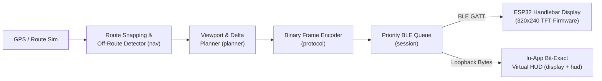

# MotoNav — Cross-Platform BLE Turn-by-Turn Navigation Engine & ESP32 Handlebar HUD

<div align="center">
  <p align="center">
    
    
    
    
  </p>
</div>

---

## 🧭 Overview

**MotoNav** is a compact motorcycle handlebar navigation HUD system. An Android companion app computes routes, snaps real-time GPS coordinates to street/alley geometry, and streams compact binary frames over **Bluetooth Low Energy (BLE)** to an **ESP32-2432S028R (`320×240` TFT)** handlebar display.

### Key Architectural Highlight: Bit-Exact Virtual HUD
The in-app virtual display on Android renders **exclusively from the exact binary BLE frames** sent over the air, using the **exact same 16-color indexed pixel/bitmap rasterizer (`hud`)** that runs on the ESP32 firmware. What you see on the phone's preview canvas is pixel-for-pixel identical to the physical 320×240 hardware screen.



---

## 📂 Repository Architecture

| Directory / Module | Description |
| :--- | :--- |
| [`android/`](android/) | 11-module Kotlin + Jetpack Compose project (`model`, `protocol`, `nav`, `planner`, `sources`, `hud`, `display`, `session`, `e2e`, `platform`, `app`). The first 9 modules are pure JVM Kotlin and run full E2E frame-to-PNG tests on desktop without an emulator. |
| [`firmware/`](firmware/) | ESP32-2432S028R firmware & shared C++17 binary protocol/rendering core (`motonav_core`). |
| [`docs/PROTOCOL.md`](docs/PROTOCOL.md) | Binary wire protocol specification between the Android phone and ESP32 HUD. |
| [`design/`](design/) | Vector UI specifications (`MotoNav-Display-redesign.svg`, `MotoNav-App-redesign.svg`). |
| [`sim/`](sim/) | Browser-based interactive HUD simulator (`320×240` & `480×320`, day/night themes, OpenStreetMap/Vietmap route fetcher). |
| [`tools/`](tools/) | Protocol frame generators and bitmap font bakers (`Barlow` bitmap glyph tools). |

---

## 🚀 Build & Test

### 1. Android App & Pure-JVM Test Suite
```powershell
cd android
.\gradlew.bat test                      # Run unit + E2E pixel-snapshot tests on desktop JVM
.\gradlew.bat :app:assembleDebug        # Build debug APK
```

### 2. Interactive Web Simulator (`sim/`)
Open `sim/index.html` directly in any browser, or fetch a custom route from OpenStreetMap:
```powershell
python sim/fetch_route.py --from 10.8221,106.6868 --to 10.8009,106.6789
```

---

**Author:** **Trung Thanh Tran** (*Trần Trung Thành*) · [GitHub `@Tthanh2k6`](https://github.com/Tthanh2k6) · [Upwork Profile](https://www.upwork.com/freelancers/~01ee7c2348cb4b62fe)
