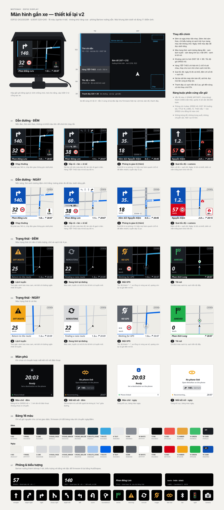
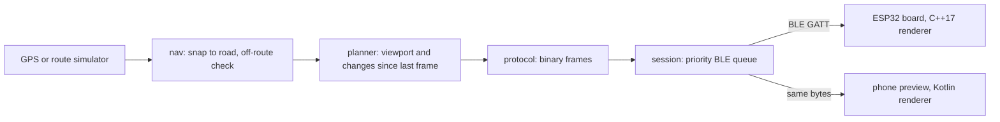

# MotoNav

A turn-by-turn navigation display for a motorcycle handlebar. An Android app plans the route, snaps GPS fixes to the road, and sends small binary frames over Bluetooth Low Energy to an ESP32-2432S028R board with a 320×240 screen. The phone draws the same frames in a preview, using a Kotlin copy of the board's renderer, so you can work on the display without the hardware.



This is a personal learning project.

## How the pieces fit



The renderer exists twice: in Kotlin (`android/hud`, `android/display`) and in C++17 (`firmware/motonav/lib/motonav_core`). A host test compares them. The Kotlin side dumps 16 golden scenes (`android/testdata/firmware_golden/*.bin`: cruise, approach, lanes, off-route, link lost, rerouting and others, plus a video stream), and the C++ host build (`firmware/motonav/test_host`) renders the same input and diffs the pixels. Those checks run on a PC; this README makes no claim about results on the physical board.

## Repository

| Path | What is there |
| --- | --- |
| `android/` | 11 Gradle modules: `model`, `protocol`, `nav`, `planner`, `sources`, `hud`, `display`, `e2e`, `session`, `platform`, `app` (Jetpack Compose). The first nine are plain JVM Kotlin, so the end-to-end frame tests run on a desktop without an emulator. |
| `firmware/` | ESP32 firmware (PlatformIO), the shared C++17 core and the host test build. `firmware/bringup` is a screen colour check for a new board. |
| `docs/PROTOCOL.md` | The wire protocol between phone and board. |
| `sim/` | Browser simulator of the display (320×240 and 480×320, day and night), with a script that fetches a route from OpenStreetMap. |
| `tools/` | Golden frame generator and the bitmap font baker (Barlow). |
| `design/` | SVG designs for the display and the app. |

## Build and test

```powershell
cd android
.\gradlew.bat test                 # unit and end-to-end frame tests on the JVM
.\gradlew.bat :app:assembleDebug   # debug APK
```

Simulator: open `sim/index.html` in a browser. To load another route:

```powershell
python sim/fetch_route.py --from 10.8221,106.6868 --to 10.8009,106.6789
```

Firmware: see `firmware/motonav/README.md` (PlatformIO).

## Author

Trung Thanh Tran, [GitHub](https://github.com/Tthanh2k6)
